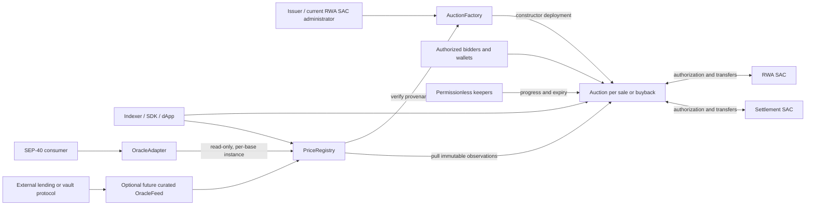
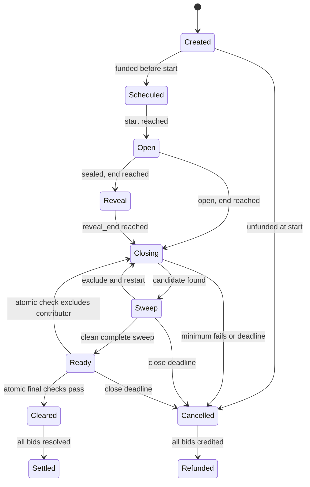
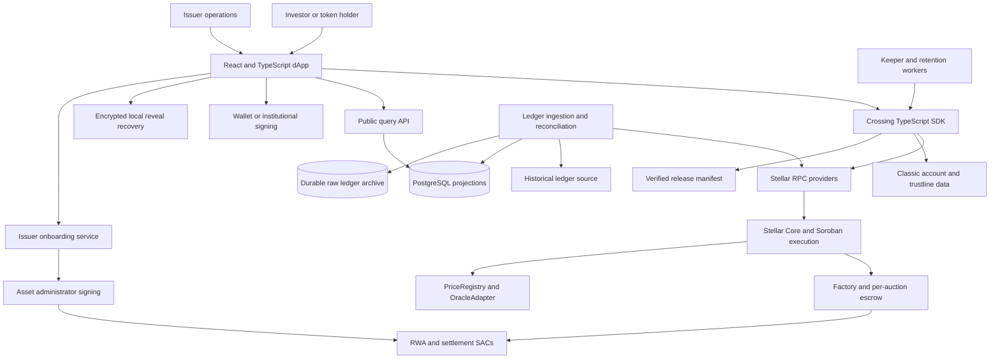
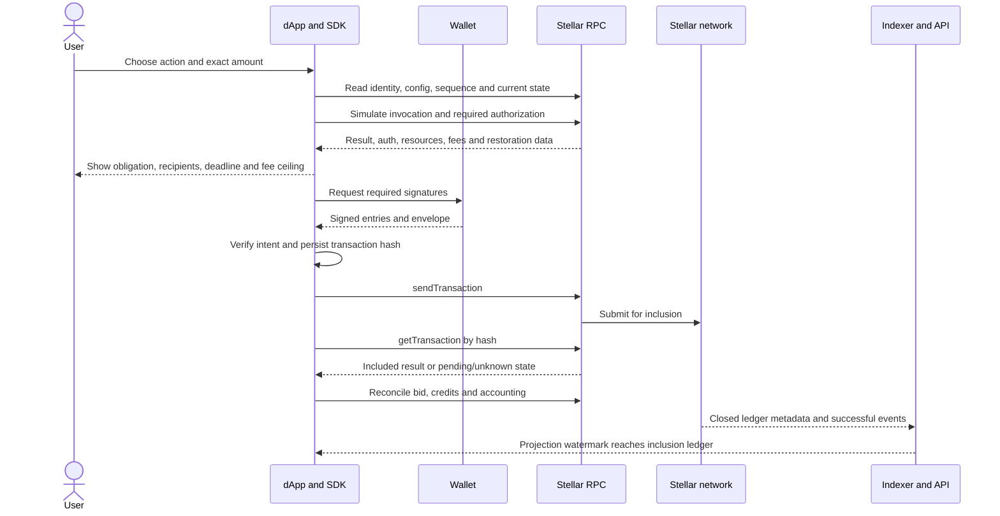

# Crossing Protocol Technical Architecture

Version **2.1** · Contract PoC baseline **0.1.0** · Updated **5 November 2026**

Crossing is an issuer-authorized auction protocol for tokenized real-world
assets on Stellar. The full implementation combines Soroban escrow and uniform
price discovery with a wallet-connected dApp, an integration SDK, durable market
indexing and permissionless operating services. Investors retain signing
authority; each auction holds its own collateral; application services never
decide allocations or redirect withdrawals.

This architecture specifies the completed production project: contracts,
application, integration interfaces, public data infrastructure, operating
services and the open-source project's lifecycle. Requirements describe the
target implementation, including its maintenance and release obligations.
They are not restricted to the components or operational practices available
in the current repository.

The production design uses genuine issued Stellar Asset Contracts, fully
funded Sale/Buyback auctions, Open/Sealed bids, atomic final eligibility checks,
independent delivery and owned withdrawal credits. Repository implementation
status is tracked separately below; it does not narrow the target scope.

| Area | Repository baseline | Full implementation |
|---|---|---|
| Smart contracts | Four deployable contracts and shared library; local tests and recorded Testnet activity | Reviewed immutable releases, measured capacity, network recovery and resource qualification |
| dApp and wallet flows | Not implemented | Issuer workspace, investor participation, portfolios, reveal vault and recovery |
| TypeScript SDK | Independent arithmetic/XDR reference scripts only | Generated bindings, verified deployments, exact amounts and transaction orchestration |
| Indexer and API | Not implemented | Durable ledger ingestion, public projections, reconciliation, discovery and history |
| Keeper and retention services | Public contract methods exist; no hosted service | Bounded closing/expiry/publication, fee budgets, TTL monitoring and recovery |
| Price integration | Raw registry and partial read-only SEP-40 adapter | Clear execution/freshness semantics; curated feed only as a separate later extension |

The checked-in [deployment manifest](deployments/testnet.json) and
[transaction log](deployments/TESTNET_TRANSACTIONS.md) record Testnet evidence.
They are historical records, not a live service-health assertion. Mainnet
qualification and an independent external audit remain release requirements.
The [Contract API](docs/reference/CONTRACT_API.md) owns exact current wire behavior;
the architecture defines the full target system. Planned interfaces are marked
as such and do not imply that application packages already exist.

| Reading path | Sections |
|---|---|
| Product, boundaries and lifecycle | [1](#1-product-scope-and-decisions)–[5](#5-state-machine-and-timing) |
| Bidding, clearing, eligibility and money | [6](#6-open-and-sealed-bids)–[9](#9-settlement-refunds-and-conservation) |
| Storage, observations and network resources | [10](#10-storage-indexing-events-and-errors)–[12](#12-ttl-restoration-and-resource-engineering) |
| Complete dApp, SDK, indexer and Stellar integration | [13](#13-full-application-and-stellar-integration) |
| Verification, implementation sequence and platform references | [14](#14-security-properties-and-verification-gates)–[16](#16-primary-references-and-platform-compatibility) |
| Exact interfaces, authorization, accounting and failure cases | [17](#17-exact-interface-and-data-requirements)–[22](#22-adversarial-economics-and-release-policy) |
| Full-system acceptance and reproducible checks | [23](#23-full-system-acceptance-criteria)–[24](#24-implemented-wire-types-and-reproducible-checks) |
| Open-source governance, licensing and maintenance | [25](#25-open-source-governance-and-distribution)–[26](#26-maintenance-and-project-continuity) |

## 1. Product, scope, and decisions

Crossing runs issuer-authorized, fully funded, uniform-price auctions for RWAs on
Stellar. The issuer either sells an escrowed token quantity or buys tokens against
an escrowed settlement-asset budget. Bidders submit maximum buy prices in a sale
and minimum sell prices in a buyback. Successful allocations use one clearing
price, with the integer rounding specified below. The issuer chooses open or
commit-reveal bids.

Public auction observations are queryable between auctions. They are **not a
continuously refreshed valuation, independent appraisal, or guarantee of safe
collateral acceptance**.

### 1.1 Core architectural decisions

| Area | Normative decision |
|---|---|
| Creator | The current administrator of the genuine RWA SAC authorizes creation and funding. This is initially the issuing account; delegated SAC administration is explicitly supported. |
| Quantity | Always RWA base units in both modes. Deposit units depend on mode. |
| Buyback | Reprice all accepted quantity at each candidate uniform price. Never sum heterogeneous ask-price costs. Never exceed budget; exhaustion is not guaranteed. |
| Partial sale | All eligible demand fills at the sale reserve if actual integer allocation meets the minimum. |
| Sparse buyback | Stop at the previous accepted ask if admitting the next ask would require cutting already higher-priority offers. Return unused budget. |
| Compliance | Every bidder needs RWA authorization, including sale investors. Final closing checks all price-contributing bids atomically, including marginal bids rounded to zero. Claim checks again before actual delivery. |
| Capacity | Baseline `MAX_BIDS = 16`, including non-reveals. This makes final authorization verification bounded and atomic. Raising it requires a reviewed, benchmarked release. |
| Non-reveal | Full refund by default. An issuer may configure a penalty up to 50% on a cleared auction's `NonReveal` resolution before or after delivery expiry, credited to the issuer in the deposit asset. Cancelled auctions and revealed `Revoked`/`DeliveryExpired` bids refund fully; revocation alone does not exempt an unrevealed bid (§6.3). |
| Frozen refunds | Preserve same-owner, same-asset withdrawal credit until transfers are possible. Never assume a revoked SAC recipient can receive immediately. |
| Issuer proceeds | Credit earned proceeds only after corresponding delivery succeeds. Reserve every reversible trade. |
| Claim tail | Fixed delivery deadline, then permissionless refund resolution. Withdrawal credits never expire or become issuer property. |
| Registry | Separate immutable clearing observations from actual execution summaries. Publication is retriable and cannot block settlement. |
| Upgrades | Immutable factory, auctions, and raw registry per release. Deploy a new release for changes; no live-auction upgrade or custody key. |

Unrestricted thousands-of-bidders scale and a resumable sweep that certifies all
winners at one instant cannot both be promised under a bounded final transaction.
V1 prioritizes the stated compliance guarantee and exposes its capacity before
funding. The initial 32-bid draft was reduced to 16 after compiled-WASM testing exceeded
the pinned SDK's default footprint limit (103 entries versus 100). The current
cap is still subject to target-network and worst-case validation.

### 1.2 Scope

Implemented PoC: sale, buyback, both bid modes (including an optional, bounded
non-reveal penalty, §6.3), escrow, clearing, compliance, independent claims,
refunds, raw price observations, and a read-only, partial SEP-40 adapter over
those observations (§11.3). The initial full product adds the client SDK, dApp,
indexer/API, keeper services and release operations (§13). Optional later ramp
and curated-feed integrations have separate provider, source and governance
requirements. These application services and optional integrations are not
implemented in the current PoC.

No AMM, bridge, leverage, continuous book, external-price-based clearing, protocol
fee, arbitrary-token support, discretionary bidder allowlist, automatic auction creation/scheduling inside contracts,
or legal-transferability determination is included. No explicit burn entrypoint
is included. A SAC transfer to the classic issuing account can itself burn the
asset; the buyback recipient choice must disclose this behavior.

## 2. Components and trust boundaries



There are **four deployable contracts**: factory, auction template, raw registry,
and the read-only `OracleAdapter`. `common` is a compiled library for types, wide
checked arithmetic, SAC identity/authorization, and commitment encoding.
`OracleAdapter` exposes part of the [SEP-40](https://github.com/stellar/stellar-protocol/blob/master/ecosystem/sep-0040.md)
shape directly over the raw registry (§11.3); it is not the separately reviewed,
governed curated feed described there, which remains a future, higher-trust layer
with its own source/manipulation policy.

Each auction owns its two SAC balances. Escrow, clearing, and settlement share
one instance for atomic accounting. No factory/registry function transfers auction
funds. On-chain progress does not require the frontend or a privileged keeper.

| Dependency / actor | Power and boundary |
|---|---|
| RWA SAC administrator | Can change authorization and exercise asset-enabled clawback, including against the auction. Crossing cannot override these powers. |
| Quote SAC administrator | Can freeze or claw back under the asset's rules. Fully funded escrow does not eliminate external issuer risk. |
| Issuer | Chooses immutable terms, funds inventory/budget, receives earned proceeds. Cannot withdraw reserves or redirect refunds. |
| Bidder | Can submit funded bids and withhold a reveal. Revealed bids may be claimed by any caller to fixed recipients; the bidder cannot reserve delivery timing. Cannot replace terms or withdraw early. |
| Keeper/publisher | Pays fees for deterministic progress/publication. Cannot choose price, allocations, or recipients. |
| Release deployer | Selects reviewed artifacts and addresses. A verified manifest is required; an address alone does not prove correctness. |
| SDK/RPC/indexer/wallet | Presentation and transaction infrastructure. Contracts verify authorization and terms; users authenticate deployments and signing intent. |
| Oracle consumer | Must enforce freshness, source, quote currency, liquidity, and manipulation policies. Provenance alone does not establish economic independence. |
| `OracleAdapter` | Read-only; cannot write registry state, hold funds, or influence any auction. Fixed at construction to one registry and one base/quote asset; reports exactly what the registry already recorded, nothing more. |

Only genuine SACs are supported. Verify a token's executable is the built-in
Stellar asset executable; do not trust arbitrary WASM exposing `authorized`,
`admin`, or `transfer`. The chosen SDK must support this check. The
[Stellar SAC documentation](https://developers.stellar.org/docs/tokens/stellar-asset-contract)
describes executable identification and asset control semantics.

## 3. Units, bounds, and immutable configuration

### 3.1 Units and arithmetic

`S = PRICE_SCALE = 10^7`. Require both SACs to report `decimals() == 7` in V1.
This removes an implicit decimal-normalization assumption.

| Value | Unit |
|---|---|
| `q`, `Q`, `f` | RWA smallest units: bid quantity, sale supply, allocation |
| `d`, `B`, `c` | Quote smallest units: sale deposit, buyback budget, payment |
| `p` | Quote whole tokens per whole RWA token, multiplied by `S` |
| `floor_cost(q,p)` | `floor(q*p/S)` quote smallest units |
| `ceil_cost(q,p)` | `ceil(q*p/S)` quote smallest units |

Inputs and stored totals use checked `i128` with strictly positive or nonnegative
signs as appropriate. Use a checked unsigned 256-bit intermediate after sign
validation for multiplication/division, then checked conversion to `i128`.
Compute ceiling from quotient and remainder, not `a*b+denominator-1` in `i128`.
Zero denominators, overflow, and out-of-range results fail atomically.

Per-auction admitted quantity and deposit totals are checked against `i128::MAX`;
sealed deposits count before reveal. A reveal whose quantity would overflow a
total fails without losing its deposit. No counter wraps. Classic-account SAC
trustline limits can be smaller than `i128`; failed delivery preserves the claim
and the SDK simulates account capacity before signing.

### 3.2 Schema

```rust
// Current version-1 fields; contract annotations omitted.
enum Mode { Sale, Buyback }
enum BidMode { Open, Sealed }
struct Config {
    version: u32,                 // exactly 1
    rwa_token: Address,
    quote_token: Address,
    issuer: Address,              // current RWA SAC admin at create/fund
    buyback_recipient: Address,   // immutable; used only in Buyback
    mode: Mode,
    bid_mode: BidMode,
    nonreveal_penalty_bps: u32,    // 0..=5000; must be 0 when bid_mode is Open
    supply_or_budget: i128,       // RWA Q in Sale; quote B in Buyback
    min_fill_quantity: i128,      // RWA units in both modes
    min_bid_quantity: i128,       // RWA units
    min_deposit: i128,            // mode-specific escrow-asset units
    min_price: i128,              // Sale reserve / lowest permitted ask
    max_price: i128,              // Sale highest bid / Buyback ceiling
    tick_size: i128,
    max_bids: u32,                // 1..=16; non-reveals consume slots
    max_bids_per_address: u32,    // 1..=max_bids
    start_ledger: u32,
    end_ledger: u32,              // exclusive placement/commit boundary
    reveal_end_ledger: u32,       // ==end for Open; >end for Sealed
    close_deadline: u32,          // exclusive finalization boundary
    delivery_deadline: u32,       // exclusive successful-delivery boundary
}
```

Factory, registry, template hash, and protocol domain are constructor-established
provenance. `config_hash = SHA256(XDR(Config))` uses canonical Soroban contract
value encoding; verify a Rust/TypeScript golden vector before implementing clients.
There is one source of reserve/ceiling values. The current Config has no separate
`limit_price` field that could conflict with the grid.

### 3.3 Validation

1. Distinct, genuine deployed SACs with seven decimals. V1 excludes native XLM
   because it requires the admin/authorization interface of an issued SAC.
2. `issuer == rwa_sac.admin()` and issuer signature at creation and funding.
   Recheck at funding to reject stale dormant instances after admin transfer.
   Later admin changes do not alter withdrawal ownership.
3. Positive supply/budget, minimums, prices, and tick size; `min_price <= max_price`;
   divisible grid span; `1 + (max_price-min_price)/tick_size <= 4096`. Bid prices
   must be exactly on-grid and in range, never silently quantized.
4. Global and per-address caps within bounds. Issuer, buyback recipient, auction,
   factory, and registry cannot bid in that auction. The buyback recipient cannot
   be the auction, factory, or registry; check against the actual deployed address
   before funding, not just user input. Otherwise a transfer to the auction itself
   could be counted as delivery while tokens remain inaccessible in escrow.
   These filters do not prevent related-account bids.
5. `now < start < end <= reveal_end < close_deadline < delivery_deadline`, with
   equality `end == reveal_end` only for Open. Check arithmetic and the TTL
   schedule horizon (§12). All time comparisons use ledger sequence.
6. Sale minimum fill cannot exceed inventory. Buyback maximum affordable quantity
   `floor(B*S/min_price)` must itself fit `i128`, and minimum fill cannot exceed
   it. This rejects a budget/price combination whose capacity calculation would
   overflow later during closing. Require
   `floor_cost(min_bid_quantity,min_price) >= 1` to limit worthless tiny bids.
7. Funding requires auction authorization on both SACs, issuer authorization on
   both assets, and RWA authorization of the buyback recipient. Placement requires
   both SAC authorizations for the bidder. Actual transfers remain authoritative.
8. `nonreveal_penalty_bps <= MAX_NONREVEAL_PENALTY_BPS` (5,000, i.e. 50%), and must
   be exactly zero when `bid_mode == Open` — there is no non-reveal event to
   penalize in that mode, so a nonzero value there would be dead, confusing
   configuration rather than a real control.

## 4. Deployment, funding, and interfaces

### 4.1 Immutable release deployment

Publish network ID, source revision, compiler/SDK/CLI versions, lockfile hash,
all four WASM hashes, salts, and addresses in a release manifest. Precompute the
factory address. Deploy registry with that address and reviewed auction-template
hash, then factory with registry and template hash. Factory construction checks
registry's pinned factory equals itself and its template hash matches. Registry
construction does not call the not-yet-deployed factory. Creation also verifies
the pinned registry executable against the reviewed release. The factory's
immutable constructor checks establish the registry's matching bindings. Each
`OracleAdapter` instance is deployed separately afterward, once per base asset
needed, pinning the already-live registry's hash (§11.3); it has no bindings to
establish with the factory or auction template.

Use constructors, not a raceable public `initialize`. Namespace auction salts
with a domain-separated hash of `(network_id,factory,issuer,user_salt)`. Another
issuer cannot consume the victim's salt namespace. Same-issuer salt reuse fails
before funds move. Deploy with constructor arguments and register metadata in
the same atomic invocation. No upgrade, template rotation, arbitrary call,
emergency withdrawal, or rescue entrypoint exists in the core contracts.

Local regressions exercise real `deploy_v2` bootstrap with incorrect registry
hash, expected factory address/hash, and auction template. A valid retry reuses
the same salts after each failed bootstrap. Constructor reinvocation is rejected
by the host. Factory creation tests additionally cover exact signed config/salt,
create-time admin changes, namespace isolation, and rollback after a deliberately
injected post-deployment counter fault. These are local deployment tests;
public-network release verification remains separate.

### 4.2 Deploy before funding

An `AUTH_REQUIRED` asset may require explicit approval of the auction address
before it can receive funds. `create` therefore produces a dormant `Created`
instance without escrow. Asset administrators authorize that address through
their SACs. `fund()` then locks exactly `Q` RWA or `B` quote, once, with issuer
authorization and strictly before start. No bids are accepted while unfunded.
An unfunded instance can expire at start; no investor capital is exposed to
unfinished setup. Do not assume undeployed addresses can be preauthorized.

### 4.3 Public interfaces

| Contract / method | Authority | Effect |
|---|---|---|
| Factory `create(config,salt)` | Current RWA SAC admin | Deploy/register dormant instance |
| Factory `get_auction(address)` | Public | Immutable metadata/provenance |
| Factory `predict(issuer,user_salt)` / `bindings()` | Public | Deterministic address / immutable release pins |
| Factory `count()` / `list(start,limit)` | Public | Bounded discovery, at most 32 addresses |
| Factory `maintain(start,count)` | Permissionless | Extend at most 8 discovery entries and their metadata |
| Auction `fund()` | Issuer | One-time exact escrow before start |
| Auction `place_bid(bidder,p,q)` | Bidder | Open deposit/aggregate, return global bid ID |
| Auction `commit_bid(bidder,nonce,hash,max_locked)` | Bidder | Sealed deposit, no tick contribution |
| Auction `reveal_bid(id,p,q,salt)` | Recorded bidder | Verify commitment and collateral; aggregate once |
| Auction `advance(work_limit)` | Permissionless | Bounded tick or sweep work |
| Auction `finalize()` | Permissionless | Atomic final checks; finalize or exclude/restart |
| Auction `expire()` | Permissionless | Unfunded-start / unfinished-close cancellation |
| Auction `claim_bid(id)` | Permissionless | Deliver to fixed recipients or credit refunds once |
| Auction `expire_bid(id)` | Permissionless | Post-deadline refund and reserve release |
| Auction `expire_range(start_id,count)` | Permissionless | Resolve up to 8 expired bids without transferring tokens |
| Auction `withdraw(owner,asset,amount)` | Owner | Same-owner credit withdrawal only |
| Auction `maintain(keys)` | Permissionless | Bounded typed TTL extension |
| Auction getters | Public | Config, state/cursors, timing flags, bids, totals, credits, liabilities, observations |
| Registry `record_clearing(auction)` | Permissionless | Verify source and pull immutable result once |
| Registry `record_settlement(auction)` | Permissionless | Pull final actual execution summary once |
| Registry getters | Public | Pair history/latest and immutable observations |
| Registry `maintain(rwa,quote,start,count)` | Permissionless | Extend at most 8 history records and pair pointers |
| OracleAdapter `maintain()` | Permissionless | Extend its instance/code; registry retention remains separate |

An address argument or transaction source is not authentication. Require actual
spenders' authorization for the exact invocation and necessary SAC subcalls.
Permissionless functions cannot replace terms or select a refund recipient.

## 5. State machine and timing



Scheduled/Open/Reveal are effective states derived from ledger boundaries while
funded and not closing; no issuer activation call is needed. Placement uses
`start <= ledger < end`; sealed reveal uses `end <= ledger < reveal_end`.
Closing starts at `ledger >= reveal_end`. Finalization requires
`ledger < close_deadline`; at equality an unfinished auction can only cancel.

A cleared auction never re-clears. Successful delivery requires
`ledger < delivery_deadline`. At equality all unresolved bids become refund-only.
Deadlines never confiscate earned credits or already delivered assets. After
funding there is no discretionary cancellation or bid withdrawal. Deterministic
cancellation covers no demand, inadequate actual fill, definite global asset
authorization failure at finalization, and unfinished-close expiry.

## 6. Open and sealed bids

### 6.1 Open placement

Validate phase, signer, both authorizations, quantity, grid, capacity, and totals.
Sale deposit is `ceil_cost(q,bid_price)` quote; buyback deposit is `q` RWA.
Enforce the configured deposit minimum. Transfer the exact deposit and persist
bid, aggregates, counters, and event atomically. Failure leaves no consumed bid
ID or tick contribution. There are no factory allowances or fee deductions.

### 6.2 Commit-reveal encoding

The bidder chooses a unique `nonce: BytesN<32>` and a cryptographically random
`salt: BytesN<32>`. The commitment is exactly:

```text
SHA256(XDR(ScVal::Vec([
  Symbol("CROSSING_BID_V1"),
  Bytes(network_id[32]), Address(auction), Address(bidder), Bytes(nonce[32]),
  Bytes(config_hash[32]), I128(max_locked), I128(price), I128(quantity),
  Bytes(salt[32])
])))
```

Hash the entire canonical ScVal XDR, including discriminants. Do not concatenate
raw text. Domain, network, auction, owner, unique nonce, terms, and deposit are
bound. Rust/TypeScript golden vectors must match byte for byte.

Commit locks `max_locked` in the mode's deposit asset. Validate positive deposit,
minimum, cumulative bound, capacity, and unused `(bidder,nonce)`. Immediately
consume one bid slot and record its ownership; never reuse the nonce or slot.
Do not write price or quantity aggregates yet.

For Sealed Sale, admission additionally requires
`floor(total_admitted_deposits * SCALE / min_price) <= i128::MAX`, using U256
intermediates and a checked result. Since every valid reveal has
`q <= floor(deposit * SCALE / price)` and `price >= min_price`, the sum of all
admitted hidden quantities then fits i128 in any reveal order. Reject capacity
overflow before transferring collateral or consuming the nonce/slot. This
conservative reservation includes excess collateral; a low reserve price or
large overcollateralization can exhaust capacity before the bid-count cap.
Buyback already bounds quantities by admitted RWA deposits, and Open admission
checks known quantity totals directly.

Reveal requires the recorded owner's signature, reveal window, exact hash,
unrevealed/unexcluded state, ordinary quantity/grid validations, and
`ceil_cost(q,p) <= max_locked` for Sale or `q <= max_locked` for Buyback.
**Keep all excess collateral escrowed until claim**; no external refund on reveal.
Write the quantity aggregate exactly once. Non-reveals never contribute to price
and are resolved through the terminal refund path at claim.

Sealed mode hides the preimage, not bidder identity, deposits, timing, or count.
Deposit size may constrain or reveal quantity, especially in a buyback. Clients
must use high-entropy salts, preserve encrypted recovery material, and never log
secrets. Lost secrets prevent reveal but not eventual deposit resolution.

### 6.3 Optional non-reveal penalty

By default `nonreveal_penalty_bps == 0`: a non-revealer's full original deposit
returns through the refund path, exactly as in §6.2. An issuer running a Sealed
auction may instead set `nonreveal_penalty_bps` up to `MAX_NONREVEAL_PENALTY_BPS`
(5,000, i.e. 50%) at creation. At claim, a bid resolved with reason `NonReveal`
then refunds `deposit - floor(deposit * bps / 10_000)` to the bidder and credits
the floored remainder to the issuer, in the deposit's own asset (quote for Sale,
RWA for Buyback) — never a different asset, and never more than the configured
proportion. This is a deliberate, bounded deterrent against occupying a scarce
bid slot without ever revealing, not a mechanism an issuer can use to confiscate
an honest bidder's full deposit: the 50% cap is enforced at validation (§3.3),
and the rule only applies to the `NonReveal` reason. **`NonReveal` is classified
ahead of the timing-derived `DeliveryExpired` reason on a cleared auction**: an
unrevealed bid is `NonReveal` whether it is resolved via `claim_bid` before the
delivery deadline or via permissionless `expire_bid`/`expire_range` after it —
waiting out the deadline is not a way to dodge the penalty, and it applies
regardless of who calls the resolving entrypoint. Only a genuinely cancelled
auction (which never cleared, so no price was ever distorted by the non-reveal)
skips the penalty and refunds in full, via the auction-wide cancel reason, which
still takes precedence. An unrevealed bid remains `NonReveal` even if its owner
has since lost SAC authorization; revocation does not exempt it from the
penalty. A revealed bid resolved as `Revoked` still receives a full refund.
Choosing a nonzero penalty is an immutable issuer choice, not a protocol
default.

The 22-field Config includes this value in its canonical hash. Adding the field
changed the pre-release ABI and commitment fixtures even when its value is zero;
older 21-field clients/commitments are incompatible and must not be reused.

## 7. Clearing mathematics

Active means open/revealed and not permanently excluded. Let `T[p]` be total
active **RWA quantity**, not quote collateral, at a tick. Clearing has no transfers,
registry writes, external price input, or operator choice.

### 7.1 Sale: descending demand

Walk descending. `L` is quantity at strictly higher ticks and `Q` is inventory.

```text
for p descending:
    q = T[p]
    if L + q >= Q:
        candidate = (p, target=Q, numerator=Q-L, denominator=q)
        stop
    L += q
if grid ends:
    candidate = (min_price, target=L, numerator=1, denominator=1)
    // Every active bid fills fully; no marginal rationing.
```

Above the clearing price fill fully, below fill zero. At an oversubscribed
marginal tick allocate `floor(q_i*numerator/denominator)`. With insufficient
demand, all active bids fill at the reserve. Zero demand cancels.

`sum(f_i) <= Q`. For a winning buyer `p_clear <= bid_price` and `f_i <= q_i`, so
`ceil_cost(f_i,p_clear) <= ceil_cost(q_i,bid_price) <= deposit_i`.

### 7.2 Buyback: ascending supply at one uniform budget

At each **occupied** ask tick `p`, compute `K(p)=floor(B*S/p)`, the capacity if
all accepted offers are paid the same price. Empty ticks only advance the cursor.
`L` is quantity at strictly lower asks.

```text
for occupied p ascending:
    q = T[p]
    capacity = floor(B*S/p)
    if capacity <= L:
        if L == 0: cancel(no affordable quantity)
        else: candidate = previous occupied p, target=L, full ratio 1/1
        stop
    if L + q >= capacity:
        candidate = (p, target=capacity, numerator=capacity-L, denominator=q)
        stop
    L += q
    previous occupied p = p
if grid ends:
    if L == 0: cancel(no demand)
    else: candidate = previous occupied p, target=L, full ratio 1/1
```

Cheaper asks fill fully, the marginal ask fills pro rata with floor, higher asks
fill zero. At `capacity == L`, select the previous ask: a new zero-allocation
offer must not set price. When capacity is smaller than the cheaper accepted
quantity, do not cut those offers to admit a worse ask. Undersubscribed buybacks
use the highest accepted ask, not the configured ceiling.

For allocated quantity `F`, rounded buyback payments are
`c_i=floor_cost(f_i,p_clear)`:

```text
F <= floor(B*S/p_clear)
C = sum(floor(f_i*p_clear/S)) <= floor(F*p_clear/S) <= B
bid_price_i <= p_clear <= max_price for every executed seller
```

Per-bid ceilings can break the budget and are forbidden in Buyback.

**Sparse-price example, scale 1:** budget 100, offers `8 @ 10` and `1 @ 20`.
At 20 the budget buys only 5, fewer than the 8 higher-priority units. Buy 8 at 10
and return 20. Never pay 160 or partially cut the cheaper offer to admit a worse
one. Replace “always exhausts budget” with “never exceeds budget.”

### 7.3 Actual allocations, minimum, and rounding

Derive each allocation with wide checked arithmetic. If an allocation or its
mode-specific payment rounds to zero, make that bid refund-only and do not
redistribute its dust. Evaluate `min_fill_quantity` against the resulting
**actual** sum `F`, not nominal target. Cancel if `F == 0` or below the minimum.

The marginal price is determined from aggregate capacity **before** indivisible
per-bid rounding. A positive nominal marginal quantity can round to zero across
all individual marginal bids while better bids still execute. The recorded price
remains the nominal marginal tick; do not describe it as necessarily the price
of an individually delivered marginal bid. This is distinct from the buyback
`capacity == L` branch, where the nominal marginal quantity is already zero.

Before the zero-payment filter, pro-rata quantity dust is less than the number
of marginal bids in RWA base units. The filter may create additional unused
inventory; do not reuse that bound afterwards. Sale charges round up; Buyback
payments round down, with less than one quote base unit rounding per executed
bid. Splitting cannot improve pro-rata quantity rounding, can increase sale
charges, and can decrease buyback receipts. Unallocated RWA/unused budget belongs
to the issuer; no ownerless rounding pool exists.

### 7.4 Resumability

Use bounded `u32` tick indices, deriving prices with checked arithmetic. Persist
epoch, cursor, cumulative quantity, previous occupied tick, and candidate.
`advance(work_limit)` processes at least one and at most 32 ticks or 8 sweep
bids; zero work is an error. A read/no-op never resets progress.

At the descending index-zero boundary, finish the walk instead of decrementing
an unsigned cursor. At the ascending final index, finish before incrementing
past the configured count. Do not encode a negative-price/index sentinel in
contract storage; the Python model's local loop sentinels are not a Rust schema.

Any change to active totals increments the epoch and resets **all** clearing
accumulators. Never reuse a prefix built from a prior active set. Chunk sizes
and caller identity cannot change price, allocation, or reserve totals.

## 8. Three lines of compliance and closing termination

### 8.1 Placement and preliminary sweep

Check both SAC authorizations of every bidder before escrow in both modes.
The preliminary sweep enumerates dense global bid IDs `0..bid_count` and checks
all revealed, nonexcluded bids at or better than the candidate price. A marginal
bid can influence the uniform price even if its individual quantity or payment
rounds to zero; it must pass the same checks as a positive allocation. A definitely
deauthorized contributor is permanently excluded, its revealed quantity
subtracted exactly once, and clearing restarted.
Its deposit remains an owned pending refund. Do not transfer refunds in a sweep.

Returned `false` proves deauthorization. A query error, unexpected type, missing
or archived dependency, or resource failure establishes neither trading permission
nor permission to exclude permanently. Abort that invocation atomically; restore
and retry where needed. Deadline cancellation remains available. Treating every
error as a durable revocation would enable accidental permanent bid removal.

### 8.2 Atomic finalization

A sweep split across transactions cannot certify one instant. An address checked
on page one can be revoked before the final page. A clean sweep enters `Ready`,
not `Cleared`.

`finalize()` reads at most 16 records, derives allocations, and checks all
price contributors' current RWA and quote authorizations **in one transaction**,
including marginal bids whose allocation or payment rounds to zero.
It also checks the auction's authorization on both assets and the buyback
recipient's RWA authorization. A definite global failure cancels into refunds.

On the first revoked contributor, exclude it, subtract one aggregate, increment epoch,
reset clearing, and **return successful progress**. Returning an error would
roll back the intended exclusion. If all pass, compute exact `F` and `C`, verify
minimum and bounds, save immutable result, initialize reserves once, and enter
`Cleared` atomically. No caller-provided winner subset or inline registry call is
allowed. Query errors consume no progress or deposits.

This certifies the price-contributing set at finalization. Later revocation can reduce
execution; the registry must distinguish allocation and delivery.

### 8.3 Termination and the capacity tradeoff

Each restart excludes a new active bid permanently; reauthorization cannot put
it back. With `N <= 16`, at most `N` exclusion restarts and one clean pass occur,
absent infrastructure failures or deadline expiry. Cursors progress within an
epoch. Total elementary walk/sweep work is bounded by
`(N+1)*(tick_count+N)`, plus bounded finalizer calls. A full pass need not fit one
transaction. No proof depends on monotone clearing prices, which sparse buyback
fallback makes unsafe as a general assumption.

Benchmark the 16-record finalizer with distinct classic trustlines and contract
bidders, maximum data/event size, and restoration before deployment. If it does
not fit with margin, lower the release cap before deployment. Never substitute
an asynchronous final check and claim the same guarantee. Network limits are
configurable; [Stellar resource guidance](https://developers.stellar.org/docs/build/guides/storage/storage-strategies)
requires checking the target network. Resource sizing is an open implementation
gate, not evidence already obtained by this design review.

## 9. Settlement, refunds, and conservation

### 9.1 Reserve initialization

Let final actual allocations be `f_i`, payments `c_i`, `F=sum(f_i)`, `C=sum(c_i)`.
Allocation is derived from immutable bid terms, exclusions, and final result.

| Mode | Immediate issuer credit | Unresolved trade reserve |
|---|---|---|
| Sale | `Q-F` RWA | `F` RWA; every full quote deposit remains pending |
| Buyback | `B-C` quote | `C` quote; every full RWA deposit remains pending |

No unresolved sale proceeds are released early. Terminal initialization is
exactly once. On cancellation, credit all funded issuer escrow and reserve no
trades; bidder deposits remain pending until credited individually. Unfunded
cancellation creates no issuer credit.

### 9.2 Per-bid resolution

`claim_bid(id)` is permissionless with fixed recipients. It needs no other
bidder's claim or withdrawal. Guard replay before external calls; a delivery
failure rolls back transfers and state together. No catching an error and
marking a trade paid anyway.

**Refund-only:** cancelled auction, excluded bid, zero allocation,
or definite claim-time deauthorization. Resolve once and credit the **entire
original deposit** in its original asset to its original owner. Non-reveals
also follow this path, with only the configured `NonReveal` penalty split in
§6.3 deducted into an issuer credit, before or after delivery expiry. Auction
cancellation waives it; expiry alone does not.
If allocated,
release `f_i` RWA to issuer in Sale or `c_i` quote to issuer in Buyback, reducing
that unresolved reserve. These are internal credits, not transfers to frozen
recipients.

**Successful Sale:** recheck bidder RWA/quote and auction authorizations, then
transfer `f_i` RWA from escrow to the bidder. Atomically resolve, credit
`deposit_i-c_i` quote to bidder and `c_i` quote to issuer, and reduce RWA reserve
by `f_i`. Proceeds become withdrawable only after actual RWA delivery.

**Successful Buyback:** recheck bidder RWA/quote, auction, and recipient RWA
authorizations. Atomically transfer `f_i` RWA to the fixed recipient and `c_i`
quote to the bidder. Resolve, credit `deposit_i-f_i` RWA to bidder, reduce quote
reserve by `c_i`. Either transfer failing rolls back both and all bookkeeping.
SAC transfer to a classic issuer may burn the delivered RWA.

At claim, definite deauthorization of a required delivery address takes the
refund-only path. Query errors abort without resolving. Transfer failure despite
positive authorization (e.g. a full trustline) preserves the bid for retry or
deadline refund. A permissionless helper can resolve a currently revoked bidder
into a refund; this irreversible behavior is explicit. Successful delivery is
final; subsequent revocation does not undo Crossing's completed trade or recall
the issuer's earned proceeds.

### 9.3 Expiry and withdrawal

At/after delivery deadline, `expire_bid` performs refund-only bookkeeping without
SAC calls. Anyone can finish all unresolved bids in bounded batches even if
recipients are frozen or absent. All resolved means `Settled` for a cleared
auction or `Refunded` for a cancelled one; it does not mean all credits withdrawn.

`withdraw(owner,asset,amount)` requires owner authorization, positive amount,
one of the configured assets, and sufficient same-owner credit. Reduce credit
and liability, then transfer only to that owner. Failure restores both
atomically. Partial withdrawals can accommodate trustline capacity. There is no
recipient redirect, forfeiture, cross-asset substitution, or admin override.

A revoked owner must regain authorization or pursue the asset issuer's external
process. Auction-wide SAC freezing can block that asset for everyone. Clawback
can remove escrow despite correct accounting; Crossing cannot guarantee recovery
from these administrator powers.

### 9.4 Per-asset conservation

Never add RWA units to quote units. For each asset `a`:

```text
tracked_liability[a]
  = pending_bid_deposits[a]
  + unresolved_trade_reserve[a]
  + sum(unwithdrawn_credits[owner,a])
actual_SAC_balance[a] >= tracked_liability[a]
```

Before clearing, issuer escrow is the unresolved reserve; afterwards split it
as above. Refund resolution moves pending deposit to a credit, creating no money.
Delivery or withdrawal reduces the corresponding balance and liability equally.
Equality holds with protocol-only inflows and no external clawback. Unsolicited
transfers produce a surplus, not issuer property; V1 exposes but cannot sweep it.

Check both actual balances against liabilities before every outward transfer.
If clawback creates a deficit, report insolvency and stop withdrawals/deliveries
until replenished, rather than letting early claimants drain the remainder.
Never silently reduce a claimant's recorded property. Refund-credit and expiry
bookkeeping can still proceed. This preserves detection and fair suspension,
not immunity to external asset loss.

## 10. Storage, indexing, events, and errors

Use separate persistent entries, not growing global maps or per-bidder vectors.
Keep only bounded configuration/counters/results in instance storage.

| Contract / key | Value |
|---|---|
| Factory instance `Registry`, `RegistryHash`, `Template`, `Count`, `Lock` | Immutable pins, checked creation count, mutation guard |
| Factory `Auction(address)` | Issuer, pair, mode, config/template hashes, creation ledger |
| Factory `At(sequence)` | Address for bounded discovery pagination |
| Registry instance `Factory`, `FactoryHash`, `Template`, `Lock` | Immutable source pins and mutation guard |
| Registry `Clearing(auction)` / `Settlement(auction)` | Separate immutable observations / duplicate guards |
| Registry `History(rwa,quote,sequence)` / `Count(rwa,quote)` | Pair-scoped append history and count |
| Registry `Latest(rwa,quote)` / `LastSettled(rwa,quote)` | Source-ordered clearing / positive-execution pointers |
| Auction instance `Config`, `Provenance` | Immutable bounded values |
| Auction instance `State` | Persisted stage, epoch, bid count, cursors, cumulative quantity, previous price, candidate |
| Auction instance `Clearing` | Candidate, F, C, winner count, source ledger/timestamp |
| Auction instance `Accounting` | Pending deposits, reserves, per-asset liabilities/total credits, resolved count, actual executed totals |
| Auction instance `Settlement`, `CancelReason`, `Lock` | Terminal summary, cancellation reason, mutation guard |
| Auction `Bid(id)` | Owner, sealed nonce/hash if applicable, deposit, optional price/quantity, exclusion, resolution outcome |
| Auction `Tick(index)` | Active revealed RWA quantity |
| Auction `Count(owner)` / `OwnerBid(owner,local_index)` | Capacity and indexed global IDs |
| Auction `Nonce(owner,nonce)` | Persistent reuse guard |
| Auction `Credit(owner,asset)` | Nonnegative withdrawable property |

Global dense bid IDs enumerate the whole book. Tick totals match revealed active
quantities exactly. Settlement never deletes ownership or resets resolution.
All sequence and monetary increments are checked. Names above match the private
storage-key enum variants; they are not separate public entry points. Instance
storage shares the instance entry's TTL; listed per-record keys are persistent.

Versioned events: creation, funding, open bid, commit, reveal, exclusion,
progress, clearing, cancellation, delivered bid, refund credited, withdrawal,
settlement completed, clearing recorded, settlement recorded. Include bid IDs,
epoch/cursor, quantities/asset units, and reason codes as relevant. Never expose
sealed preimages before reveal. Events aid discovery; storage is authoritative.

Typed errors cover phase/deadline, authority, asset identity/decimals, bounds,
grid, arithmetic, capacity, collateral, commitment mismatch/reuse, duplicates,
insufficient credit, blocked delivery, query failure, insolvency, and provenance.
Every error preserves ownership and liabilities. Eligibility exclusion is a
successful transition, not an error rolling back the exclusion.

## 11. Raw price records and future oracle

### 11.1 Retriable, verified publication

`record_clearing(auction)` accepts an address, never caller-supplied price or
volume. Verify the pinned factory executable from the release, its auction
metadata, the auction's reviewed template executable, and pulled config/result.
Cross-check issuer, pair, mode, version, and config hash. Only positive Cleared
or Settled results are recordable. Unregistered clones cannot write fabricated
records for real assets. Duplicate publication is idempotent, without duplicate
history or changing an existing record.

Record auction, release/factory, config hash, pair, mode, scale, price, allocated
RWA `F`, reserved quote `C`, winner count, clearing ledger/timestamp, delivery
deadline, and separate publication time. Registry outages or archived state
cannot block closing, delivery, or refunds; anyone retries publication later.

### 11.2 Pair, ordering, and execution

Key by `(rwa,quote)`, never RWA alone. History sequence is publication order;
latest is greatest `(clearing_ledger,auction_address)` using lexicographic raw
contract-ID byte order to break same-ledger ties. Delayed old records cannot
replace a newer mark. Use source time, never publication time, for freshness.

After a cleared auction reaches `Settled`, pull its immutable summary: actual delivered
RWA, actual paid/earned quote, refunded-deposit totals, completion ledger/time.
Ensure the clearing record exists if necessary; never overwrite it. Zero
executed volume is recorded explicitly and cannot update `LastSettled`.
Completion time is not a new discovery timestamp. Post-clear revocations and
missed delivery reduce execution without silently changing the historical price.
Cancelled/refunded auctions have no successful clearing and cannot publish
registry observations, even though their own `settlement()` getter records
completed refund accounting.

Provenance does not prevent related accounts manufacturing demand. Raw records
must not directly authorize borrowing, liquidation, or NAV. Minimum volume alone
is not a wash-trading defense.

### 11.3 OracleAdapter: a partial, raw SEP-40 read surface

`OracleAdapter` is a fourth, separately deployed, read-only contract. Its
constructor fixes one `PriceRegistry` (its WASM hash pinned once, the same way
the factory pins the registry's hash) and one `base` quote asset for the
lifetime of the instance; a deployment exists per quote asset an integrator
cares about, not per RWA. It implements four of [SEP-40](https://github.com/stellar/stellar-protocol/blob/master/ecosystem/sep-0040.md)'s
methods directly over the registry's existing `latest(rwa, quote)`:

The base must be a genuine seven-decimal issued SAC with an admin interface;
native XLM and arbitrary WASM are rejected like the auction's quote asset.
Construction forces both instance and reused-code retention to the supported
rolling retention target. Permissionless `maintain()` renews those TTLs without
changing bindings or extending registry dependencies. Reads do not renew them.

| Method | Behavior |
|---|---|
| `base()` | `Asset::Stellar(base)`, fixed at construction |
| `decimals()` | `7`, matching `PRICE_SCALE` |
| `resolution()` | `0` — this feed is event-driven (published whenever an auction clears), not periodic, so no fixed update interval applies. A SEP-40 consumer that requires a genuinely periodic, nonzero resolution is not a fit for this feed today. |
| `lastprice(asset)` | `Asset::Stellar(rwa)` maps to `registry.latest(rwa, base)`; `Asset::Other` always returns `None`, since this registry only ever prices SAC pairs |

**This is explicitly a partial surface, not full SEP-40 conformance.** `assets()`
(pair enumeration), `price(asset, timestamp)` (point-in-time lookup), and
`prices(asset, records)` (bounded history) are not implemented: the registry's
storage is keyed for append-only history and `latest()`, not for timestamp-indexed
lookup, and enumerating every RWA ever priced against a base would need a new,
separately bounded index. A consumer that only needs the current clearing price
is fully served; a consumer that needs historical point-in-time queries is not,
and should read `PriceRegistry.history`/`get_clearing` directly instead.

Everything in the raw-registry section above still applies unchanged: the
adapter adds no filtering, no manipulation policy, no minimum-volume or
maximum-staleness check, and no source governance. It is a different *shape* on
the same raw data, not the separately reviewed, governed curated feed this
section originally scoped. That curated layer — trusted issuers/assets, minimum
actual volume/execution fraction, maximum source age, an independently reviewed
manipulation policy, and (if needed) the remaining SEP-40 methods — remains
future work, and should not be inferred from this adapter's existence. No oracle
governance controls auction escrow either way.

## 12. TTL, restoration, and resource engineering

### 12.1 Ownership survives archival

Use persistent/instance storage for all financial records and replay guards;
never temporary storage. Do not delete credit ownership at delivery expiry or
reinitialize archived records as empty/unclaimed.

At create/fund require remaining schedule plus recovery margin to fit current
runtime `storage.max_ttl()`. Compute an absolute target at least
`delivery_deadline + recovery_margin`, checked against overflow. The pinned SDK
defines TTL excluding the current ledger: `live_until = current + extend_to`.
Therefore `target - current == storage.max_ttl()` is supported; no additional
ledger is required. Tests must assert actual live-until ledgers at boundaries,
not only the extension argument. Extend instance, code, and financial keys on
relevant writes. Never pass an absolute ledger as a relative TTL.

Auction construction must force the complete supported financial horizon for
both its fresh instance and its potentially reused WASM code entry. The SDK
evaluates the two TTL thresholds independently. A half-retention threshold can
skip older shared code that is still above that threshold but expires before a
new auction's delivery deadline. Set the initial extension threshold equal to
the requested horizon; subsequent rolling extensions may use the half-horizon
threshold because the immutable auction's absolute financial target is already
protected. This guarantee does not replace maintenance/restoration for factory
metadata, registry history, or credits retained beyond the recovery horizon.

Credit writes and maintenance after settlement extend credit, guards, instance,
and code on a rolling supported horizon. Finite TTL is not ownership expiry.
Restore archived records using target-network restoration and retain their old
values. A missing `Bid(id)` with `id < bid_count` is an error requiring recovery,
not permission to create a replacement. Missing archived registration cannot be
interpreted as a new legitimate auction.

`maintain(keys)` accepts at most 8 recognized typed keys and extends those keys
plus instance/code; it cannot write arbitrary data. Submitters pay rent. Operators
monitor TTL and finance restoration. No contract can guarantee someone pays rent
forever. Follow the target protocol's
[archival rules](https://developers.stellar.org/docs/learn/fundamentals/contract-development/storage/state-archival).

### 12.2 Resource limits and liveness

| Operation | Baseline bound |
|---|---|
| Place / reveal | Constant entries, no book scan |
| Clearing | 32 ticks/call, 4096/pass |
| Preliminary sweep | 8 bids/call |
| Finalization | 16 bids plus their SAC checks in one atomic call |
| Claim / withdrawal | One bid / one owner credit |
| Expiry helper / maintenance | 8 records/call |
| Public page / history getter | 32 entries/page |

Clearing arithmetic is `O(ticks)`, compliance and exact reserves `O(bids)`;
the whole lifecycle is not bidder-count-independent. Re-clearing adds the bounded
passes in §8.3. Benchmark fees, CPU, footprints, writes, bytes, event/return size,
and restoration against target settings. No chunk can contain an unbounded
inner loop or growing single entry.

Keepers simulate each call, handle restoration, pay fees, and re-simulate stale
footprints. Invalid work limits never mean unlimited work. No keeper subsidy or
preferred issuer scheduler is assumed. Deadline refunds bound lockup in protocol
time, but a fee-paying caller must still submit progress/expiry transactions.

## 13. Full application and Stellar integration

The production application consists of a browser dApp, a public TypeScript SDK,
an indexer and query API, permissionless keeper workers, and release and asset
metadata. The contracts in §§1–12 remain the authority for money, eligibility,
price and ownership. This section defines the completed application and its
required interfaces. The implementation-status table in the introduction tracks
which components are present in the repository.

| Application concern | Detailed design |
|---|---|
| Stack, identity, wallets, SDK and transaction lifecycle | §§13.1–13.7 |
| Asset onboarding and external ramps | §§13.8–13.9 |
| dApp screens, issuer/investor flows and recovery | §§13.10–13.13 |
| Indexer, database and public API | §§13.14–13.17 |
| Keepers, price consumers, operations and scaling | §§13.18–13.22 |

### 13.1 Production topology and technology choices



The reference application uses React and TypeScript with a static Vite build,
Node.js and TypeScript for the API and workers, PostgreSQL for durable public
data and jobs, and object storage for raw ledger evidence. Browser and server
code share the protocol SDK. Runtime and dependency versions are pinned when
these packages are implemented. API, ingestion and keeper processes have
separate service identities and database permissions even if deployed together.

Start with PostgreSQL job leases and a transactional outbox. A separate message
broker or Redis may be added when measured load justifies it. Neither becomes
the only durable copy of a transaction attempt, ingestion checkpoint or deadline
job. Private onboarding records have a separate storage and access boundary.

| Component | Owns | Authority boundary |
|---|---|---|
| Contracts | Escrow, clearing, delivery, credits and liabilities | No off-chain identity, document or fiat decision |
| Browser dApp | Input, presentation, wallet interaction and local recovery | No custody or final allocation decision |
| Public SDK | Exact encoding, verified reads and transaction orchestration | No embedded user signer or server dependency |
| Indexer and API | Search, public portfolios and durable history | No power to validate or redirect a payout |
| Keepers | Timely public progress, expiry, publication and retention calls | Fixed outcomes and recipients; fee-account authority only |
| Issuer onboarding | Verification workflow and requests for asset authorization | Asset administrators remain separate from the trading service |
| Release operations | Artifact publication, infrastructure and release catalog | No upgrade or seizure of existing escrow |

### 13.2 Roles of the Stellar stack components

| Stellar component | Crossing integration | Boundary |
|---|---|---|
| Stellar Core and SCP | Ordering, application and final ledger state | No custom consensus or dedicated validator is required |
| Soroban runtime and Rust SDK | WASM execution, authorization, storage and cross-contract calls | Rust SDK and client SDK are independently versioned |
| Issued assets and SACs | RWA and settlement balances on the same ledger | Genuine seven-decimal issued SACs only |
| Stellar RPC | Network/state reads, simulation, submission, confirmation and ingestion | Provider health and history retention are monitored |
| Horizon | Optional classic account, trustline, flag and transaction-history queries | Contract execution and confirmation use RPC |
| Stellar JavaScript SDK | XDR, StrKey, transactions, RPC and optional Horizon clients | Crossing adds protocol-specific verification and economics |
| Wallets | Account selection, transaction and authorization signatures | Capabilities are tested per wallet/account type |
| Stellar CLI | Artifact upload, deployment, inspection and recovery | Operator dependency; no browser requirement |
| Historical ledger providers | Replay, backfill and audit evidence | Historical data does not restore contract storage |
| Network configuration | Fees, resource limits, protocol and TTL settings | Local host defaults do not establish production limits |

Use the Stellar JavaScript SDK in browser and Node.js packages. Horizon may
supply Classic account information; tested RPC ledger reads may replace that
convenience dependency. [Client SDKs](https://developers.stellar.org/docs/tools/sdks/client-sdks),
[Horizon](https://developers.stellar.org/docs/data/apis/horizon).

Auction transactions invoke Soroban contracts. Allocation does not create SDEX
offers, route through liquidity pools or use path payments. A separate swap or
ramp can help users obtain the quote asset before bidding. Classic trustline
balances and SAC contract balances represent the same asset without a bridge
or a second wrapped token. [SAC integration](https://developers.stellar.org/docs/tokens/stellar-asset-contract).

### 13.3 Network identity and asset identity

Every prepared operation, stored record, cache key, subscription and recovery
bundle includes a network ID. The manifest carries the exact network passphrase
and its SHA-256 ID. SDK startup compares provider-reported network identity with
that manifest. An address or symbol alone never establishes a trusted release.

A passphrase/network ID can remain the same after a Testnet reset. Assign an
off-chain `networkInstanceId` bound to a verified genesis/reset checkpoint.
Database uniqueness, raw-object paths, job keys, caches and recovery context use
that concrete instance as well as protocol network identity. In the tables below,
network-scoped storage means this concrete instance. API network aliases resolve
to one instance and return its ID; old instances are archived separately. This
adds no field to the on-chain commitment preimage. Refuse old recovery/signing
context against a different instance until it has been explicitly reconciled.

An asset descriptor contains network ID, Classic code and issuing account, SAC
address, decimals, verified executable type, current SAC administrator, issuer
domain and metadata provenance. Code plus issuing account identifies the Classic
asset; the current SAC administrator may be different. Derive the expected SAC
address using the Stellar SDK and compare it with on-chain identity. Asset
aliases are display values, never equality keys. [Asset identity](https://developers.stellar.org/docs/learn/fundamentals/stellar-data-structures/assets).

Use issuer domain-linked `stellar.toml` metadata where supported. Catalog entries
record verification time and source. Domain metadata supports identification;
it does not prove backing, confer trading permission or verify deployed code.
Refresh administrator and permission information before actionable operations.
[SEP-1](https://github.com/stellar/stellar-protocol/blob/master/ecosystem/sep-0001.md).

Support Classic `G...` and explicitly tested contract `C...` owners. The current
Soroban `Address` ABI has no muxed-subaccount or memo ownership field: reject an
`M...` owner instead of silently stripping its subaccount ID. Pooled custodial
accounts require a separate attribution and signing integration. XLM pays fees
and rent but is not a supported RWA or quote asset in this release. Account
activation/reserves, wallet asset balance and auction deposits are distinct.

### 13.4 Wallets and signing authority

A wallet adapter exposes account discovery, network identity, transaction
signing, authorization-entry signing where supported, account-change events,
disconnect and capability reporting. Use a maintained integration library and a
published compatibility matrix. SEP-43 is an interface reference; it does not
prove every wallet supports every required operation. [Wallet integration](https://developers.stellar.org/docs/tools/developer-tools/wallets),
[SEP-43](https://github.com/stellar/stellar-protocol/blob/master/ecosystem/sep-0043.md).

Distinguish transaction source, fee payer and action authorizer. A relay paying
fees never acquires the owner's authority. Classic multisig must satisfy account
thresholds. Contract accounts authorize through their account policy and
callback rather than an assumed single Ed25519 key. Unsupported signing flows
fail before deposits are accepted. [Soroban authorization](https://developers.stellar.org/docs/learn/fundamentals/contract-development/authorization).

For direct transactions use source-account authorization where appropriate. An
authorizing address different from the source needs exact Soroban address
credentials over the invocation tree, network, nonce and expiration ledger.
Authorize the complete auction arguments and required transfer subcalls. A login
signature, supplied address or earlier transaction does not authorize a deposit.
See §18.1 for the invocation trees.

The initial service supports direct user-paid transactions and keeper-paid
permissionless calls. A sponsorship relay is an optional later service requiring
its own method allowlist, quotas, fee ceilings and review. A fee bump preserves
the signed inner transaction; it does not change its invocation or authorizer.
Changing source or invocation after signing requires new preparation/signatures.
[Fee-bump transactions](https://developers.stellar.org/docs/build/guides/transactions/fee-bump-transactions).

Institutional accounts may export XDR for separate signer collection. Track
partial signatures, expiration and required thresholds without submitting
incomplete envelopes. Account or network changes invalidate prepared operations
and lock unlocked reveal material. Test transaction signing, address credentials,
multisig and contract accounts separately; support for one does not imply the rest.

### 13.5 SDK packages and exact numeric handling

The intended packages are `@crossing/contracts` for generated released bindings
and `@crossing/sdk` for protocol orchestration. These packages do not yet exist.
Browser exports must not import database clients, server signers, environment
secrets or Node-only modules. Workers use server entrypoints over the same core.

| Module | Responsibility |
|---|---|
| `deployments` | Parse manifests, verify network/bindings/executables and retain historical releases |
| `assets` | Derive SAC identity; read precision, permissions, balance and Classic capacity |
| `amounts` | Exact parsing/formatting, bounds, grids and checked conversions |
| `factory` | Predict/create auctions, verify registration and paginate discovery |
| `auctions` | Read/build funding, bid, reveal, closing, claim, expiry, withdrawal and maintenance calls |
| `commitments` | Canonical config/commitment XDR, nonce/salt generation and vector conformance |
| `recovery` | Versioned local encryption, export/import and chain reconciliation |
| `transactions` | Simulation, authorization/resources, signing, submission journal and confirmation |
| `registry` | Pair histories, clearing/execution status and source-age calculations |
| `quotes` | Pure indicative open-book clearing using protocol rounding |
| `keeper` | Select bounded public work from authoritative stage/cursor/deadlines |
| `errors` | Stable categories carrying protocol codes, diagnostic context and recovery actions |

Generate bindings from exact released WASM specifications. CI detects ABI drift
and requires a reviewed compatibility change. Preserve tagged optional-record
encodings, all 22 Config fields and canonical ScVal XDR. Rust field declaration
order, a JSON object or concatenated integers are not encoding substitutes.

Amounts and prices are `bigint`; JSON uses canonical decimal integer strings.
Ledger/bid IDs use checked u32 values; discovery/history indexes use bigint or
strings. Reject exponent notation, excessive decimals, negative/overflow values
and off-grid prices. No amount passes through `Number`, `parseFloat`, binary
floating arithmetic or a rounded display string.

The SDK separates preparation, signing and execution:

```typescript
// Target interface; generated methods preserve the actual contract ABI.
type PreparedOperation = {
  operationId: string;
  releaseId: string;
  networkId: string;
  networkInstanceId: string;
  contract: string;
  method: string;
  configHash?: string;
  invocationDigest: string;
  simulatedLedger: number;
  validBeforeLedger?: number;
  transactionXdr: string;
  authorizationEntryXdr: readonly string[];
  requiredAuthorizers: readonly string[];
  estimatedFeeStroops: bigint;
  maximumFeeStroops: bigint;
};

type SubmittedOperation<T> =
  | { status: "pending"; transactionHash: string }
  | { status: "confirmed"; transactionHash: string; ledger: number; result: T }
  | { status: "failed"; transactionHash: string; error: CrossingError }
  | { status: "unknown"; transactionHash: string };
```

`CrossingError` is the SDK's structured error type. `operationId` is local
correlation, not an on-chain replay guard. Return a human-readable signing
summary alongside preparation. Reveal XDR and results can contain secrets;
callers explicitly exclude them from logs and telemetry.

### 13.6 Transaction preparation and confirmation



Authenticate release and wallet, read the latest ledger/sequence, immutable
config/provenance and action-specific state. Use short transaction time bounds
and ledger preconditions where supported. Placement, reveal, closing and delivery
must be included before their exclusive ledger boundary. A countdown cannot
reserve a place in a ledger.

Build one contract invocation per Soroban transaction. Simulation provides result,
footprint, minimum resource fee and authorization entries. Use recording mode to
discover authorization, then enforce collected credentials where the pinned
provider/SDK supports it. Assemble resources through supported SDK helpers.
Resimulation must preserve intended arguments and must not silently replace
signed authorization entries with newly recorded unsigned entries.
[Simulation API](https://developers.stellar.org/docs/data/apis/rpc/api-reference/methods/simulateTransaction).

Apply a bounded resource margin and explicit fee ceiling. Display inclusion,
resource, restoration and retention costs separately from the trade deposit.
Fees and rent use XLM; resource prices and limits are target-network inputs.
[Fees and metering](https://developers.stellar.org/docs/learn/fundamentals/fees-resource-limits-metering).

Verify the signed envelope against the prepared source, network, invocation,
authorization tree, validity and fee ceiling. Persist its exact hash and attempt
metadata before broadcasting. Coordinate one in-flight source sequence across
browser tabs; server signers use durable sequence leases.

Submission acceptance is not execution success. `PENDING` and `DUPLICATE` lead to
confirmation polling; `TRY_AGAIN_LATER` permits bounded retry of the same envelope;
`ERROR` requires rejection decoding. Confirmation distinguishes `SUCCESS`, `FAILED`
and `NOT_FOUND`. A timeout or `NOT_FOUND` does not prove failure.
[Submission API](https://developers.stellar.org/docs/data/apis/rpc/api-reference/methods/sendTransaction),
[Confirmation API](https://developers.stellar.org/docs/data/apis/rpc/api-reference/methods/getTransaction).

An identical envelope has the same hash. Rebuilding can create another economic
action. Before rebuilding reconcile all hashes, source sequence, validity and
protocol state. Identify a sealed commit by owner/nonce/hash, creation by predicted
address, resolution by bid outcome and publication by immutable record. Open
placement has no client nonce: never automatically issue a second bid while the
first is uncertain. Apply the same discipline to withdrawals.

After inclusion decode the actual return and reread state. Exclusion and
cancellation may be successful results. A claim can create credit rather than
deliver assets. Confirm from RPC immediately, then mark API projections as
catching up until their watermark reaches the inclusion ledger.

### 13.7 Storage restoration and retention integration

Contract archival recovery and historical-query recovery are separate. The
former restores original ledger entries; the latter replays ledger metadata
into a database. Neither replaces the other.

On supported networks from Protocol 23, simulation can populate a restore list
for archived persistent/instance entries and restoration occurs with invocation.
Include its resources/rent. Use a separate `RestoreFootprint` transaction if an
explicit restore preamble is returned, combined restoration exceeds limits, or
an operator deliberately pays separately. After separate restoration confirms,
resimulate the original action. [State archival](https://developers.stellar.org/docs/learn/fundamentals/contract-development/storage/state-archival).

The compatibility matrix records protocol, RPC/client versions, wallet and tested
restore flow. Compilation does not prove network/provider compatibility.
Restoration cannot reopen a bid/reveal window; it can recover an old credit
subject to asset permissions and solvency.

Monitor shared code, instance, financial keys, SAC contract balances, relevant
auth state, factory registration, registry observations and pointers independently.
Use typed maintenance or supported external TTL operations as appropriate.
Adapter maintenance does not renew the registry; factory maintenance does not
renew all auctions. Reads and simulations do not purchase on-chain retention.

### 13.8 Issuer and asset onboarding

The initial product accepts existing issued RWAs. Auction creation does not
create a legal instrument. Onboarding records asset identity, economic unit,
descriptive documents, transfer restrictions, investor/jurisdiction policy,
settlement asset and responsible administrators. Sensitive verification documents
stay with the issuer/provider in a private system; public pages expose approved
metadata and document references only.

1. Establish Classic issuance/distribution and asset controls through the issuer's
   process, and deploy the SAC if absent.
2. Verify Classic-to-SAC identity, precision, both asset administrators and the
   current RWA admin that will create/fund auctions.
3. Ensure the configured issuer can supply inventory/budget. The current ABI has
   no separate treasury funding address. A Classic issuing account issues its
   own asset when transferring it out; the issuer's external issuance/backing
   policy remains necessary, and buybacks to that account burn the returned asset.
4. Complete investor verification and request both relevant asset authorizations.
   Classic investors may need trustlines and account reserves. Contract holders
   use SAC-managed balances/permissions rather than Classic trustlines.
5. Create the dormant auction, authorize its address on both assets, validate any
   recipient and fund before start.
6. Exercise the actual signing/account model through a complete Testnet pilot
   before supporting valuable inventory.

The quote issuer is a separate dependency. The RWA administrator cannot promise
permission on an unrelated restricted quote asset. Confirm quote-escrow policy
before scheduling. Asset-admin signing infrastructure is separate from trading
API and keeper credentials.

Verification status is advisory application data. SAC checks at admission,
finalization and delivery enforce trading permission. A previous approval does
not guarantee later delivery or off-chain legal validity. Verification expiry
may cause the asset administrator to change permissions; the application must
show the resulting restriction and preserve any owned credit.

Optional provider integrations use SEP-10 for Classic web sessions and SEP-12
for customer-data exchange. Contract-account login needs a compatible mechanism
such as draft SEP-45 and an explicitly tested provider. Web login never replaces
contract authorization. [SEP-10](https://github.com/stellar/stellar-protocol/blob/master/ecosystem/sep-0010.md),
[SEP-12](https://github.com/stellar/stellar-protocol/blob/master/ecosystem/sep-0012.md),
[SEP-45](https://github.com/stellar/stellar-protocol/blob/master/ecosystem/sep-0045.md).

Public market reads require no login. Private onboarding, saved preferences and
opt-in notifications require authenticated sessions. Challenges are domain-bound,
expiring and single use; session keys and asset-admin keys are isolated.

### 13.9 Settlement asset funding and external ramps

Sale bidders need the exact quote asset; Buyback bidders need the exact RWA.
Both need a fee-paying path. Read actual on-chain balances and transfer capacity;
a bank-transfer request or ramp receipt is not auction collateral.

If integrated, discover the anchor from verified metadata and use its supported
SEP-24 hosted deposit/withdrawal flow. Keep anchor transaction IDs separate from
Stellar hashes and auction bid IDs. Enable bidding only after the configured
asset reaches the wallet. [SEP-24](https://github.com/stellar/stellar-protocol/blob/master/ecosystem/sep-0024.md).

An off-ramp begins after credit withdrawal to the owner's wallet, followed by a
separate anchor payment under its instructions. Auction `withdraw` is not a bank
withdrawal and has no memo/redirect field. It cannot directly attribute payment
to a pooled anchor account requiring a memo. Anchor availability, bank settlement
and additional verification never extend auction deadlines. Currency conversion
and cross-border payment protocols are outside the initial trading release.

### 13.10 dApp structure and data state

Separate issuer operations, investor participation, owned positions, observations
and recovery. Routes identify network/release/auction. The SDK owns amounts,
commitments, math and transaction construction; UI components do not duplicate it.

Maintain three state domains: authenticated immutable config/provenance,
refreshable chain/query observations carrying source ledgers, and local private
secrets. Cache by network/contract. Account changes invalidate positions and
prepared operations; network changes invalidate all chain caches. No URL, API
response or remote metadata silently overrides the trusted deployment catalog.

| View | Required behavior |
|---|---|
| Directory | Pair/issuer/mode/phase filters, funding status, source lag, capacity and release identity |
| Auction detail | Immutable terms, grid/windows, permissions, inventory/budget and public book |
| Issuer workspace | Config preview, current admin, escrow/recipient readiness and workload estimate |
| Participation | Exact obligation, balance/capacity checks, wallet capability, signing and confirmation |
| Sealed bid vault | Commit/reveal state, backup status and encrypted import/export |
| Closing console | Persisted stage, epoch/cursor, deadlines and public bounded-work actions |
| Portfolio | Deposits, allocation, delivery, credits, proceeds and withdrawals separately |
| Pair history | Source price/volume, actual execution, publication and raw-feed status |
| Recovery | Unknown attempts, archived entries, frozen credit and historical-release access |

Actions follow idle, validating, simulating, awaiting signature, submitting,
pending and confirmed states, with separate failed and unknown outcomes. Retain
hash and signing summary across reload. A confirmed credit offers withdrawal;
it is not displayed as an already transferred refund.

Render contract/issuer metadata as untrusted text. Sanitize links, isolate external
onboarding windows, enforce a restrictive content security policy and minimize
third-party scripts on secret-bearing screens. Do not place session credentials
or unlocked preimages in global persistence or analytics. Provide accessible
labels/keyboard controls and exact raw-unit details. Ledger boundaries are
authoritative; wall-clock countdowns are estimates.

Server-side metadata and issuer-document retrieval runs through an isolated
fetcher with restricted outbound access. Accept HTTPS only, validate resolved
IPv4/IPv6 destinations, block loopback/private/link-local and metadata-service
addresses, connect only to the validated addresses while preserving TLS hostname
verification, and disable redirects or revalidate each destination. Do not allow
a second unvalidated DNS resolution to bypass the check. Bound response size/time
and rate, and never forward service credentials.
Approved onboarding/ramp origins are configured independently of arbitrary
issuer metadata; embedded windows cannot replace the dApp's trusted signing
origin. [SSRF prevention](https://cheatsheetseries.owasp.org/cheatsheets/Server_Side_Request_Forgery_Prevention_Cheat_Sheet.html).

### 13.11 Issuer creation and funding flow

Select mode, bid mode, exact pair, inventory/budget, quantity/deposit minima,
grid, caps, recipient, penalty and ledger schedule after release/admin checks.
Validate the full Config and simulate creation. Preview units, potential closing
work, supported rent horizon, recipient burn behavior and required asset admins.
Translate calendar scheduling to ledger estimates using recent cadence, then
require acceptance of the actual ledger boundaries.

The production SDK/dApp rejects closing windows below the release's measured
workload policy. The PoC checks ordering but does not enforce this additional
minimum duration. An on-chain version of the rule requires a new release.
Disclose typical and adversarial workload assumptions and fee policy.

Retain the user salt, predict address, submit creation and verify registration.
Creation moves no tokens. Track RWA escrow authorization, quote authorization
and recipient readiness separately, then simulate/sign exact funding. Missing
start leaves unfunded expiry; there is no late activation. After funding there
is no discretionary term edit or cancellation. Show earned issuer credits
separately from still-reserved inventory or budget.

### 13.12 Investor participation and reveal recovery

Open bidding shows public quantities and an indicative result with source ledger.
Verify permissions, full deposit at the limit, remaining capacity and wallet
support before signing. Only inclusion consumes a slot; preflight cannot reserve
one. Current bids cannot be replaced or withdrawn.

For sealed bidding generate independent random 32-byte nonce and salt locally.
Build/verify canonical commitment and retain recovery material before submission.
The network sees address, collateral, timing and hash, which can leak economic
information; the preimage remains hidden until reveal.

A single-bid recovery payload contains network ID, network instance, release/
ABI identity, auction, owner, config hash, nonce, deposit, price, quantity, salt
and commitment. Append bid ID/hash after confirmation without replacing the
original preimage. Amounts remain decimal strings.

The version-1 encrypted envelope uses a fixed, published profile:

| Parameter | Version-1 requirement |
|---|---|
| Password KDF | Argon2id version 0x13, 65,536 KiB memory, three passes, four lanes, 32-byte output |
| KDF salt | Fresh random 16 bytes per encryption; distinct from the bid's secret salt |
| Encryption | AES-256-GCM with a fresh random 12-byte IV and 128-bit authentication tag |
| Password encoding | UTF-8 as entered; no implicit trimming, case folding or Unicode normalization |
| Context binding | Authenticated format/profile version, network and instance, release, auction, owner and config hash |
| Import bounds | At most 64 KiB per single-bid envelope; exact supported profile, lengths and fields checked before KDF execution |

This selects RFC 9106's second Argon2id profile for a browser memory budget;
AES-GCM uses the WebCrypto authenticated-encryption interface. The profile is a
target client specification, not an implemented or independently reviewed vault.
[RFC 9106 §4](https://www.rfc-editor.org/rfc/rfc9106.html#section-4),
[WebCrypto AES-GCM](https://www.w3.org/TR/2017/REC-WebCryptoAPI-20170126/#aes-gcm).

Encode authenticated context as the UTF-8 JSON array of strings in this exact
order: format version, profile ID, network ID, network instance ID, release ID,
auction address, owner address, config hash. Use canonical lowercase hex for
hashes and canonical StrKey addresses. Payload/header encodings and byte-level
vectors ship with the SDK. Reject unknown or duplicate fields, malformed lengths,
unsupported versions and altered context. Do not accept file-controlled KDF
costs, silent weak-profile fallback or unauthenticated plaintext on failure.
Run derivation in a worker and qualify the fixed profile on supported devices;
unsupported devices cannot commit without a supported recovery path. Changing
parameters requires an explicit new profile and compatibility tests.

The encryption password is separate from wallet recovery phrases and never
leaves the browser. Public wallet signatures are not encryption keys. Store
ciphertext in IndexedDB, support encrypted export and require backup confirmation
before commit. Import checks commitment and owner/nonce/deposit/config/bid against
chain. Encryption protects stored data; frontend supply-chain controls and session
locking protect access while the vault is unlocked.

An authorized user reveal must land within the ledger window. Notifications can
remind without receiving secrets. Keepers have no reveal authority. Lost secrets
prevent that bid from entering clearing; eventual credit follows the configured
non-reveal penalty policy, with waiver on cancellation. Exclude unrevealed
preimages and pre-broadcast reveal payloads from analytics, exceptions, URLs,
remote storage and diagnostics. After inclusion, reveal terms and salt are
public transaction data and are necessarily present in raw ledger archives.
Unrevealed recovery material remains local.

### 13.13 Claims and portfolio semantics

Identify a position by network/auction/bid ID and distinguish deposited,
allocated, resolved and withdrawn. Allocation does not establish delivery. Sale
delivery creates bidder quote-surplus and issuer earned-quote credits. Buyback
pays the seller directly and may create RWA surplus credit. Refund resolution
creates original-asset credit that still needs withdrawal.

Before delivery expiry, simulate `claim_bid` and inspect its actual result.
Anyone can submit claims to fixed recipients. The initial hosted keeper policy
handles post-deadline expiry automatically; pre-deadline claims are user-initiated.
Other public callers can still claim sooner. A definite revocation may therefore
irreversibly resolve a bid into refund even if its permissions could later return.

After delivery expiry offer refund resolution, not delivery. Allow partial
credit withdrawal to accommodate capacity and always pay the same owner. Distinguish
permission, capacity, archival and solvency failures while preserving positions.
An empty or stale API response does not prove a zero balance.

Include historical supported releases. On API failure users can enter a verified
auction and query owner bid-ID pagination and credits through RPC. Export public
transaction references for recovery; the service cannot recover a lost secret.

### 13.14 Indexer requirement and trust boundary

The full product includes a durable indexer for cross-auction search, portfolios,
historical prices, exports and operational scheduling. The bounded contract
getters do not offer unbounded account-wide market search. Rescanning every
factory and bid at each page load is unsuitable for the production query path.

Indexing is an application requirement, not a settlement dependency. A known
auction remains usable through SDK/RPC during database/API failure. Authenticate
network, release and factory catalog; verify created children and template/config
pins before treating their events as trusted. Keep unknown events for diagnosis
without listing unregistered contracts as authentic markets. Aggregation across
releases preserves the provenance of every source.

### 13.15 Ledger ingestion and historical replay

A `LedgerSource` abstraction returns ordered closed ledgers, header/hash,
transaction envelopes/results and metadata. Production ingestion reads
`getLedgers` from a compatible provider and durably retains raw XDR in object
storage. Decode successful contract events and relevant state changes from ledger
metadata. `getEvents` can provide update hints and a simpler development adapter;
it does not replace durable replay. [Ledger API](https://developers.stellar.org/docs/data/apis/rpc/api-reference/methods/getLedgers).

Process complete ledgers in transaction/event order. Within one database
transaction insert evidence, apply projections, enqueue outbox jobs and advance
the committed watermark. Raw objects are keyed by network/ledger/hash and
checksum-verified before being referenced. A crash may leave an unreferenced
object, but never a committed cursor without its projection. Replays are idempotent.

A child created in one transaction may receive calls later in the same ledger.
Full-ledger decoding discovers and processes it in order. A filtered event
adapter registers new child filters and backfills inclusively from creation
before marking discovery complete. Shard filters within provider limits, retain
per-shard checkpoints and expose completeness through the minimum watermark.

Normalize network, ledger/hash, transaction hash/index, operation/event index,
emitter, topics/data XDR and decoder version. Normalize the event index to a
transaction-wide ordinal so events from separate operations cannot collide.
Retain provider event IDs and map RPC/meta events to one canonical identity. Only successful committed events
update projections; diagnostics, simulations and rolled-back invocations do not.
[Event API](https://developers.stellar.org/docs/data/apis/rpc/api-reference/methods/getEvents).

RPC history is bounded and provider-configured. Monitor oldest/latest available
ledgers and alert before ingestion falls behind retention. Deep replay uses a
historical ledger source or data-lake-enabled provider. Historical `getLedgers`
does not imply equally historical `getEvents` or `getTransaction`. Factory/state
scans can recover current positions but cannot reconstruct every historical
withdrawal or event. [Historical ledger access](https://stellar.org/blog/developers/rpc-now-with-infinite-scroll).

An applied closed ledger is the confirmation boundary; no proof-of-work-style
confirmation count is required. Quarantine provider disagreements over a closed
ledger hash, verify network identity and compare independent trusted sources.
Never merge conflicting histories or reset financial projections silently.
[Stellar consensus](https://developers.stellar.org/docs/learn/fundamentals/stellar-consensus-protocol).

### 13.16 Database and reconciliation model

Use PostgreSQL `NUMERIC(39,0)` with signed-i128 checks for monetary values,
`NUMERIC(20,0)` with u64 checks for discovery/history indexes, and `BIGINT` columns
with checks for `0..4294967295` for u32 IDs/ledgers. JSON emits strings for large
integers. Scope all identities by network and release where applicable. Validate address/hash
format and foreign-key relationships during ingestion.

| Table or projection | Identity | Main contents |
|---|---|---|
| `networks`, `releases` | Network; network/release | Network identity, WASM/ABI hashes, bindings, deployment ledgers and limits |
| `assets` | Network/SAC | Classic identity, precision, metadata and observed admin/controls |
| `ledgers` | Network/sequence | Header/predecessor hashes, time, raw-object checksum and processing state |
| `transactions`, `events` | Network/hash; network/hash/event index | Envelope/result/meta references, topics/data, order and decoder version |
| `auctions` | Network/auction | Registration, config/hash, provenance and creation/funding references |
| `auction_state_snapshots` | Network/auction/observed ledger/observation ID | Stage, epoch/cursors, accounting, source and completeness |
| `bids` | Network/auction/bid ID | Owner/deposit, commitment/nonce, revealed terms, exclusion and resolution |
| `owner_positions`, `credits` | Network/owner/auction[/asset] | Position status, observed credit and cumulative withdrawals |
| `clearings`, `executions` | Network/registry/auction | Immutable allocation result and separate final delivery totals |
| `ingestion_checkpoints` | Network/source/partition | Complete ledger/cursor, known gaps and decoder version |
| `jobs`, `transaction_attempts`, `outbox` | Job, attempt and outbox IDs | Lease, deduplication key, intent, sequence, hashes and retry state |

Decode the event ABI in the API reference. PoC bid/commit events omit owner and
complete credit deltas: fetch bid/config/accounting/credit getters where needed.
Do not infer owner from transaction source. `completed` may precede the final
`delivered` event in one invocation; apply its complete successful result before
presenting final state.

Reconcile transitions and periodically reconcile active escrows: registration/
config, bid/owner counts, active ticks, resolutions, credits, accounting equations,
actual SAC balances, registry records and source order. The bounded issuer/bidder
set permits credit enumeration. Donations, authorization changes and clawbacks
can occur without Crossing events, requiring underlying asset/state monitoring.

Snapshots record actual observation ledgers. Separate RPC reads are not an
atomic historical snapshot. Use transaction metadata for exact historical deltas;
for current reads detect changes, retry or expose an observation range. Never
attach a later getter value to an earlier event as historical fact.

On mismatch mark projections degraded, retain evidence and alert. Correct through
replay/reconciliation, never by changing contract ownership. Test schema/decoder
changes against raw fixtures and shadow projections before cutover. Back up both
PostgreSQL and raw evidence and exercise restore/replay drills.

### 13.17 Public API and update delivery

Version the read API under `/v1` and require network identity. Use opaque
pagination cursors bound to filters/network and a snapshot watermark; enforce
page limits, rate limits and timeouts.

| Endpoint | Purpose |
|---|---|
| `GET /v1/networks/{network}/releases` | Supported deployments, ABI identity and catalog version |
| `GET /v1/networks/{network}/assets` | Verified descriptors and pair discovery |
| `GET /v1/networks/{network}/auctions` | Pair, issuer, release, mode and phase filters |
| `GET /v1/networks/{network}/auctions/{auction}` | Config/provenance, state, accounting and deadlines |
| `GET /v1/networks/{network}/auctions/{auction}/bids` | Public bid/commit records and revealed terms |
| `GET /v1/networks/{network}/accounts/{owner}/positions` | Cross-auction public positions |
| `GET /v1/networks/{network}/accounts/{owner}/credits` | Observed credits and withdrawal history |
| `GET /v1/networks/{network}/pairs/{rwa}/{quote}/observations` | Clearing/execution history with registry/release provenance |
| `GET /v1/networks/{network}/transactions/{hash}` | Indexed inclusion/result |
| `GET /v1/networks/{network}/status` | Chain tip, ingestion watermark, gaps and source health |

Responses carry `networkId`, `networkInstanceId`, `indexedThroughLedger`,
`reconciledThroughLedger`, `observedAtLedger` where applicable, `chainTipLedger`,
`completeThroughLedger`, source time and `degraded` status. `indexedThroughLedger`
means raw ledger/event processing is complete. `reconciledThroughLedger` is the
last fully verified projection boundary; `completeThroughLedger` cannot exceed
either watermark or cross a known gap. Current getter observations carry their
own ledger/range and do not manufacture a historical reconciliation boundary. Label current observations separately from historical snapshots. An
unindexed address/hash is incomplete knowledge, not proof of nonexistence.
Unsupported decoders return a version error rather than guessed values.

Start with polling, ETags and bounded backoff. Optional SSE delivers invalidation
hints with identifiers/watermarks rather than authoritative balance deltas.
Clients reconnect from cursors and reread; missed hints cannot lose property.
Cache by network/release/resource and refresh effective phases as ledgers advance.

There is no generic server endpoint signing arbitrary user XDR. Any future HTTP
preparation endpoint remains subject to browser SDK verification. Private
onboarding and notification APIs have separate authentication and data roles.

### 13.18 Keeper scheduling and service policy

Run independently restartable workers with durable jobs, leases and fenced
updates. Public contract rules remain the safety mechanism when leases expire
or outside keepers compete.

| Observed condition | Candidate operation |
|---|---|
| Created, start passed | Unfunded `expire()` |
| Funded, reveal window ended | `advance(work_limit)` |
| Closing/Sweep before close deadline | Bounded continuation |
| Ready before close deadline | `finalize()` and inspect typed result |
| Unfinished, close deadline passed | Closing `expire()` |
| Cleared and unpublished | Registry `record_clearing` |
| Cleared/Cancelled, delivery deadline passed | `expire_range` until resolved |
| Settled, execution unpublished | Registry `record_settlement` |
| Retention threshold approaching | Typed maintenance, TTL extension or restoration |

Jobs identify network/release/contract/operation and observed stage/epoch/cursor.
Reread authoritative state and simulate before signing. Supersede stale jobs
when another caller advances. Exclusion is progress with a new epoch; operators
cannot choose another price or recalculate a cleared book.

Prioritize deadline safety, closing, expired liability resolution, retention,
then publication/backfill. Maintain entries early enough to survive closing
work spikes. Enforce fee ceilings, retry limits and per-auction/network XLM
budgets; alert on exhaustion and retain manual public actions. Escrow has no
undisclosed keeper-fee deduction or protocol subsidy.

Fee signers authorize only allowlisted public methods on verified contracts.
Use isolated restricted signers, rotate fee accounts and separate deployment/
asset-admin credentials. Persist intent, envelope/hash and attempt outcomes.
Different auctions can progress concurrently, while shared auction accounting,
factory/registry state or source sequence can still contend.

Optional reminders retain consent, contact destination, bid/auction reference
and ledger deadlines only. Delivery is best effort with unsubscribe/retention
controls; it neither reveals a bid nor extends a window.

### 13.19 Price consumers and curated oracle boundary

Market views show source price/time, allocated volume, actual execution,
pending/final status, delivery deadline, quote/release identity and publication
time together. Retain zero-execution history. `latest` is source-ordered clearing;
`latest_settled` is positive execution ordered by clearing source, not publication.

OracleAdapter exposes only `base`, `decimals`, `resolution` and `lastprice`. It
returns raw clearing data, including before delivery, reports resolution zero
and has no freshness/manipulation filter. Consumers explicitly accept the partial
surface; full SEP-40 conformance is not claimed. [SEP-40](https://github.com/stellar/stellar-protocol/blob/master/ecosystem/sep-0040.md).

A curated feed is an optional later contract/service requiring its own review.
Define eligible release/asset/issuer sources, actual volume/execution thresholds,
participation/concentration controls, quote/depeg policy, source-age limits,
aggregation/outlier rules and unavailable/stale results. Full SEP-40 also needs
bounded asset enumeration and historical lookups with defined timestamps and
resolution.

Curated source policy must be constructor-fixed or explicitly governed with
versioning/delay. A guardian may only mark that feed unavailable under policy;
it cannot rewrite raw history or access escrow. Lending/vault consumers supply
their own collateral/fallback rules. Neither a curated feed nor a price-publisher
key is required by the initial auction product.

### 13.20 Deployment and service operations

Separate local, Testnet and Mainnet configuration, signers, databases, buckets
and release catalogs. Record test-network resets so old cursors/addresses cannot
be confused with a new network incarnation.

A release bundle contains source revision, lockfiles, compiler/Rust SDK/CLI
versions, exact WASMs/hashes/specifications, constructor arguments, salts,
addresses/deployment references, tested protocol/resource limits, generated
bindings and SDK compatibility. The PoC pins Rust 1.94.1/Soroban SDK 25.3.2;
production qualifies its selected toolchain against the target network rather
than inferring compatibility from that baseline.

Build once, test exact artifacts, deploy mutually pinned registry/factory and
verify on-chain identities. Deploy per-base adapters afterward. Publish the
manifest, index from deployment to tip, run the complete pilot, then enable the
release's creation route. Valuable production inventory requires independent
review/remediation, resource qualification and network recovery drills.

Serve versioned manifests through a trusted distribution point and ship trusted
release identity with SDK/dApp. If manifests are signed, pin the verification key
independently of the delivery endpoint. Verify all claims on chain. Remote catalog
changes and query parameters never establish trust automatically.

Use CDN-hosted static assets, stateless TLS API instances, workers without public
ingress and a private backed-up database. Secret-manager credentials have least
privilege: API reads projections, ingestion writes them, and workers access only
required jobs/journals. The signer validates network/contract/method/fee policy
independently of queue payloads. Private verification data stays outside public
replicas.

Use additive migrations, retained historical decoders and shadow replay before
read cutover. Hosted rollback changes services, preserving chain ownership.
New immutable releases use new addresses; old escrows remain under original
code. Keep historical-release reads and exit paths available.

### 13.21 Observability and failure isolation

Measure provider/chain lag, oldest retained ledger, watermark/gaps, projection
mismatches, queue age, unknown attempts, sequence conflicts, signing failures,
fee headroom, closing workload/deadlines, TTL, asset permissions and per-asset
deficits. Logs include network/release/contract/method/operation/hash/ledger
without seeds, credentials, preimages or sensitive verification documents.

The production engineering targets, to be demonstrated in release qualification,
are 99.9% monthly read API availability, p95 projected reads below 500 ms and normal ingestion lag
within three closed ledgers. Evaluate keeper work at each observed ledger;
alert when sources stop progressing, retention gaps grow or deadline headroom
shrinks. Inclusion depends on network availability and fee policy. These are
production acceptance targets; measurements and any public service commitment
are published separately. Operator ownership, recovery objectives and support
windows are required release outputs, as specified in §26.

| Failure | Response | Recovery authority |
|---|---|---|
| RPC stale/unavailable | Mark freshness unknown, verify failover network, reconcile hashes | Operator/user |
| Indexer/API failure | Stale/incomplete labels and direct SDK/RPC fallback | Infrastructure operator |
| Ingestion gap | Retain incomplete status and replay durable evidence | Indexer operator |
| Keeper outage | Public manual actions and deadline/fee alerts | Any fee-paying caller |
| Unsupported signing | Block before deposit; use tested signing flow | User/provider |
| Frozen/full trustline | Preserve credit and expose precise restriction | Holder or asset admin |
| Escrow deficit | Contract blocks outflows and preserves liabilities | External replenishment process |
| Registry unavailable | Independent settlement and publication retry | Any publisher |
| Frontend/release defect | Disable new hosted starts, identify affected release, retain exits | Operator and existing immutable rules |

Backups cover raw checksums, projections, checkpoints, release catalog and
job/attempt journals. Rebuild and compare representative accounts with chain in
drills. User-held unrevealed recovery files are outside server recovery. A restored
service must reconcile signed attempts before creating any replacement payment.

### 13.22 Scaling and contract evolution

Scale reads through indexed queries, caches and API replicas. Partition ingestion
by network and bounded ledger/contract ranges with complete ordered watermarks.
Scale workers across auctions and fee sources. Measure RPC quota, database,
retention and operational costs separately from contract costs.

Initial production retains one immutable escrow per auction and the 16-bid cap.
Many simultaneous auctions do not constitute one pooled book. Splitting an
offering creates independent clearing prices, minimum-fill tests and allocations;
the interface must show them separately.

Before increasing capacity, qualify atomic finalization with distinct Classic
trustlines, supported contract accounts, late exclusions, maximal serialization,
restoration and target-network limits. Any increase is a reviewed new template/
release; the SDK shows its real bound.

If desired capacity cannot fit atomic final checks, review a different compliance
model explicitly. Paged snapshots with claim-time checks weaken the simultaneous
price-contributor guarantee. Changed asset policy or verifiable proofs introduce
different assumptions. A larger database or off-chain matcher does not preserve
that guarantee. A new design requires reviewed economics/auth, formats, evidence
and compatibility; the initial system keeps on-chain clearing.

The production contract backlog includes stronger closing-window policy, stable
event/schema versioning and complete resource/restore testing. Config/type/domain
changes regenerate bindings and vectors. Protocol fees, separate treasury roles,
discretionary pause, arbitrary-token adapters and curated feeds are separately
scoped extensions, not implicit initial-release capabilities.

## 14. Security properties and verification gates

| ID | Property | Required evidence |
|---|---|---|
| INV-01 | Per-asset conservation and explicit surplus/deficit | Exact accounting and randomized sequences |
| INV-02 | Sale allocation <= inventory, payment <= deposit | Fixed-point edges and generated books |
| INV-03 | Buyback payment <= budget; ask limits and priority | Sparse-gap regressions / independent reference |
| INV-04 | Keeper chunking and claim order within the same resolution/deadline policy do not change economics | Continuation / shuffled resolution equivalence; penalty/expiry precedence |
| INV-05 | Every deposit is accounted to its owner or the explicitly configured non-reveal penalty recipient | Cancellation, surplus deposit, penalty, expiry sequences |
| INV-06 | Exactly-once reveal/exclusion/init/resolution/withdrawal | Replay and rollback tests |
| INV-07 | Correct signers and genuine assets/deployments | Real Soroban auth and fake-token tests |
| INV-08 | Every final price contributor is atomically eligible, including rounded-zero marginal bids | Revoke before sweep and after Ready; zero-quantity/payment regressions |
| INV-09 | Issuer cannot consume undelivered reserves | Issuer-first withdrawal, revocation/default tests |
| INV-10 | Failed credit transfer isolated to its owner | Frozen/full trustlines and retry |
| INV-11 | Bounded progress or deadline refund | Worst-case resource and expiry tests |
| INV-12 | Commitment binds domain, owner, terms and secret | Rust/Node canonical-XDR golden vectors; future SDK conformance |
| INV-13 | Ownership/replay guards survive archive/restore | Live-until and real restoration tests |
| INV-14 | Observation provenance/pair/order/status correct | Forgery, delayed, duplicate, stale publication |
| INV-15 | Deficit detected before an outward transfer | Genuine SAC clawback and preflight tests |

The [Python model](tools/design/auction_model.py), independent
[TypeScript-compatible BigInt reference](tools/design/reference.mjs), and
[design tests](tests/design/test_auction_model.py) validate numerical rules and a
simplified lifecycle. They are not contract coverage, performance benchmarks,
canonical-XDR validation, or an independent audit.

The [testing guide](docs/TESTING.md) owns dated suite totals and coverage
measurements. The [contract review](docs/security/CONTRACT_REVIEW.md) and
[cryptographic review](docs/security/CRYPTOGRAPHIC_REVIEW.md) record compiled-WASM,
genuine SAC, scoped and signed authorization, two-leg rollback, revocation,
clawback, TTL, provenance, independent vectors and bounded-finalizer evidence.
The native LLVM workflow separately enforces the per-file executable-line
coverage policy. Model comparisons, native source coverage and guest execution
are distinct evidence classes.

Current local evidence does not establish complete target-network restoration,
worst-case fee/resource acceptance, broad stateful fuzz coverage or wallet/service
integration. Qualification must use exact release artifacts on the target
protocol and supported account models. The application also needs independent
security review of signing intent, secret handling, ingestion correctness and
operational keys. Full-system acceptance is specified in §23.

## 15. Repository structure and implementation sequence

Current repository packages and supporting documents:

```text
contracts/common/                  # shared wire types, math, SAC and XDR helpers
contracts/auction/                 # escrow, clearing, delivery, credits, expiry
contracts/auction-factory/         # issuer-authorized deployment and discovery
contracts/price-registry/          # verified clearing and execution observations
contracts/oracle-adapter/          # read-only, partial SEP-40 surface over the registry
contracts/auction/tests/           # real WASM suite and native coverage fixtures
tests/design/                     # independent model regression suite
tests/vectors/                    # canonical XDR and clearing fixtures
tools/design/                     # models, BigInt reference, vector generation
scripts/                          # checks, demonstration, coverage, doc validation
docs/reference/                   # current ABI
docs/security/                    # design, contract, and auction logic reviews
docs/operations/                  # release, maintenance, recovery runbooks
ARCHITECTURE.md                   # complete product architecture
README.md                         # setup, scope, evidence, repository map
```

### 15.1 Target repository additions

These paths define the intended package boundaries; they are not present yet.
Existing contract paths remain stable, and the application workspace is added
alongside the Rust workspace.

```text
sdk/generated/                 # @crossing/contracts from released specifications
sdk/core/                      # @crossing/sdk, browser-safe protocol modules
sdk/server/                    # server transport and keeper helpers
sdk/tests/                     # bindings, vectors, exact amounts and transaction lifecycle
dapp/                          # React/TypeScript reference application
services/indexer/              # ledger source, XDR decoding, projection and reconciliation
services/api/                  # public query API and update hints
services/keeper/               # permissionless progress, expiry, publication and retention
services/notifications/        # optional reminders without reveal secrets
services/onboarding/           # optional issuer/provider adapter; isolated private data
packages/api-types/            # public schemas, pagination and error representations
db/migrations/                 # versioned projections, jobs and checkpoints
infra/                         # environment configuration, deployment and dashboards
releases/                      # immutable manifests, ABI hashes and compatibility metadata
tests/e2e/                     # wallet-to-ledger and cross-service acceptance
tests/fixtures/ledgers/         # committed and adversarial replay fixtures
tests/fuzz/                    # stateful contract/reference comparisons
contracts/oracle-feed/         # optional later curated feed with separate review
```

Keep generated bindings separate from handwritten orchestration. UI and server
packages depend on the SDK and API schemas; the SDK never imports the dApp or
database. Optional onboarding depends on provider contracts rather than sharing
asset-admin secrets with public workers.

### 15.2 Delivery sequence and dependencies

| Stage | Deliverable | Completion evidence |
|---|---|---|
| 1 Contract release qualification | Economics/ABI freeze, resource envelopes, restoration, dependency review and independent review/remediation | Exact WASMs, reproducible bundle and tested release limits |
| 2 SDK and release identity | Generated bindings, BigInt amounts, manifest checks, signing/confirmation and recovery primitives | Rust/client vectors and real signed Testnet actions with unknown-status recovery |
| 3 Ingestion and query services | Durable ledgers, idempotent projection, reconciliation, historical replay and versioned API | Database rebuild from raw evidence, no gaps/duplicates and chain comparison |
| 4 Issuer and investor dApp | Creation/funding, Open/Sealed participation, encrypted recovery, claims and portfolios | Full flows across the supported wallet/account matrix |
| 5 Operating services | Keeper, retention, monitoring, fee budgets, failover and recovery runbooks | Deadline/TTL drills, competing workers and restart after uncertain submission |
| 6 Integrated pilot | All four mode combinations, actual issuer policies and representative users | Complete escrow-to-withdrawal conservation and correct history under injected failures |
| 7 Production release | Reviewed network/asset identities, operational readiness and immutable public manifest | All initial-release gates in §23 satisfied |
| Later extensions | Ramps, additional signing models, curated oracle or capacity changes | Separate scope, compatibility policy and review for each extension |

Indexer work can proceed from ABI fixtures while SDK signing is developed; dApp
screens can use those contracts once schemas stabilize. A pilot requires all
mandatory components together. Curated-feed or ramp work does not delay the
initial auction product because neither controls its settlement path.

The contract workspace pins Rust 1.94.1, Soroban SDK 25.3.2 and
`wasm32v1-none`, with locked dependencies. The checked local build/test order is
in `scripts/check.sh`; build verified WASM before its integration tests. Local
contract testing requires no wallet, RPC endpoint or deployment credentials.
Application releases add their own locked client toolchain, database migrations,
provider compatibility and environment-specific verification.

## 16. Primary references and platform compatibility

The contract source, generated WASM specifications and canonical vectors define
Crossing's exact implementation. The following primary sources define the
platform interfaces used by the target system. Integration references were
checked on **5 November 2026**; deployment acceptance still verifies the actual
target protocol, provider versions and network settings.

| Platform area | Primary reference | Crossing dependency |
|---|---|---|
| Asset representation and controls | [Stellar Asset Contract](https://developers.stellar.org/docs/tokens/stellar-asset-contract), [SEP-41](https://github.com/stellar/stellar-protocol/blob/master/ecosystem/sep-0041.md) | Built-in SAC identity plus issuer controls; generic SEP-41 alone is insufficient |
| Contract authorization | [Authorization framework](https://developers.stellar.org/docs/learn/fundamentals/contract-development/authorization), [authorization guide](https://developers.stellar.org/docs/build/guides/auth/contract-authorization) | Invocation trees, source/address credentials and contract accounts |
| Storage layout | [Persisting data](https://developers.stellar.org/docs/learn/fundamentals/contract-development/storage/persisting-data), [storage strategies](https://developers.stellar.org/docs/build/guides/storage/storage-strategies) | Separate bounded entries and shared-state contention |
| Archival | [State archival and restoration](https://developers.stellar.org/docs/learn/fundamentals/contract-development/storage/state-archival) | TTL, automatic restoration and explicit restore operations |
| Transaction resources | [Fees, limits and metering](https://developers.stellar.org/docs/learn/fundamentals/fees-resource-limits-metering) | XLM fees, simulation and measured envelopes |
| Transactions and RPC | [Transaction lifecycle](https://developers.stellar.org/docs/learn/fundamentals/transactions/transaction-lifecycle), [simulation](https://developers.stellar.org/docs/data/apis/rpc/api-reference/methods/simulateTransaction), [submission](https://developers.stellar.org/docs/data/apis/rpc/api-reference/methods/sendTransaction), [confirmation](https://developers.stellar.org/docs/data/apis/rpc/api-reference/methods/getTransaction) | Prepared intent through confirmed inclusion |
| Ingestion | [Events](https://developers.stellar.org/docs/data/apis/rpc/api-reference/methods/getEvents), [ledgers](https://developers.stellar.org/docs/data/apis/rpc/api-reference/methods/getLedgers) | Bounded live history and durable ledger replay |
| Issuer metadata | [SEP-1](https://github.com/stellar/stellar-protocol/blob/master/ecosystem/sep-0001.md) | Domain-linked discovery; not asset permission |
| Optional identity and ramps | [SEP-10](https://github.com/stellar/stellar-protocol/blob/master/ecosystem/sep-0010.md), [SEP-12](https://github.com/stellar/stellar-protocol/blob/master/ecosystem/sep-0012.md), [SEP-24](https://github.com/stellar/stellar-protocol/blob/master/ecosystem/sep-0024.md), [SEP-45](https://github.com/stellar/stellar-protocol/blob/master/ecosystem/sep-0045.md) | Provider-dependent web auth, verification and ramps; SEP-45 is a draft |
| Wallets | [SEP-43](https://github.com/stellar/stellar-protocol/blob/master/ecosystem/sep-0043.md) | Draft interface reference with tested wallet capabilities |
| Price consumers | [SEP-40](https://github.com/stellar/stellar-protocol/blob/master/ecosystem/sep-0040.md) | Partial raw interface; full feed requires additional methods and policy |

Release compatibility records include network identity/protocol, Rust and client
SDKs, RPC/provider behavior, wallets/account types, restoration path and reviewed
capacity. They are verified together rather than inferred from one package's
version. A specification's existence does not establish provider support or
protocol-wide conformance by Crossing.

## 17. Exact interface and data requirements

This section supplements the lifecycle description with implementation contracts.
All methods returning a contract error must cause invocation rollback. Native and
WASM tests must establish that behavior; a successful `Finalization::Excluded` is
intentionally different from an error.

### 17.1 Constructor and provenance arguments

```rust
PriceRegistry::__constructor(
    factory: Address, factory_wasm_hash: BytesN<32>, auction_wasm_hash: BytesN<32>
)
AuctionFactory::__constructor(
    registry: Address, registry_wasm_hash: BytesN<32>, auction_wasm_hash: BytesN<32>
)
Auction::__constructor(
    config: Config, factory: Address, registry: Address,
    auction_wasm_hash: BytesN<32>
)
OracleAdapter::__constructor(
    registry: Address, registry_wasm_hash: BytesN<32>, base: Address
)
```

These constructor signatures are implemented in the core contracts. The
implementation names the version-1 configuration struct `Config`. Hashes are constructor
arguments verified against the release manifest; no compiled-in circular hash
reference is required. The registry stores the expected factory executable.
Factory construction checks its own executable equals that expected hash and
that the actual registry executable equals `registry_wasm_hash`. Both pin the
same auction hash. At publication the registry rechecks the factory and auction
executables. This defines precisely how “verify against the release” is enforced
on-chain rather than leaving it to a frontend claim.

The auction verifies its actual executable and stored immutable configuration.
Before `fund`, it also requires a matching entry for itself in the configured
factory, with the correct config hash, issuer, pair, and template. Copying
constructor arguments cannot register a clone in the release's authentic factory
or registry. This does not authenticate an arbitrary alternative factory:
clients must verify the release manifest and factory address. Registration happens after
constructor deployment in the same factory transaction; the constructor does
not require its registration to exist prematurely.

Factory salt derivation is `SHA256(XDR(ScVal::Vec([Symbol("CROSSING_AUC_V1"),
Bytes(network_id), Address(factory), Address(issuer), Bytes(user_salt)])))`, with
both network ID and user salt exactly 32 bytes. The deployer's address and derived
salt determine the auction address. Expose a read-only `predict(issuer,user_salt)`
helper so authorization/UI tooling uses the same preimage. Prediction does not
reserve an address, authorize it on a SAC, or move funds.

### 17.2 Mutating ABI and typed results

All amounts/prices are `i128`; all IDs/work limits are `u32`; nonces/hashes/salts
are `BytesN<32>`. Ledger sequence is `u32`; ledger timestamp is `u64`.
Factory and history sequences are checked `u64`. No floats or free-form asset
identifiers appear in the contract ABI.

| Entry point | Exact input shape | Successful result |
|---|---|---|
| `create` | `Config, BytesN<32>` | Auction `Address` |
| `fund` | No input | `()`; state becomes Funded |
| `place_bid` | `Address, i128, i128` | Global `u32` bid ID |
| `commit_bid` | `Address, BytesN<32>, BytesN<32>, i128` | Global `u32` bid ID |
| `reveal_bid` | `u32, i128, i128, BytesN<32>` | `()`; bid stores revealed terms |
| `advance` | `u32` work limit | `Progress { epoch, stage, cursor, processed }` |
| `finalize` | No input | `Finalization::Cleared(summary)`, `Excluded(id,epoch)`, or `Cancelled(reason)` |
| `expire` | No input | Deterministic cancellation reason |
| `claim_bid` / `expire_bid` | `u32` | `Resolution { delivered, rwa, quote, refund, reason, ledger, timestamp }` |
| `expire_range` | `start_id:u32, count:u32` with `1<=count<=8` | `(next_id, newly_resolved_count)` |
| `withdraw` | `Address, Address, i128` | Amount transferred |
| `maintain` | `Vec<MaintenanceKey>` with length `1..=8` | Count extended |
| `record_clearing` / `record_settlement` | Auction `Address` | Existing or newly inserted record ID |

`expire_range` is the implemented bounded helper for `expire_bid`, with identical
deadline rules. It skips already resolved bids, never reads beyond `bid_count`,
and never restarts at ID zero implicitly. Starting at or beyond `bid_count`
returns an empty range. Unsupported phases, invalid batch limits, or missing
required records fail atomically. Per-bid ownership and exact deltas match the
single-bid operation. No general-purpose batch arbitrary-call method exists.

Finalization returns only a bounded summary, not all bid records. Pagination
returns **IDs/addresses only**, at most 32, with separate one-record getters for
config, metadata, bids, and observations. Returning 32 full records/configurations
could exceed response byte limits even if entry count fits. Test serialized key,
entry, event, and return sizes against the pinned network in addition to counts.

### 17.3 Persistent types and terminal summaries

The implemented names and fields are defined in
[common/src/lib.rs](contracts/common/src/lib.rs). Earlier conceptual names such
as `BidRecordV1` refer to these records, not additional ABI types.

| Record | Encoded fields |
|---|---|
| `Bid` | `owner`, `deposit`, `nonce`, `commitment`, `price`, `quantity`, `excluded`, `resolution` |
| `Resolution` | `delivered`, `rwa`, `quote`, `refund`, `reason`, `ledger`, `timestamp` |
| `Candidate` | `price`, `target`, `numerator`, `denominator` |
| `Clearing` | `candidate`, `filled`, `quote`, `winners`, `epoch`, `ledger`, `timestamp` |
| `Settlement` | `executed_rwa`, `executed_quote`, `refunded_rwa`, `refunded_quote`, `resolved`, `ledger`, `timestamp` |
| `Provenance` | `factory`, `registry`, `template`, `config_hash` |
| `AuctionMeta` | `issuer`, `rwa`, `quote`, `mode`, `config_hash`, `template`, `ledger` |
| `Observation` | `auction`, `meta`, `clearing`, `delivery_deadline`, `published_at` |
| `Execution` | `auction`, `clearing_ledger`, `settlement`, `published_at` |

Bid terms remain immutable after placement/reveal; exclusion and resolution are
single-use decisions. `Resolution.refund` is denominated in the bid's original
deposit asset: quote for Sale, RWA for Buyback. There is no separately encoded
refund-asset field. `reason` and `resolution` use the explicit tagged optional
records described in §24; scalar/hash optional fields use `Option`.

`Clearing` never changes after Cleared. Its config hash is authenticated through
`Provenance` and `AuctionMeta`, rather than duplicated in the clearing struct.
`Settlement` becomes immutable when the final bid resolves; it does not contain
a clearing-reference field. Registry `Execution` associates it with the auction
and source clearing ledger. Credit withdrawals do not revise either summary.

`Accounting` stores per-asset pending deposits, reserves, aggregate credits,
liabilities, executed/refunded/withdrawn totals, plus admitted quantity/deposit
and resolved count. Individual and aggregate credit updates are atomic. Public
reconciliation enumerates the bounded bidder set and issuer. The buyback
recipient receives direct delivery, not a separate protocol credit.

### 17.4 Persisted stage versus time-derived presentation

Persist `Created`, `Funded`, `Closing`, `Sweep`, `Ready`, `Cleared`, `Cancelled`,
`Settled`, or `Refunded`. While Funded, the client derives
Scheduled/Open/Reveal/AwaitingClose from ledger bounds. The contract's
`timing() -> (bool,bool)` reports `now >= close_deadline` and
`now >= delivery_deadline` in that order, independently of stage. These are clock
flags, not named encoded fields or evidence that cancellation/refund accounting
has occurred. `expire` must still initialize that accounting once. The UI must
read `state().stage` and actual credits before displaying completion.

## 18. Atomic mutation and authorization specification

### 18.1 Invocation rules

Use the explicit per-instance `Lock` guard for mutating entrypoints: set before
external authorization/invocation, clear on successful exit, and rely on rollback
on failure. Internal helper calls do not re-enter public wrappers. Read-only
getters cannot mutate financial state. Also test the target runtime's re-entry
behavior; do not import EVM assumptions or treat blanket host auth mocking as a
security test. Genuine SACs eliminate arbitrary token callbacks, but custom
account authorization remains an external invocation boundary.

Issuer creation authority is the current RWA SAC admin, which may be a classic
multisig or a contract account. A contract admin must support the appropriate
invocation/authorization flow; merely being returned by `admin()` is insufficient.
The current SAC admin is checked again before funding. Existing auction property
remains with the configured issuer after a later admin transfer.

The required signer authorizes the complete entrypoint arguments. An illustrative
funding authorization tree is:

```text
issuer: Auction.fund()
  -> source SAC.transfer(from=issuer, to=auction, amount=Q or B)
bidder: Auction.place_bid(bidder,p,q)
  -> deposit SAC.transfer(from=bidder, to=auction, amount=required_deposit)
owner: Auction.withdraw(owner,asset,amount)
```

Outgoing transfers from the auction are direct authorized invocations by its own
contract identity. The factory never gets a token allowance. Keep deeper nested
contract-account authorization trees explicit and test them without broad mock
approval. Nonce protection for signed Soroban invocations comes from the host;
sealed bid nonces additionally prevent protocol-level commitment reuse.

### 18.2 Transaction recipe

1. Enter the mutation guard; validate fixed input types, stage, ledger bounds,
   existence, and replay flags; require any necessary signer.
2. Read authoritative config/state/dependencies. Run checked arithmetic and
   eligibility queries. An infrastructure query failure has no durable effects.
3. Before any outgoing transfer, compare **both** actual balances to liabilities.
   Precompute all outgoing legs and ensure every destination/amount is fixed.
4. Apply bid outcome, counters, reserves, credits, and liabilities coherently;
   invoke only the configured genuine SACs. Any failed delivery propagates as an
   invocation error and rolls back all legs and accounting. Definite revocation
   instead chooses the refund-credit branch without an external payout.
5. Extend affected keys/instance/code, emit bounded events after successful
   effects, clear guard, and return a bounded typed result.

Global ledger transactions do not interleave within this invocation. State changes
between keeper calls are handled by fresh reads and epoch invalidation. Shared
accounting entries serialize conflicting claim writes; “independent claims” means
no dependency on another claimant's action or transfer success, not unlimited
parallel write throughput.

## 19. Exact accounting delta table

For a bid, let deposit `d`, allocation `f`, payment `c`. `P` is pending deposits,
`R` unresolved reserve, `K(owner,asset)` credit, and `L` tracked liability.
Each delta below is same-transaction and per asset. Internal credit creation does
not change `L`; only an actual inflow/outflow does.

| Transition | Required deltas |
|---|---|
| Issuer funding | Escrow's issuer-funded asset balance `+Q` or `+B`; same asset `R` and `L` increase equally |
| Bid deposit | Escrow's deposit-asset balance `+d`; same asset `P` and `L` each `+d` |
| Sale finalization | RWA `R:Q -> F`; `K(issuer,rwa)+=Q-F`; liabilities/balances unchanged |
| Buyback finalization | Quote `R:B -> C`; `K(issuer,quote)+=B-C`; liabilities/balances unchanged |
| Cancellation | Issuer-asset `K(issuer)+=R`, `R=0`; bidder deposits stay pending |
| Sale delivery | Quote `P-=d`; bidder quote credit `+=d-c`; issuer quote credit `+=c`; RWA `R-=f`, balance `-=f`, `L-=f` |
| Sale allocated refund | Quote `P-=d`; bidder quote credit `+=d`; RWA `R-=f`, issuer RWA credit `+=f`; no outflow |
| Buyback delivery | RWA `P-=d`, bidder RWA credit `+=d-f`, balance and `L` each `-=f`; quote `R-=c`, balance and `L` each `-=c` |
| Buyback allocated refund | RWA `P-=d`, bidder RWA credit `+=d`; quote `R-=c`, issuer quote credit `+=c`; no outflow |
| Revealed nonallocated refund | Deposit-asset `P-=d`, bidder credit `+=d`; no trade reserve changes |
| `NonReveal` on cleared auction, before or after delivery expiry | Deposit-asset `P-=d`; `h=floor(d*bps/10000)`; bidder credit `+=d-h`, issuer credit `+=h`; no trade reserve or liability changes |
| Withdrawal `w` | Owner credit `-=w`; same asset balance and `L` each `-=w` |
| Unsolicited donation | Actual asset balance increases; no liability/credit change |
| External clawback | Actual asset balance decreases; liabilities unchanged; expose deficit and suspend outflows |

Terminal initialization and each bid resolution have separate replay guards.
There is no all-or-nothing `counterparty_claim` that assumes every potential
revocation has already happened; the issuer withdraws only accumulated available
credits. Every successful delivered sale allocation has fully backed issuer
proceeds; every still-reversible allocation retains its full reserved backing.

## 20. Failure and recovery matrix

| Condition | State / money behavior | Recovery |
|---|---|---|
| Wrong signature, phase, grid, capacity | Invocation fails; no deposit/effect | Correct transaction or wait for supported phase |
| SAC query error / archived dependency | Invocation fails, no permanent exclusion | Restore/re-simulate/retry; closing expiry remains available |
| Revoked candidate winner at sweep/finalize | Exclude once, reset epoch, retain deposit | Re-clear; terminal full refund credit |
| Revoked winner after clear | No delivery; full deposit credit and issuer reserve release | Owner regains SAC authorization before withdrawal |
| Full recipient trustline despite authorization | Delivery invocation rolls back completely | Adjust capacity and retry, or deadline refund |
| Second Buyback transfer fails | First transfer and every accounting effect roll back | Retry or deadline refund |
| Global authorization false at finalize | Cancel, initialize issuer credit, preserve bid deposits | Resolve refunds; external administrators restore transfer permissions |
| Global freeze after clear | Claims can refund into credits; asset transfers may remain blocked | External asset administrator action; no privileged Crossing override |
| Escrow clawback / observed deficit | Suspend all outward transfers, preserve liabilities | External replenishment; expiry/refund bookkeeping still possible |
| No keeper / abandoned bidder | No automatic transaction occurs | Anyone pays for progress or deadline expiry |
| Lost salt / withheld reveal | Bid never enters tick totals | Deposit credit follows §6.3 penalty policy before and after delivery expiry; auction cancellation refunds fully |
| Registry outage / late publisher | Auction continues normally; observation still in auction storage | Permissionless independent retry with original source time |
| Old record published after new one | History may append; latest pointer never moves backwards | No corrective price write needed |
| Credit TTL expires | Ownership archived, never reassigned | Restore original entries and instance/code, then withdraw |
| Arithmetic overflow / invalid denominator | No partial deposit, aggregate, or payout changes | Reject invalid terms/input; no wrapping or operator override |

A freeze, clawback, censorship, or lack of fee-paying callers is not fixed by
claim independence. Those external dependencies remain explicit product risks.

## 21. TTL constants, byte limits, and worst-case cost gates

The implemented recovery margin is a fixed **120,960 ledgers**; the rolling
retention target is **518,400 ledgers**, capped by current `max_ttl()`. These are
ledger counts, not wall-clock promises. Reject creation/funding if
`delivery_deadline + recovery_margin` overflows or cannot be supported from the
current ledger. The recovery margin is not silently capped. The requested TTL is
`max(remaining_financial_horizon, min(518400, max_ttl()))`.
Construction forces instance and shared code with
`threshold = extend_to`; later rolling extensions use half the supported target.
The pinned SDK defines `live_until = current + extend_to`, excluding the current
ledger. Compiled-WASM regressions accept exactly `max_ttl()`, reject one beyond,
and check actual live-until values after creating/funding an auction with reused,
aged code. Restoration and target-network rent/resource acceptance remain open.

The absolute targets apply independently to auction instance, shared WASM code,
bid records, tick totals, owner indexes, nonces, and later credits. A write that
creates a new credit near/after delivery expiry uses a fresh rolling horizon.
Factory metadata and registry duplicate/history guards also use persistent
retention/maintenance. Read access never authorizes resetting an archived guard.

Resource tests must capture CPU instructions, memory, read/write footprint count,
disk-read count/bytes, written bytes, key/entry sizes, event and return bytes,
transaction envelope size, restoration cost, and extension rent. Serialized keys
must fit network limits including ledger-key overhead. Counts alone are insufficient.

With `N=16`, `T=4096`, tick batches 32 and sweep batches 8, a conservative
continuation-call bound is `(N+1)*(ceil(T/32)+ceil(N/8)+1) = 2227`, excluding
claims, publication, maintenance, and failed transactions. It is a worst-case
bound, not a typical fee estimate. Benchmark smaller realistic books as well,
and expose closing-window/capacity choices to issuers. Deadlines ensure a refund
path if keepers choose not to pay for the worst case. No production capacity,
fee estimate, coverage percentage, or finalizer fit is claimed without measurement.

The maximum-grid regression executes 16 permanent exclusions across 4096 ticks
in **2,200 successful `advance` calls**, below the 2,227 bound, and drains all
refund liabilities. This measures continuation count locally; it does not prove
network affordability or the cost of every finalizer/revocation branch.

## 22. Adversarial economics and release policy

Open books permit strategic last-window bidding. Sealed deposits still leak
metadata and non-reveal gives an option; the issuer cannot force revelation.
Per-address caps, deposit minimums, and RWA authorization limit spam costs but do
not establish independent identities. Authorized bidders can occupy all 16 slots.
The protocol does not hide that capacity/exclusion risk behind a permissionless
factory claim. Issuers choose suitable minimum deposits and windows; clients show
remaining capacity. There is no discriminatory operator intervention mid-auction.

Only direct self-participation/protocol-address mistakes are blocked. Related
accounts, collusion, issuer-controlled authorization, and manufactured clearing
prices remain possible. Raw registry data always carries creator, pair, release,
allocation/execution status, and source time so consumers can apply their own
policy. A fake quote SAC cannot impersonate another quote address; it can still
create a misleading-looking symbol, so the dApp authenticates asset addresses.

Immutable releases cannot patch a funded auction. A newly discovered flaw stops
new deployment through operational advice, not a secret on-chain drain/pause
power. Existing assets retain deterministic deadline and credit paths as far as
the reviewed code permits. A future emergency mechanism would require an
explicit new design and user-visible trust tradeoff. Independent review before
valuable/mainnet funding is therefore a release requirement.

## 23. Full system acceptance criteria

Production acceptance applies to a complete release: exact contracts, generated
bindings, SDK/dApp, provider configuration, indexer/API, workers and operational
runbooks. The existing [review records](docs/security/CONTRACT_REVIEW.md) establish
PoC evidence; the following criteria define completion of the full implementation.

### 23.1 Contract and economic acceptance

All invariants in §14 must hold across Sale/Buyback and Open/Sealed modes, including
maximum grid/capacity, fractional and near-i128 values, actual minimum fill,
pro-rata dust, repeated exclusions, claim ordering, penalties, cancellation and
full drainage of credits. Generate books independently and compare compiled-WASM
results with the reference rather than comparing two wrappers of the same code.

Qualify genuine Classic trustlines, actual multisig/address credentials and each
supported contract-account policy. Verify invocation mutations, replay/expiry,
callback behavior, full trustlines, late revocation, two-leg rollback, global
freezes, clawback deficit suspension/replenishment, retained ownership and
unregistered-source rejection. Measure complete transaction envelopes and real
network restoration, not only local host instruction estimates.

### 23.2 SDK and wallet acceptance

| Case | Required result |
|---|---|
| Every canonical config/commitment vector | SDK XDR/hash equals independent Rust/reference outputs |
| Large/fractional values and invalid input | Exact units or explicit validation error; no floating loss |
| Wrong network, code hash, bindings or config | Signing preparation rejected |
| Wallet modifies invocation, source or auth tree | Signed envelope rejected before broadcast |
| Missing multisig or unsupported address credentials | Clear incomplete/unsupported state before funds move |
| RPC timeout after acceptance | Known hash reconciled without a duplicate deposit/withdrawal |
| Source sequence conflict and multiple browser tabs | Bounded rebuild after reconciliation; no second economic action |
| Separate or inline restoration | Original entries retained and action resimulated where required |
| Encrypted export/import, wrong password or changed context | Correct recovery or authenticated failure; no secret leakage |
| Oversized recovery file, duplicate fields or hostile KDF parameters | Rejected before expensive derivation; fixed profile and context enforced |
| Metadata redirect or private-network destination | Rejected by isolated fetcher; no credential or internal-network exposure |
| Lost/withheld reveal and delivery expiry | Correct immutable penalty/refund behavior and credit display |

Test hardware/institutional or contract-wallet support only for combinations
actually included in the release matrix. Browser crypto dependencies, recovery
formats and frontend secret-handling paths receive security review.

### 23.3 Indexer and service acceptance

| Failure or load case | Required result |
|---|---|
| Duplicate ledger/event and worker restart | Exactly one effective projection transition |
| Crash before/after raw write or database commit | Replay-safe checkpoint with no acknowledged missing data |
| Child created and used in the same ledger | Complete ingestion from creation, including later calls |
| Missing owner/credit fields in events | Authoritative reconciliation rather than source-account guesses |
| Failed/rolled-back contract invocation | No delivered position or financial projection |
| Gap beyond live RPC retention | Explicit incomplete status and historical replay |
| Decoder/schema upgrade | Shadow replay agrees before cutover; historical releases remain readable |
| Concurrent getter state changes | Actual observation ledger/range exposed; no fabricated snapshot |
| External donation, permission change or clawback | Balance/permission reconciliation and correct deficit alerts |
| Competing keepers and expired job leases | Deterministic outcomes; stale jobs cannot choose new terms |
| Signer/network/database outage after submission | Journal/hash reconciliation before replacement work |
| API/indexer unavailable | Verified direct SDK/RPC claim and withdrawal remain usable |
| Provider disagreement or test-network reset | Quarantine/reset handling without mixing histories |
| Backup restoration | Positions rebuilt and compared with chain; old signed attempts reconciled |

Load tests cover release-expected auctions, event rates, history size, concurrent
wallet activity and worst-case closing waves. Establish sustainable ingestion,
API latency and worker budgets with headroom; publish measured limits separately
from the engineering targets in §13.21. Simulate fee-budget exhaustion and
near-deadline contention, and verify alerts reach an accountable operator.

### 23.4 Integrated lifecycle and launch gate

Run all four auction combinations through real wallet signing on Testnet:
issuer onboarding and escrow authorization, creation/funding, bids/reveal,
closing with a restart, raw publication, partial/revoked delivery, expiry, credit
withdrawals and final execution publication. Include an oversubscribed Sale,
sparse Buyback, minimum-fill cancellation, non-reveal penalty and an old-release
credit restored after service migration. Reconcile both SAC balances and all
liability buckets at each terminal outcome.

Launch requires reproducible reviewed artifacts, independent security findings
resolved to the release policy, a verified manifest/network/asset catalog,
completed recovery and failover drills, fee/rent funding, documented operational
ownership, release licensing/dependency notices, maintenance/support boundaries
and all mandatory acceptance cases. Optional ramps and curated feeds
have their own acceptance boundaries and cannot be assumed from auction launch.

## 24. Implemented wire types and reproducible checks

The production `State.candidate`, `Resolution.reason`, and `Bid.resolution`
fields use explicit `CandidateValue`, `ReasonValue`, and `ResolutionValue`
contract enums with `None` / `Some(value)` variants. This avoids the pinned SDK's
native-test XDR limitation for `Option<custom contract type>` without using a
different type/encoding in tests. Conceptual optional records in earlier sections
refer to these enums. Built-in optional scalar/hash fields remain ordinary
`Option`. Generated contract specifications are authoritative for client encoding.

Auction `maintain` takes `Vec<MaintenanceKey>`. Factory maintenance instead takes
`(start:u64,count:u32)` over registered auction IDs; registry maintenance takes
`(rwa,quote,start:u64,count:u32)` over pair history. Both range counts are capped
at 8 and extend associated indexes/duplicate guards as well as their instance/code.
The [current API reference](docs/reference/CONTRACT_API.md) lists all public methods,
errors, permission requirements, and getter semantics. These helpers only extend known stored records; they cannot set arbitrary keys.

Transfer errors are normalized to protocol `Error::Transfer` and propagated so
the complete invocation, including any first Buyback leg, rolls back. Raw SAC
error numbers are not exposed as unrelated protocol error variants. Individual
credits and aggregate withdrawal totals are updated atomically. Public
`tick_total`, `cancel_reason`, and registry `count` getters support reconciliation.

Run `scripts/check.sh` for format checking, locked WASM builds, compiled-WASM
integration and shared-unit tests, Clippy with warnings denied, design-model
tests, and the independent XDR-vector check. `scripts/coverage.sh` separately measures
native source execution, enforces the per-file 95% line threshold, and produces
HTML/JSON reports; all-WASM behavioral/resource tests remain required. Read `docs/security/CONTRACT_REVIEW.md`
for the boundary between local evidence and production release gates.


## 25. Open source governance and distribution

The completed Crossing project is open source under [Apache-2.0](LICENSE).
The project includes contracts, SDK, dApp, indexer/API, keepers, deployment
configuration, tests and technical documentation. Project governance controls
source and release decisions; it does not authorize RWA transfers, upgrade old
auctions or confer custody over users' credits.

### 25.1 Project policies and responsibility

| Policy | Scope in the completed project |
|---|---|
| [Contributing](CONTRIBUTING.md) | Contributor workflow, regression evidence, compatibility and submission rights |
| Governance (§25.1) | Maintainer roles, design decisions, critical review, releases and succession |
| Community conduct (required production policy) | Participation, confidential reporting, moderation and conflicts |
| [Security](SECURITY.md) | Vulnerability intake, coordinated disclosure and affected-release handling |
| Support (§26.4) | User help, supported versions and service boundaries |
| Licensing (§25.2) | Distribution scope, attribution and incorporated third-party material |
| Maintenance (§26) | Component upkeep, dependency policy, operating schedule, recovery and retirement |
| Design decisions (pull requests and owning documentation) | Durable decisions about economics, authority, compatibility and operations |

Assign accountable roles for contracts/security, SDK, dApp, data services,
operations and release management. Each production service has a primary and
backup owner, access policy and handover instructions. Role definitions belong
in the architecture; actual names, endpoints and access membership are maintained
in the release/operator records. Missing staffing cannot be represented as a
completed production-support requirement.

Economic, custody, authorization, encoding, capacity and source-policy changes
require a written decision and regression evidence. Critical code and release
changes require a qualified reviewer other than the author and a second release
verification. No single person approves their own production-sensitive change.
Private security work follows the same evidence requirements with disclosure
sequenced to protect affected users.

Branch protection, required checks, publishing access, protected tags and private
reporting are verified hosting controls. Policy files alone cannot enable them.
Record their production configuration without embedding credentials in source.

### 25.2 License scope and redistribution

Original contracts, libraries, SDK, dApp, services, tests and documentation use
Apache-2.0 unless a file explicitly states otherwise. Dependencies and external
assets retain their terms. Distributions include license metadata, project
LICENSE and applicable project/upstream notices. Contributor copyrights
remain with their owners; contribution terms are defined in LICENSE §5 and
CONTRIBUTING, without a separate assignment requirement.

Keep the canonical LICENSE unchanged. Preserve actual attribution, identify
modifications and verify rights for vendored code, documents, imagery, fonts
and branding. The license's standard example appendix is not an ownership
statement. Any distributed NOTICE is informational and does not add restrictions.
Before distribution, inventory incorporated material, record its origin and
license, include required notices and block release on unresolved obligations.

### 25.3 Reproducible releases and supply chain

Each release binds source/tag, lockfiles, target/features, compiler, exact WASMs,
contract specifications, generated clients, checksums, review evidence, software
bill of materials, license/notice files and deployment manifests. Publish
immutable versioned artifacts in a durable release archive; temporary CI
retention is not release hosting. Sign release provenance and manifests with
keys anchored independently of their download location, and verify artifacts
against deployed executables before enabling new markets.

Inventory both direct and transitive incorporated dependencies and assets for
each distributable. Review their license obligations and advisories, retain
required upstream notices and document deliberate exceptions. Unknown origin,
missing notices or unresolved incompatible terms block the affected release.
Publish the public dependency inventory without exposing private verification
records. The current artifact helper includes the project LICENSE;
complete production inventory/provenance generation remains implementation work.

Isolate publication credentials from operational fee signers and asset admins.
Package verification checks what consumers download, including generated code
and documentation. No new package or source release mutates previously deployed
WASM or migrates custody. SDK/API support and deprecation policies are versioned
independently from immutable contract identities.

### 25.4 Independent operation and forks

An independently operated instance publishes its network incarnation, release
identity, asset policies, endpoints, operator responsibilities and support terms.
A fork retains license/attribution and identifies its modifications; a different
deployment cannot claim an original release's review evidence. A compatible
client or keeper can interact with a verified original release without obtaining
permission to alter recipients or spending authority.

Open-source code does not make customer verification records or issuer documents
public datasets. Reproducible installation uses configuration schemas, sample
values and deployment instructions, with credentials and private material kept
outside the public repository. Project branding and external asset names remain
subject to their own rights.

## 26. Maintenance and project continuity

Maintenance is part of the completed system, covering source, deployed contract
dependencies, hosted services, release compatibility and outstanding user
positions. This section defines the operating policy;
[operations](docs/operations/README.md) defines build/deployment/recovery
procedures. These are required production capabilities, with implementation
status tracked separately from the target design.

### 26.1 Component ownership and change policy

Every component has a primary owner, backup, supported-version record and
applicable checks. Review bug reports, advisories, dependency updates, compiler/
host upgrades and stale documentation. Contract or ABI changes require reviewed
regressions, rebuilt artifact identities and updated bindings/vectors. Resource,
authorization and archival evidence is renewed after relevant runtime changes.

Preserve old source tags, specifications, deployment manifests and decoding
support for outstanding positions. Disable new creation on deprecated releases
without removing read/withdrawal/restoration tools. Support windows for hosted
clients do not erase liabilities or change immutable credit ownership.

### 26.2 Financial retention and operating budgets

Inventory the complete retention dependency graph: instances, shared code,
bid/tick/owner/nonce/credit entries, SAC balances/permissions, factory registration,
registry history/pointers and adapters. Monitor live-until ledgers separately
and renew early enough to accommodate operator response, restoration and multiple
failed submissions. Typed maintenance and restoration preserve original values;
neither creates a fresh owner nor reopens an expired participation window.

For the reference contract release, construction covers delivery plus the
120,960-ledger recovery margin; rolling retention targets 518,400 within current
network bounds. Other releases publish their measured constants and supported
horizons. Financial ownership outlives a finite retention horizon, while access
can require a fee-paying restoration transaction.

The operator maintains a disclosed XLM budget for public progress, retention and
recovery, with per-auction forecasts, fee ceilings, low-runway alerts and backup
funding authority. Initial contracts deduct no keeper commission from escrow.
A sponsorship change requires its own reviewed policy rather than silently
spending investor deposits. A funding shortfall triggers incident handling and
manual fallback; it cannot extend an immutable deadline.

### 26.3 Service schedule and recovery objectives

Evaluate ledger progress, pending closing/expiry/publication, unknown attempts,
retention and deadline headroom continuously. Review unresolved positions,
provider history headroom, fee/rent runway and backup health daily; dependency/
advisory proposals weekly; restore/replay drills at least monthly. Protocol,
provider and toolchain changes trigger compatibility checks before adoption.
Record completion with network instance, observed ledger and accountable role.

Set measurable recovery objectives per component and prove them in drills.
The reference targets are API recovery within 60 minutes and keeper/signer
recovery within 15 minutes, subject to stricter auction deadline requirements.
Recoverable projection snapshots may lag by at most 15 minutes provided raw
ledger replay closes the gap. Durable acknowledged raw history and signed-attempt
journals have a zero-loss objective under the defined storage failure model.
Validate recovery under loss of one process, node or availability zone; total
loss of every replica and backup is outside this reference fault model.
Acknowledge raw-history and journal writes only after durable replication across
separate failure domains; persist signed-attempt identity before broadcast.
Retain checksummed raw-ledger objects and independently recoverable backups.
Browser-owned reveal secrets are outside server recovery objectives. These
targets do not imply that the current repository already operates those services.

Restore with signing disabled. Verify network incarnation/checkpoints, replay
gaps, reconcile hash/sequence journals and compare representative balances/
liabilities against chain before enabling workers. Source ingestion and verified
financial projections use separate completeness watermarks. Report degraded
state until both meet their declared boundaries.

### 26.4 Security response and supported versions

Provide private vulnerability intake with primary/backup coverage, triage,
affected-version analysis, coordinated disclosure and a reviewed release path.
A production incident may disable new hosted starts or a compromised signer,
but cannot pause existing immutable auctions. Publish affected hashes and
usable exit/recovery paths accurately, including external asset dependencies.

The reference stable-client policy supports the current SDK major and its
previous major for 12 months after replacement; a versioned API major receives
at least six months' deprecation notice. Publish concrete dates with releases.
Contract provenance, ABI records and user exit tooling remain available for
outstanding positions regardless of ordinary client-version support periods.
Changes to this policy are published prospectively rather than silently removing
an existing commitment. These are target production policies, not claims of an
existing stable package or support contract.

### 26.5 Retirement and handover

Retirement begins by stopping new obligations and publishing affected services,
network/release identities and exit instructions. Resolve or explicitly hand over
closing, expiry, publication and retention jobs; reconcile all uncertain attempts
before transferring operational responsibility. A receiving operator accepts
its role explicitly. Document access removal and signer/key rotation.

Preserve durable release/source/ABI records, public exports and direct SDK/CLI
instructions. Publish when service/fee funding ends and how independent parties
can maintain or restore outstanding records. Retiring infrastructure never
forfeits credits to maintainers or issuers. The ability to transfer still depends
on network availability, SAC permissions and actual backing.
