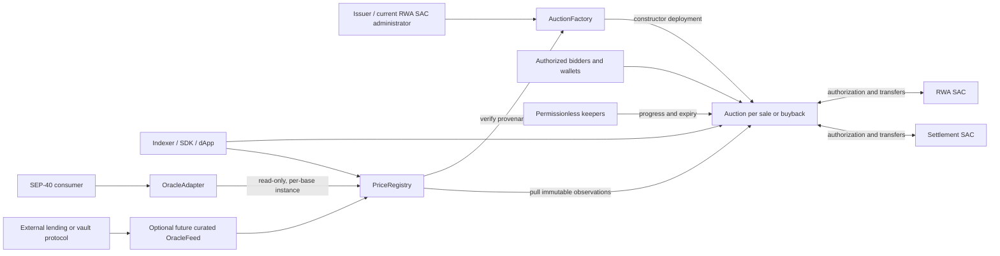
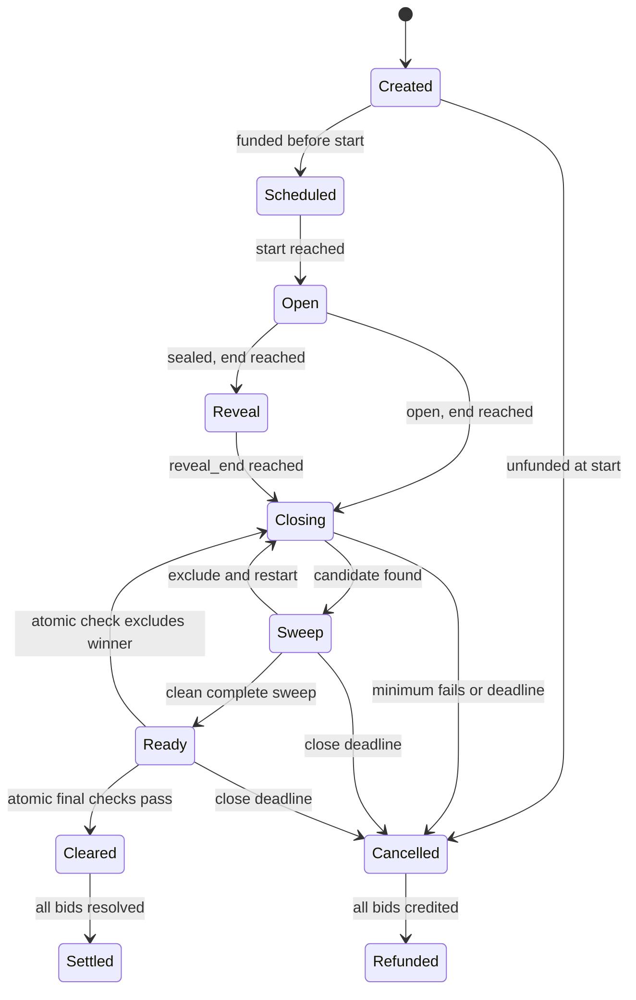
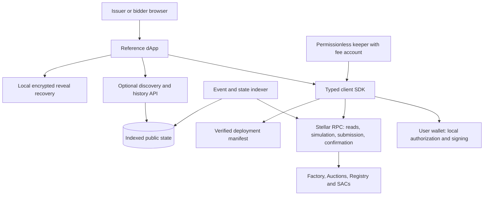

# Crossing Protocol — Design and Architecture

Version **1.6 — full system architecture** · Contract baseline **0.1.0** · Reviewed **24 October 2026**

**Status:** the core Rust/Soroban contracts and executable design models are
implemented and locally reviewed, and have been deployed to and exercised on
Stellar Testnet — see
[deployments/testnet.json](deployments/testnet.json) and the
[testnet transaction log](deployments/TESTNET_TRANSACTIONS.md). There is no
Mainnet deployment and no independent external contract audit. This document
maps the implemented contract baseline and the planned full system. The
[design audit](docs/security/DESIGN_AUDIT.md) tracks design corrections and
release gates; the [contract review](docs/security/CONTRACT_REVIEW.md)
records actual runtime evidence.

Read §§1–5 for the system and lifecycle, §§6–9 for economic/security rules,
§§10–13 for storage and integrations, and §§17–22 for exact ABI, authorization,
accounting, failure handling, and release limits. Verification is in §§14 and 23.

## 1. Product, scope, and decisions

Crossing runs issuer-authorized, fully funded, uniform-price auctions for RWAs on
Stellar. The issuer either sells an escrowed token quantity or buys tokens against
an escrowed settlement-asset budget. Bidders submit maximum buy prices in a sale
and minimum sell prices in a buyback. Successful allocations use one clearing
price, with the integer rounding specified below. The issuer chooses open or
commit-reveal bids.

Public auction observations are queryable between auctions. They are **not a
continuously refreshed valuation, independent appraisal, or guarantee of safe
collateral acceptance**.

### 1.1 Decisions resolving the previous specification

| Area | Normative decision |
|---|---|
| Creator | The current administrator of the genuine RWA SAC authorizes creation and funding. This is initially the issuing account; delegated SAC administration is explicitly supported. |
| Quantity | Always RWA base units in both modes. Deposit units depend on mode. |
| Buyback | Reprice all accepted quantity at each candidate uniform price. Never sum heterogeneous ask-price costs. Never exceed budget; exhaustion is not guaranteed. |
| Partial sale | All eligible demand fills at the sale reserve if actual integer allocation meets the minimum. |
| Sparse buyback | Stop at the previous accepted ask if admitting the next ask would require cutting already higher-priority offers. Return unused budget. |
| Compliance | Every bidder needs RWA authorization, including sale investors. Final closing checks all price-contributing bids atomically, including marginal bids rounded to zero. Claim checks again before actual delivery. |
| Capacity | Baseline `MAX_BIDS = 16`, including non-reveals. This makes final authorization verification bounded and atomic. Raising it requires a reviewed, benchmarked release. |
| Non-reveal | Full refund by default. An issuer may configure a penalty up to 50% on a cleared auction's `NonReveal` resolution before or after delivery expiry, credited to the issuer in the deposit asset. Cancelled auctions and revealed `Revoked`/`DeliveryExpired` bids refund fully; revocation alone does not exempt an unrevealed bid (§6.3). |
| Frozen refunds | Preserve same-owner, same-asset withdrawal credit until transfers are possible. Never assume a revoked SAC recipient can receive immediately. |
| Issuer proceeds | Credit earned proceeds only after corresponding delivery succeeds. Reserve every reversible trade. |
| Claim tail | Fixed delivery deadline, then permissionless refund resolution. Withdrawal credits never expire or become issuer property. |
| Registry | Separate immutable clearing observations from actual execution summaries. Publication is retriable and cannot block settlement. |
| Upgrades | Immutable factory, auctions, and raw registry per release. Deploy a new release for changes; no live-auction upgrade or custody key. |

Unrestricted thousands-of-bidders scale and a resumable sweep that certifies all
winners at one instant cannot both be promised under a bounded final transaction.
V1 prioritizes the stated compliance guarantee and exposes its capacity before
funding. The initial 32-bid draft was reduced to 16 after compiled-WASM testing exceeded
the pinned SDK's default footprint limit (103 entries versus 100). The current
cap is still subject to target-network and worst-case validation.

### 1.2 Scope

Implemented PoC: sale, buyback, both bid modes (including an optional, bounded
non-reveal penalty, §6.3), escrow, clearing, compliance, independent claims,
refunds, raw price observations, and a read-only, partial SEP-40 adapter over
those observations (§11.3). Full product scope also includes the client SDK,
dApp, indexer/API, keeper services, release operations, and a separately
reviewed curated oracle feed with its own source/manipulation governance (§13).
These remaining application components are specified here but are not
implemented in the current PoC.

No AMM, bridge, leverage, continuous book, external-price-based clearing, protocol
fee, arbitrary-token support, discretionary bidder allowlist, automatic auction creation/scheduling inside contracts,
or legal-transferability determination is included. No explicit burn entrypoint
is included. A SAC transfer to the classic issuing account can itself burn the
asset; the buyback recipient choice must disclose this behavior.

## 2. Components and trust boundaries



There are **four deployable contracts**: factory, auction template, raw registry,
and the read-only `OracleAdapter`. `common` is a compiled library for types, wide
checked arithmetic, SAC identity/authorization, and commitment encoding.
`OracleAdapter` exposes part of the [SEP-40](https://github.com/stellar/stellar-protocol/blob/master/ecosystem/sep-0040.md)
shape directly over the raw registry (§11.3); it is not the separately reviewed,
governed curated feed described there, which remains a future, higher-trust layer
with its own source/manipulation policy.

Each auction owns its two SAC balances. Escrow, clearing, and settlement share
one instance for atomic accounting. No factory/registry function transfers auction
funds. On-chain progress does not require the frontend or a privileged keeper.

| Dependency / actor | Power and boundary |
|---|---|
| RWA SAC administrator | Can change authorization and exercise asset-enabled clawback, including against the auction. Crossing cannot override these powers. |
| Quote SAC administrator | Can freeze or claw back under the asset's rules. Fully funded escrow does not eliminate external issuer risk. |
| Issuer | Chooses immutable terms, funds inventory/budget, receives earned proceeds. Cannot withdraw reserves or redirect refunds. |
| Bidder | Can submit funded bids, withhold reveals, and delay delivery until deadline. Cannot replace accepted terms or withdraw early. |
| Keeper/publisher | Pays fees for deterministic progress/publication. Cannot choose price, allocations, or recipients. |
| Release deployer | Selects reviewed artifacts and addresses. A verified manifest is required; an address alone does not prove correctness. |
| SDK/RPC/indexer/wallet | Presentation and transaction infrastructure. Contracts verify authorization and terms; users authenticate deployments and signing intent. |
| Oracle consumer | Must enforce freshness, source, quote currency, liquidity, and manipulation policies. Provenance alone does not establish economic independence. |
| `OracleAdapter` | Read-only; cannot write registry state, hold funds, or influence any auction. Fixed at construction to one registry and one base/quote asset; reports exactly what the registry already recorded, nothing more. |

Only genuine SACs are supported. Verify a token's executable is the built-in
Stellar asset executable; do not trust arbitrary WASM exposing `authorized`,
`admin`, or `transfer`. The chosen SDK must support this check. The
[Stellar SAC documentation](https://developers.stellar.org/docs/tokens/stellar-asset-contract)
describes executable identification and asset control semantics.

## 3. Units, bounds, and immutable configuration

### 3.1 Units and arithmetic

`S = PRICE_SCALE = 10^7`. Require both SACs to report `decimals() == 7` in V1.
This removes an implicit decimal-normalization assumption.

| Value | Unit |
|---|---|
| `q`, `Q`, `f` | RWA smallest units: bid quantity, sale supply, allocation |
| `d`, `B`, `c` | Quote smallest units: sale deposit, buyback budget, payment |
| `p` | Quote whole tokens per whole RWA token, multiplied by `S` |
| `floor_cost(q,p)` | `floor(q*p/S)` quote smallest units |
| `ceil_cost(q,p)` | `ceil(q*p/S)` quote smallest units |

Inputs and stored totals use checked `i128` with strictly positive or nonnegative
signs as appropriate. Use a checked unsigned 256-bit intermediate after sign
validation for multiplication/division, then checked conversion to `i128`.
Compute ceiling from quotient and remainder, not `a*b+denominator-1` in `i128`.
Zero denominators, overflow, and out-of-range results fail atomically.

Per-auction admitted quantity and deposit totals are checked against `i128::MAX`;
sealed deposits count before reveal. A reveal whose quantity would overflow a
total fails without losing its deposit. No counter wraps. Classic-account SAC
trustline limits can be smaller than `i128`; failed delivery preserves the claim
and the SDK simulates account capacity before signing.

### 3.2 Schema

```rust
// Current version-1 fields; contract annotations omitted.
enum Mode { Sale, Buyback }
enum BidMode { Open, Sealed }
struct Config {
    version: u32,                 // exactly 1
    rwa_token: Address,
    quote_token: Address,
    issuer: Address,              // current RWA SAC admin at create/fund
    buyback_recipient: Address,   // immutable; used only in Buyback
    mode: Mode,
    bid_mode: BidMode,
    nonreveal_penalty_bps: u32,    // 0..=5000; must be 0 when bid_mode is Open
    supply_or_budget: i128,       // RWA Q in Sale; quote B in Buyback
    min_fill_quantity: i128,      // RWA units in both modes
    min_bid_quantity: i128,       // RWA units
    min_deposit: i128,            // mode-specific escrow-asset units
    min_price: i128,              // Sale reserve / lowest permitted ask
    max_price: i128,              // Sale highest bid / Buyback ceiling
    tick_size: i128,
    max_bids: u32,                // 1..=16; non-reveals consume slots
    max_bids_per_address: u32,    // 1..=max_bids
    start_ledger: u32,
    end_ledger: u32,              // exclusive placement/commit boundary
    reveal_end_ledger: u32,       // ==end for Open; >end for Sealed
    close_deadline: u32,          // exclusive finalization boundary
    delivery_deadline: u32,       // exclusive successful-delivery boundary
}
```

Factory, registry, template hash, and protocol domain are constructor-established
provenance. `config_hash = SHA256(XDR(Config))` uses canonical Soroban contract
value encoding; verify a Rust/TypeScript golden vector before implementing clients.
There is only one source of reserve/ceiling values. Remove the old independent
`limit_price` to prevent conflicting grids.

### 3.3 Validation

1. Distinct, genuine deployed SACs with seven decimals. V1 excludes native XLM
   because it requires the admin/authorization interface of an issued SAC.
2. `issuer == rwa_sac.admin()` and issuer signature at creation and funding.
   Recheck at funding to reject stale dormant instances after admin transfer.
   Later admin changes do not alter withdrawal ownership.
3. Positive supply/budget, minimums, prices, and tick size; `min_price <= max_price`;
   divisible grid span; `1 + (max_price-min_price)/tick_size <= 4096`. Bid prices
   must be exactly on-grid and in range, never silently quantized.
4. Global and per-address caps within bounds. Issuer, buyback recipient, auction,
   factory, and registry cannot bid in that auction. The buyback recipient cannot
   be the auction, factory, or registry; check against the actual deployed address
   before funding, not just user input. Otherwise a transfer to the auction itself
   could be counted as delivery while tokens remain inaccessible in escrow.
   These filters do not prevent related-account bids.
5. `now < start < end <= reveal_end < close_deadline < delivery_deadline`, with
   equality `end == reveal_end` only for Open. Check arithmetic and the TTL
   schedule horizon (§12). All time comparisons use ledger sequence.
6. Sale minimum fill cannot exceed inventory. Buyback maximum affordable quantity
   `floor(B*S/min_price)` must itself fit `i128`, and minimum fill cannot exceed
   it. This rejects a budget/price combination whose capacity calculation would
   overflow later during closing. Require
   `floor_cost(min_bid_quantity,min_price) >= 1` to limit worthless tiny bids.
7. Funding requires auction authorization on both SACs, issuer authorization on
   both assets, and RWA authorization of the buyback recipient. Placement requires
   both SAC authorizations for the bidder. Actual transfers remain authoritative.
8. `nonreveal_penalty_bps <= MAX_NONREVEAL_PENALTY_BPS` (5,000, i.e. 50%), and must
   be exactly zero when `bid_mode == Open` — there is no non-reveal event to
   penalize in that mode, so a nonzero value there would be dead, confusing
   configuration rather than a real control.

## 4. Deployment, funding, and interfaces

### 4.1 Immutable release deployment

Publish network ID, source revision, compiler/SDK/CLI versions, lockfile hash,
all four WASM hashes, salts, and addresses in a release manifest. Precompute the
factory address. Deploy registry with that address and reviewed auction-template
hash, then factory with registry and template hash. Factory construction checks
registry's pinned factory equals itself and its template hash matches. Registry
construction does not call the not-yet-deployed factory. Creation also verifies
the pinned registry executable against the reviewed release. The factory's
immutable constructor checks establish the registry's matching bindings. Each
`OracleAdapter` instance is deployed separately afterward, once per base asset
needed, pinning the already-live registry's hash (§11.3); it has no bindings to
establish with the factory or auction template.

Use constructors, not a raceable public `initialize`. Namespace auction salts
with a domain-separated hash of `(network_id,factory,issuer,user_salt)`. Another
issuer cannot consume the victim's salt namespace. Same-issuer salt reuse fails
before funds move. Deploy with constructor arguments and register metadata in
the same atomic invocation. No upgrade, template rotation, arbitrary call,
emergency withdrawal, or rescue entrypoint exists in the core contracts.

Local regressions exercise real `deploy_v2` bootstrap with incorrect registry
hash, expected factory address/hash, and auction template. A valid retry reuses
the same salts after each failed bootstrap. Constructor reinvocation is rejected
by the host. Factory creation tests additionally cover exact signed config/salt,
create-time admin changes, namespace isolation, and rollback after a deliberately
injected post-deployment counter fault. These are local deployment tests;
public-network release verification remains separate.

### 4.2 Deploy before funding

An `AUTH_REQUIRED` asset may require explicit approval of the auction address
before it can receive funds. `create` therefore produces a dormant `Created`
instance without escrow. Asset administrators authorize that address through
their SACs. `fund()` then locks exactly `Q` RWA or `B` quote, once, with issuer
authorization and strictly before start. No bids are accepted while unfunded.
An unfunded instance can expire at start; no investor capital is exposed to
unfinished setup. Do not assume undeployed addresses can be preauthorized.

### 4.3 Public interfaces

| Contract / method | Authority | Effect |
|---|---|---|
| Factory `create(config,salt)` | Current RWA SAC admin | Deploy/register dormant instance |
| Factory `get_auction(address)` | Public | Immutable metadata/provenance |
| Factory `predict(issuer,user_salt)` / `bindings()` | Public | Deterministic address / immutable release pins |
| Factory `count()` / `list(start,limit)` | Public | Bounded discovery, at most 32 addresses |
| Factory `maintain(start,count)` | Permissionless | Extend at most 8 discovery entries and their metadata |
| Auction `fund()` | Issuer | One-time exact escrow before start |
| Auction `place_bid(bidder,p,q)` | Bidder | Open deposit/aggregate, return global bid ID |
| Auction `commit_bid(bidder,nonce,hash,max_locked)` | Bidder | Sealed deposit, no tick contribution |
| Auction `reveal_bid(id,p,q,salt)` | Recorded bidder | Verify commitment and collateral; aggregate once |
| Auction `advance(work_limit)` | Permissionless | Bounded tick or sweep work |
| Auction `finalize()` | Permissionless | Atomic final checks; finalize or exclude/restart |
| Auction `expire()` | Permissionless | Unfunded-start / unfinished-close cancellation |
| Auction `claim_bid(id)` | Permissionless | Deliver to fixed recipients or credit refunds once |
| Auction `expire_bid(id)` | Permissionless | Post-deadline refund and reserve release |
| Auction `withdraw(owner,asset,amount)` | Owner | Same-owner credit withdrawal only |
| Auction `maintain(keys)` | Permissionless | Bounded typed TTL extension |
| Auction getters | Public | Config, state/cursors, timing flags, bids, totals, credits, liabilities, observations |
| Registry `record_clearing(auction)` | Permissionless | Verify source and pull immutable result once |
| Registry `record_settlement(auction)` | Permissionless | Pull final actual execution summary once |
| Registry getters | Public | Pair history/latest and immutable observations |
| Registry `maintain(rwa,quote,start,count)` | Permissionless | Extend at most 8 history records and pair pointers |
| OracleAdapter `maintain()` | Permissionless | Extend its instance/code; registry retention remains separate |

An address argument or transaction source is not authentication. Require actual
spenders' authorization for the exact invocation and necessary SAC subcalls.
Permissionless functions cannot replace terms or select a refund recipient.

## 5. State machine and timing



Scheduled/Open/Reveal are effective states derived from ledger boundaries while
funded and not closing; no issuer activation call is needed. Placement uses
`start <= ledger < end`; sealed reveal uses `end <= ledger < reveal_end`.
Closing starts at `ledger >= reveal_end`. Finalization requires
`ledger < close_deadline`; at equality an unfinished auction can only cancel.

A cleared auction never re-clears. Successful delivery requires
`ledger < delivery_deadline`. At equality all unresolved bids become refund-only.
Deadlines never confiscate earned credits or already delivered assets. After
funding there is no discretionary cancellation or bid withdrawal. Deterministic
cancellation covers no demand, inadequate actual fill, definite global asset
authorization failure at finalization, and unfinished-close expiry.

## 6. Open and sealed bids

### 6.1 Open placement

Validate phase, signer, both authorizations, quantity, grid, capacity, and totals.
Sale deposit is `ceil_cost(q,bid_price)` quote; buyback deposit is `q` RWA.
Enforce the configured deposit minimum. Transfer the exact deposit and persist
bid, aggregates, counters, and event atomically. Failure leaves no consumed bid
ID or tick contribution. There are no factory allowances or fee deductions.

### 6.2 Commit-reveal encoding

The bidder chooses a unique `nonce: BytesN<32>` and a cryptographically random
`salt: BytesN<32>`. The commitment is exactly:

```text
SHA256(XDR(ScVal::Vec([
  Symbol("CROSSING_BID_V1"),
  Bytes(network_id[32]), Address(auction), Address(bidder), Bytes(nonce[32]),
  Bytes(config_hash[32]), I128(max_locked), I128(price), I128(quantity),
  Bytes(salt[32])
])))
```

Hash the entire canonical ScVal XDR, including discriminants. Do not concatenate
raw text. Domain, network, auction, owner, unique nonce, terms, and deposit are
bound. Rust/TypeScript golden vectors must match byte for byte.

Commit locks `max_locked` in the mode's deposit asset. Validate positive deposit,
minimum, cumulative bound, capacity, and unused `(bidder,nonce)`. Immediately
consume one bid slot and record its ownership; never reuse the nonce or slot.
Do not write price or quantity aggregates yet.

For Sealed Sale, admission additionally requires
`floor(total_admitted_deposits * SCALE / min_price) <= i128::MAX`, using U256
intermediates and a checked result. Since every valid reveal has
`q <= floor(deposit * SCALE / price)` and `price >= min_price`, the sum of all
admitted hidden quantities then fits i128 in any reveal order. Reject capacity
overflow before transferring collateral or consuming the nonce/slot. This
conservative reservation includes excess collateral; a low reserve price or
large overcollateralization can exhaust capacity before the bid-count cap.
Buyback already bounds quantities by admitted RWA deposits, and Open admission
checks known quantity totals directly.

Reveal requires the recorded owner's signature, reveal window, exact hash,
unrevealed/unexcluded state, ordinary quantity/grid validations, and
`ceil_cost(q,p) <= max_locked` for Sale or `q <= max_locked` for Buyback.
**Keep all excess collateral escrowed until claim**; no external refund on reveal.
Write the quantity aggregate exactly once. Non-reveals never contribute to price
and are resolved through the terminal refund path at claim.

Sealed mode hides the preimage, not bidder identity, deposits, timing, or count.
Deposit size may constrain or reveal quantity, especially in a buyback. Clients
must use high-entropy salts, preserve encrypted recovery material, and never log
secrets. Lost secrets prevent reveal but not eventual deposit resolution.

### 6.3 Optional non-reveal penalty

By default `nonreveal_penalty_bps == 0`: a non-revealer's full original deposit
returns through the refund path, exactly as in §6.2. An issuer running a Sealed
auction may instead set `nonreveal_penalty_bps` up to `MAX_NONREVEAL_PENALTY_BPS`
(5,000, i.e. 50%) at creation. At claim, a bid resolved with reason `NonReveal`
then refunds `deposit - floor(deposit * bps / 10_000)` to the bidder and credits
the floored remainder to the issuer, in the deposit's own asset (quote for Sale,
RWA for Buyback) — never a different asset, and never more than the configured
proportion. This is a deliberate, bounded deterrent against occupying a scarce
bid slot without ever revealing, not a mechanism an issuer can use to confiscate
an honest bidder's full deposit: the 50% cap is enforced at validation (§3.3),
and the rule only applies to the `NonReveal` reason. **`NonReveal` is classified
ahead of the timing-derived `DeliveryExpired` reason on a cleared auction**: an
unrevealed bid is `NonReveal` whether it is resolved via `claim_bid` before the
delivery deadline or via permissionless `expire_bid`/`expire_range` after it —
waiting out the deadline is not a way to dodge the penalty, and it applies
regardless of who calls the resolving entrypoint. Only a genuinely cancelled
auction (which never cleared, so no price was ever distorted by the non-reveal)
skips the penalty and refunds in full, via the auction-wide cancel reason, which
still takes precedence. An unrevealed bid remains `NonReveal` even if its owner
has since lost SAC authorization; revocation does not exempt it from the
penalty. A revealed bid resolved as `Revoked` still receives a full refund.
Choosing a nonzero penalty is an immutable issuer choice, not a protocol
default.

The 22-field Config includes this value in its canonical hash. Adding the field
changed the pre-release ABI and commitment fixtures even when its value is zero;
older 21-field clients/commitments are incompatible and must not be reused.

## 7. Clearing mathematics

Active means open/revealed and not permanently excluded. Let `T[p]` be total
active **RWA quantity**, not quote collateral, at a tick. Clearing has no transfers,
registry writes, external price input, or operator choice.

### 7.1 Sale: descending demand

Walk descending. `L` is quantity at strictly higher ticks and `Q` is inventory.

```text
for p descending:
    q = T[p]
    if L + q >= Q:
        candidate = (p, target=Q, numerator=Q-L, denominator=q)
        stop
    L += q
if grid ends:
    candidate = (min_price, target=L, numerator=1, denominator=1)
    // Every active bid fills fully; no marginal rationing.
```

Above the clearing price fill fully, below fill zero. At an oversubscribed
marginal tick allocate `floor(q_i*numerator/denominator)`. With insufficient
demand, all active bids fill at the reserve. Zero demand cancels.

`sum(f_i) <= Q`. For a winning buyer `p_clear <= bid_price` and `f_i <= q_i`, so
`ceil_cost(f_i,p_clear) <= ceil_cost(q_i,bid_price) <= deposit_i`.

### 7.2 Buyback: ascending supply at one uniform budget

At each **occupied** ask tick `p`, compute `K(p)=floor(B*S/p)`, the capacity if
all accepted offers are paid the same price. Empty ticks only advance the cursor.
`L` is quantity at strictly lower asks.

```text
for occupied p ascending:
    q = T[p]
    capacity = floor(B*S/p)
    if capacity <= L:
        if L == 0: cancel(no affordable quantity)
        else: candidate = previous occupied p, target=L, full ratio 1/1
        stop
    if L + q >= capacity:
        candidate = (p, target=capacity, numerator=capacity-L, denominator=q)
        stop
    L += q
    previous occupied p = p
if grid ends:
    if L == 0: cancel(no demand)
    else: candidate = previous occupied p, target=L, full ratio 1/1
```

Cheaper asks fill fully, the marginal ask fills pro rata with floor, higher asks
fill zero. At `capacity == L`, select the previous ask: a new zero-allocation
offer must not set price. When capacity is smaller than the cheaper accepted
quantity, do not cut those offers to admit a worse ask. Undersubscribed buybacks
use the highest accepted ask, not the configured ceiling.

For allocated quantity `F`, rounded buyback payments are
`c_i=floor_cost(f_i,p_clear)`:

```text
F <= floor(B*S/p_clear)
C = sum(floor(f_i*p_clear/S)) <= floor(F*p_clear/S) <= B
bid_price_i <= p_clear <= max_price for every executed seller
```

Per-bid ceilings can break the budget and are forbidden in Buyback.

**Sparse-price example, scale 1:** budget 100, offers `8 @ 10` and `1 @ 20`.
At 20 the budget buys only 5, fewer than the 8 higher-priority units. Buy 8 at 10
and return 20. Never pay 160 or partially cut the cheaper offer to admit a worse
one. Replace “always exhausts budget” with “never exceeds budget.”

### 7.3 Actual allocations, minimum, and rounding

Derive each allocation with wide checked arithmetic. If an allocation or its
mode-specific payment rounds to zero, make that bid refund-only and do not
redistribute its dust. Evaluate `min_fill_quantity` against the resulting
**actual** sum `F`, not nominal target. Cancel if `F == 0` or below the minimum.

The marginal price is determined from aggregate capacity **before** indivisible
per-bid rounding. A positive nominal marginal quantity can round to zero across
all individual marginal bids while better bids still execute. The recorded price
remains the nominal marginal tick; do not describe it as necessarily the price
of an individually delivered marginal bid. This is distinct from the buyback
`capacity == L` branch, where the nominal marginal quantity is already zero.

Before the zero-payment filter, pro-rata quantity dust is less than the number
of marginal bids in RWA base units. The filter may create additional unused
inventory; do not reuse that bound afterwards. Sale charges round up; Buyback
payments round down, with less than one quote base unit rounding per executed
bid. Splitting cannot improve pro-rata quantity rounding, can increase sale
charges, and can decrease buyback receipts. Unallocated RWA/unused budget belongs
to the issuer; no ownerless rounding pool exists.

### 7.4 Resumability

Use bounded `u32` tick indices, deriving prices with checked arithmetic. Persist
epoch, cursor, cumulative quantity, previous occupied tick, and candidate.
`advance(work_limit)` processes at least one and at most 32 ticks or 8 sweep
bids; zero work is an error. A read/no-op never resets progress.

At the descending index-zero boundary, finish the walk instead of decrementing
an unsigned cursor. At the ascending final index, finish before incrementing
past the configured count. Do not encode a negative-price/index sentinel in
contract storage; the Python model's local loop sentinels are not a Rust schema.

Any change to active totals increments the epoch and resets **all** clearing
accumulators. Never reuse a prefix built from a prior active set. Chunk sizes
and caller identity cannot change price, allocation, or reserve totals.

## 8. Three lines of compliance and closing termination

### 8.1 Placement and preliminary sweep

Check both SAC authorizations of every bidder before escrow in both modes.
The preliminary sweep enumerates dense global bid IDs `0..bid_count` and checks
all revealed, nonexcluded bids at or better than the candidate price. A marginal
bid can influence the uniform price even if its individual quantity or payment
rounds to zero; it must pass the same checks as a positive allocation. A definitely
deauthorized contributor is permanently excluded, its revealed quantity
subtracted exactly once, and clearing restarted.
Its deposit remains an owned pending refund. Do not transfer refunds in a sweep.

Returned `false` proves deauthorization. A query error, unexpected type, missing
or archived dependency, or resource failure grants neither trading permission
nor permission to exclude permanently. Abort that invocation atomically; restore
and retry where needed. Deadline cancellation remains available. Treating every
error as a durable revocation would enable accidental permanent bid removal.

### 8.2 Atomic finalization

A sweep split across transactions cannot certify one instant. An address checked
on page one can be revoked before the final page. A clean sweep enters `Ready`,
not `Cleared`.

`finalize()` reads at most 16 records, derives allocations, and checks all
price contributors' current RWA and quote authorizations **in one transaction**,
including marginal bids whose allocation or payment rounds to zero.
It also checks the auction's authorization on both assets and the buyback
recipient's RWA authorization. A definite global failure cancels into refunds.

On the first revoked contributor, exclude it, subtract one aggregate, increment epoch,
reset clearing, and **return successful progress**. Returning an error would
roll back the intended exclusion. If all pass, compute exact `F` and `C`, verify
minimum and bounds, save immutable result, initialize reserves once, and enter
`Cleared` atomically. No caller-provided winner subset or inline registry call is
allowed. Query errors consume no progress or deposits.

This certifies the price-contributing set at finalization. Later revocation can reduce
execution; the registry must distinguish allocation and delivery.

### 8.3 Termination and the capacity tradeoff

Each restart excludes a new active bid permanently; reauthorization cannot put
it back. With `N <= 16`, at most `N` exclusion restarts and one clean pass occur,
absent infrastructure failures or deadline expiry. Cursors progress within an
epoch. Total elementary walk/sweep work is bounded by
`(N+1)*(tick_count+N)`, plus bounded finalizer calls. A full pass need not fit one
transaction. No proof depends on monotone clearing prices, which sparse buyback
fallback makes unsafe as a general assumption.

Benchmark the 16-record finalizer with distinct classic trustlines and contract
bidders, maximum data/event size, and restoration before deployment. If it does
not fit with margin, lower the release cap before deployment. Never substitute
an asynchronous final check and claim the same guarantee. Network limits are
configurable; [Stellar resource guidance](https://developers.stellar.org/docs/build/guides/storage/storage-strategies)
requires checking the target network. Resource sizing is an open implementation
gate, not evidence already obtained by this design review.

## 9. Settlement, refunds, and conservation

### 9.1 Reserve initialization

Let final actual allocations be `f_i`, payments `c_i`, `F=sum(f_i)`, `C=sum(c_i)`.
Allocation is derived from immutable bid terms, exclusions, and final result.

| Mode | Immediate issuer credit | Unresolved trade reserve |
|---|---|---|
| Sale | `Q-F` RWA | `F` RWA; every full quote deposit remains pending |
| Buyback | `B-C` quote | `C` quote; every full RWA deposit remains pending |

No unresolved sale proceeds are released early. Terminal initialization is
exactly once. On cancellation, credit all funded issuer escrow and reserve no
trades; bidder deposits remain pending until credited individually. Unfunded
cancellation creates no issuer credit.

### 9.2 Per-bid resolution

`claim_bid(id)` is permissionless with fixed recipients. It needs no other
bidder's claim or withdrawal. Guard replay before external calls; a delivery
failure rolls back transfers and state together. No catching an error and
marking a trade paid anyway.

**Refund-only:** cancelled auction, excluded bid, zero allocation,
or definite claim-time deauthorization. Resolve once and credit the **entire
original deposit** in its original asset to its original owner. Non-reveals
also follow this path, with only the configured `NonReveal` penalty split in
§6.3 deducted into an issuer credit, before or after delivery expiry. Auction
cancellation waives it; expiry alone does not.
If allocated,
release `f_i` RWA to issuer in Sale or `c_i` quote to issuer in Buyback, reducing
that unresolved reserve. These are internal credits, not transfers to frozen
recipients.

**Successful Sale:** recheck bidder RWA/quote and auction authorizations, then
transfer `f_i` RWA from escrow to the bidder. Atomically resolve, credit
`deposit_i-c_i` quote to bidder and `c_i` quote to issuer, and reduce RWA reserve
by `f_i`. Proceeds become withdrawable only after actual RWA delivery.

**Successful Buyback:** recheck bidder RWA/quote, auction, and recipient RWA
authorizations. Atomically transfer `f_i` RWA to the fixed recipient and `c_i`
quote to the bidder. Resolve, credit `deposit_i-f_i` RWA to bidder, reduce quote
reserve by `c_i`. Either transfer failing rolls back both and all bookkeeping.
SAC transfer to a classic issuer may burn the delivered RWA.

At claim, definite deauthorization of a required delivery address takes the
refund-only path. Query errors abort without resolving. Transfer failure despite
positive authorization (e.g. a full trustline) preserves the bid for retry or
deadline refund. A permissionless helper can resolve a currently revoked bidder
into a refund; this irreversible behavior is explicit. Successful delivery is
final; subsequent revocation does not undo Crossing's completed trade or recall
the issuer's earned proceeds.

### 9.3 Expiry and withdrawal

At/after delivery deadline, `expire_bid` performs refund-only bookkeeping without
SAC calls. Anyone can finish all unresolved bids in bounded batches even if
recipients are frozen or absent. All resolved means `Settled` for a cleared
auction or `Refunded` for a cancelled one; it does not mean all credits withdrawn.

`withdraw(owner,asset,amount)` requires owner authorization, positive amount,
one of the configured assets, and sufficient same-owner credit. Reduce credit
and liability, then transfer only to that owner. Failure restores both
atomically. Partial withdrawals can accommodate trustline capacity. There is no
recipient redirect, forfeiture, cross-asset substitution, or admin override.

A revoked owner must regain authorization or pursue the asset issuer's external
process. Auction-wide SAC freezing can block that asset for everyone. Clawback
can remove escrow despite correct accounting; Crossing cannot guarantee recovery
from these administrator powers.

### 9.4 Per-asset conservation

Never add RWA units to quote units. For each asset `a`:

```text
tracked_liability[a]
  = pending_bid_deposits[a]
  + unresolved_trade_reserve[a]
  + sum(unwithdrawn_credits[owner,a])
actual_SAC_balance[a] >= tracked_liability[a]
```

Before clearing, issuer escrow is the unresolved reserve; afterwards split it
as above. Refund resolution moves pending deposit to a credit, creating no money.
Delivery or withdrawal reduces the corresponding balance and liability equally.
Equality holds with protocol-only inflows and no external clawback. Unsolicited
transfers produce a surplus, not issuer property; V1 exposes but cannot sweep it.

Check both actual balances against liabilities before every outward transfer.
If clawback creates a deficit, report insolvency and stop withdrawals/deliveries
until replenished, rather than letting early claimants drain the remainder.
Never silently reduce a claimant's recorded property. Refund-credit and expiry
bookkeeping can still proceed. This preserves detection and fair suspension,
not immunity to external asset loss.

## 10. Storage, indexing, events, and errors

Use separate persistent entries, not growing global maps or per-bidder vectors.
Keep only bounded configuration/counters/results in instance storage.

| Contract / key | Value |
|---|---|
| Factory instance `Registry`, `RegistryHash`, `Template`, `Count`, `Lock` | Immutable pins, checked creation count, mutation guard |
| Factory `Auction(address)` | Issuer, pair, mode, config/template hashes, creation ledger |
| Factory `At(sequence)` | Address for bounded discovery pagination |
| Registry instance `Factory`, `FactoryHash`, `Template`, `Lock` | Immutable source pins and mutation guard |
| Registry `Clearing(auction)` / `Settlement(auction)` | Separate immutable observations / duplicate guards |
| Registry `History(rwa,quote,sequence)` / `Count(rwa,quote)` | Pair-scoped append history and count |
| Registry `Latest(rwa,quote)` / `LastSettled(rwa,quote)` | Source-ordered clearing / positive-execution pointers |
| Auction instance `Config`, `Provenance` | Immutable bounded values |
| Auction instance `State` | Persisted stage, epoch, bid count, cursors, cumulative quantity, previous price, candidate |
| Auction instance `Clearing` | Candidate, F, C, winner count, source ledger/timestamp |
| Auction instance `Accounting` | Pending deposits, reserves, per-asset liabilities/total credits, resolved count, actual executed totals |
| Auction instance `Settlement`, `CancelReason`, `Lock` | Terminal summary, cancellation reason, mutation guard |
| Auction `Bid(id)` | Owner, sealed nonce/hash if applicable, deposit, optional price/quantity, exclusion, resolution outcome |
| Auction `Tick(index)` | Active revealed RWA quantity |
| Auction `Count(owner)` / `OwnerBid(owner,local_index)` | Capacity and indexed global IDs |
| Auction `Nonce(owner,nonce)` | Persistent reuse guard |
| Auction `Credit(owner,asset)` | Nonnegative withdrawable property |

Global dense bid IDs enumerate the whole book. Tick totals match revealed active
quantities exactly. Settlement never deletes ownership or resets resolution.
All sequence and monetary increments are checked. Names above match the private
storage-key enum variants; they are not separate public entry points. Instance
storage shares the instance entry's TTL; listed per-record keys are persistent.

Versioned events: creation, funding, open bid, commit, reveal, exclusion,
progress, clearing, cancellation, delivered bid, refund credited, withdrawal,
settlement completed, clearing recorded, settlement recorded. Include bid IDs,
epoch/cursor, quantities/asset units, and reason codes as relevant. Never expose
sealed preimages before reveal. Events aid discovery; storage is authoritative.

Typed errors cover phase/deadline, authority, asset identity/decimals, bounds,
grid, arithmetic, capacity, collateral, commitment mismatch/reuse, duplicates,
insufficient credit, blocked delivery, query failure, insolvency, and provenance.
Every error preserves ownership and liabilities. Eligibility exclusion is a
successful transition, not an error rolling back the exclusion.

## 11. Raw price records and future oracle

### 11.1 Retriable, verified publication

`record_clearing(auction)` accepts an address, never caller-supplied price or
volume. Verify the pinned factory executable from the release, its auction
metadata, the auction's reviewed template executable, and pulled config/result.
Cross-check issuer, pair, mode, version, and config hash. Only positive Cleared
or Settled results are recordable. Unregistered clones cannot write fabricated
records for real assets. Duplicate publication is idempotent, without duplicate
history or changing an existing record.

Record auction, release/factory, config hash, pair, mode, scale, price, allocated
RWA `F`, reserved quote `C`, winner count, clearing ledger/timestamp, delivery
deadline, and separate publication time. Registry outages or archived state
cannot block closing, delivery, or refunds; anyone retries publication later.

### 11.2 Pair, ordering, and execution

Key by `(rwa,quote)`, never RWA alone. History sequence is publication order;
latest is greatest `(clearing_ledger,auction_address)` using lexicographic raw
contract-ID byte order to break same-ledger ties. Delayed old records cannot
replace a newer mark. Use source time, never publication time, for freshness.

After a cleared auction reaches `Settled`, pull its immutable summary: actual delivered
RWA, actual paid/earned quote, refunded-deposit totals, completion ledger/time.
Ensure the clearing record exists if necessary; never overwrite it. Zero
executed volume is recorded explicitly and cannot update `LastSettled`.
Completion time is not a new discovery timestamp. Post-clear revocations and
missed delivery reduce execution without silently changing the historical price.
Cancelled/refunded auctions have no successful clearing and cannot publish
registry observations, even though their own `settlement()` getter records
completed refund accounting.

Provenance does not prevent related accounts manufacturing demand. Raw records
must not directly authorize borrowing, liquidation, or NAV. Minimum volume alone
is not a wash-trading defense.

### 11.3 OracleAdapter: a partial, raw SEP-40 read surface

`OracleAdapter` is a fourth, separately deployed, read-only contract. Its
constructor fixes one `PriceRegistry` (its WASM hash pinned once, the same way
the factory pins the registry's hash) and one `base` quote asset for the
lifetime of the instance; a deployment exists per quote asset an integrator
cares about, not per RWA. It implements four of [SEP-40](https://github.com/stellar/stellar-protocol/blob/master/ecosystem/sep-0040.md)'s
methods directly over the registry's existing `latest(rwa, quote)`:

The base must be a genuine seven-decimal issued SAC with an admin interface;
native XLM and arbitrary WASM are rejected like the auction's quote asset.
Construction forces both instance and reused-code retention to the supported
rolling retention target. Permissionless `maintain()` renews those TTLs without
changing bindings or extending registry dependencies. Reads do not renew them.

| Method | Behavior |
|---|---|
| `base()` | `Asset::Stellar(base)`, fixed at construction |
| `decimals()` | `7`, matching `PRICE_SCALE` |
| `resolution()` | `0` — this feed is event-driven (published whenever an auction clears), not periodic, so no fixed update interval applies. A SEP-40 consumer that requires a genuinely periodic, nonzero resolution is not a fit for this feed today. |
| `lastprice(asset)` | `Asset::Stellar(rwa)` maps to `registry.latest(rwa, base)`; `Asset::Other` always returns `None`, since this registry only ever prices SAC pairs |

**This is explicitly a partial surface, not full SEP-40 conformance.** `assets()`
(pair enumeration), `price(asset, timestamp)` (point-in-time lookup), and
`prices(asset, records)` (bounded history) are not implemented: the registry's
storage is keyed for append-only history and `latest()`, not for timestamp-indexed
lookup, and enumerating every RWA ever priced against a base would need a new,
separately bounded index. A consumer that only needs the current clearing price
is fully served; a consumer that needs historical point-in-time queries is not,
and should read `PriceRegistry.history`/`get_clearing` directly instead.

Everything in the raw-registry section above still applies unchanged: the
adapter adds no filtering, no manipulation policy, no minimum-volume or
maximum-staleness check, and no source governance. It is a different *shape* on
the same raw data, not the separately reviewed, governed curated feed this
section originally scoped. That curated layer — trusted issuers/assets, minimum
actual volume/execution fraction, maximum source age, an independently reviewed
manipulation policy, and (if needed) the remaining SEP-40 methods — remains
future work, and should not be inferred from this adapter's existence. No oracle
governance controls auction escrow either way.

## 12. TTL, restoration, and resource engineering

### 12.1 Ownership survives archival

Use persistent/instance storage for all financial records and replay guards;
never temporary storage. Do not delete credit ownership at delivery expiry or
reinitialize archived records as empty/unclaimed.

At create/fund require remaining schedule plus recovery margin to fit current
runtime `storage.max_ttl()`. Compute an absolute target at least
`delivery_deadline + recovery_margin`, checked against overflow. The pinned SDK
defines TTL excluding the current ledger: `live_until = current + extend_to`.
Therefore `target - current == storage.max_ttl()` is supported; no additional
ledger is required. Tests must assert actual live-until ledgers at boundaries,
not only the extension argument. Extend instance, code, and financial keys on
relevant writes. Never pass an absolute ledger as a relative TTL.

Auction construction must force the complete supported financial horizon for
both its fresh instance and its potentially reused WASM code entry. The SDK
evaluates the two TTL thresholds independently. A half-retention threshold can
skip older shared code that is still above that threshold but expires before a
new auction's delivery deadline. Set the initial extension threshold equal to
the requested horizon; subsequent rolling extensions may use the half-horizon
threshold because the immutable auction's absolute financial target is already
protected. This guarantee does not replace maintenance/restoration for factory
metadata, registry history, or credits retained beyond the recovery horizon.

Credit writes and maintenance after settlement extend credit, guards, instance,
and code on a rolling supported horizon. Finite TTL is not ownership expiry.
Restore archived records using target-network restoration and retain their old
values. A missing `Bid(id)` with `id < bid_count` is an error requiring recovery,
not permission to create a replacement. Missing archived registration cannot be
interpreted as a new legitimate auction.

`maintain(keys)` accepts at most 8 recognized typed keys and extends those keys
plus instance/code; it cannot write arbitrary data. Submitters pay rent. Operators
monitor TTL and finance restoration. No contract can guarantee someone pays rent
forever. Follow the target protocol's
[archival rules](https://developers.stellar.org/docs/learn/fundamentals/contract-development/storage/state-archival).

### 12.2 Resource limits and liveness

| Operation | Baseline bound |
|---|---|
| Place / reveal | Constant entries, no book scan |
| Clearing | 32 ticks/call, 4096/pass |
| Preliminary sweep | 8 bids/call |
| Finalization | 16 bids plus their SAC checks in one atomic call |
| Claim / withdrawal | One bid / one owner credit |
| Expiry helper / maintenance | 8 records/call |
| Public page / history getter | 32 entries/page |

Clearing arithmetic is `O(ticks)`, compliance and exact reserves `O(bids)`;
the whole lifecycle is not bidder-count-independent. Re-clearing adds the bounded
passes in §8.3. Benchmark fees, CPU, footprints, writes, bytes, event/return size,
and restoration against target settings. No chunk can contain an unbounded
inner loop or growing single entry.

Keepers simulate each call, handle restoration, pay fees, and re-simulate stale
footprints. Invalid work limits never mean unlimited work. No keeper subsidy or
preferred issuer scheduler is assumed. Deadline refunds bound lockup in protocol
time, but a fee-paying caller must still submit progress/expiry transactions.

## 13. Client SDK, dApp, indexing, and operations

This section specifies the full application architecture. These components are
planned and are not part of the implemented smart-contract PoC. They consume the
current contract ABI; they do not replace contract validation or control escrow.

### 13.1 Application topology and ownership



The dApp and indexer are availability/convenience layers. User asset authority
stays with wallets and the contracts. The backend never receives signing keys,
wallet recovery phrases, unrevealed secrets, or authority to redirect refunds.
The keeper signs only its own fee-paying transactions for public maintenance
operations. Transactions requiring issuer/bidder/credit-owner authorization are
signed through that user's wallet. Direct contract interaction remains possible
if the hosted interface or indexer is unavailable.

### 13.2 SDK packages and numeric domain

The intended TypeScript client SDK has the following module boundaries:

| Module | Responsibility and constraints |
|---|---|
| `deployment` | Validate release manifest, network ID, factory/registry addresses and code hashes; reject mismatches before preparing transactions |
| `types` / `amounts` | Generated ABI types, typed errors, exact seven-decimal parsing/formatting, bounds and on-grid validation |
| `factory` | Predict/create/discover auctions, read authority/config/provenance, prepare exact creation authorization |
| `auction` | Prepare funding, placement, commit/reveal, progress, finalization, claim/expiry, credit withdrawal, maintenance |
| `commitments` | Canonical ScVal-XDR config/commitment hashing, cryptographic salt/nonce generation, local preimage verification |
| `recovery` | Versioned encrypted recovery export/import and owner/network/auction/config consistency checks |
| `registry` | Pair-scoped clearing/execution reads with source time, status, publication time and freshness policy |
| `transactions` | Simulation, authorization requirements, wallet handoff, submission, confirmation, restore/fee handling, structured retry outcomes |
| `estimates` | Deterministic open-book indicative clearing with source ledger; no sealed pre-reveal demand estimate |
| `keeper` | Bounded permissionless progress/publication/expiry/maintenance helpers; no user signing key |

All i128 values remain `bigint` in memory and decimal strings across JSON/storage.
Never use JavaScript `number`, `parseFloat`, floating multiplication, or implicit
rounding for amounts, prices, deposits, allocation, payments, or liabilities.
Ledger/bid IDs may use checked bounded integers; discovery `u64` values remain
BigInt/string. Display formatting must preserve raw units and never feed rounded
text back into a transaction. Unsigned maxima, negative amounts, extra decimals,
out-of-grid prices, and scientific notation are rejected by input parsers.

Expected client-facing shapes include:

```typescript
// Planned SDK interfaces, not an implemented package.
type PreparedOperation = {
  networkId: string;
  contract: string;
  method: string;
  sourceLedger: number;
  // Exact ABI/XDR arguments, expected signers, resources, and simulation result.
  transactionXdr: string;
  expectedEffects: Record<string, string>;
};
type SubmittedOperation =
  | { status: 'pending'; transactionHash: string }
  | { status: 'confirmed'; transactionHash: string; ledger: number }
  | { status: 'failed'; transactionHash: string; error: string }
  | { status: 'unknown'; transactionHash: string };
```

The package must use the final generated contract specification, verify canonical
vectors against Rust, and pin its own Stellar dependencies before implementation.
Names here describe responsibilities, not published packages or compatibility
claims. Network configuration and deployment addresses cannot be user-controlled
query-string overrides without explicit verification.

### 13.3 Simulation, authorization, submission, and retries

1. Read the network manifest, verify on-chain factory/registry bindings, and fetch
   immutable auction config/provenance plus a recent ledger. Validate the user's
   wallet network/account and current SAC permissions.
2. Convert human input to exact units, compute the full potential obligation,
   inspect trustline/balance capacity, and prepare the exact contract invocation.
   Show source asset, destination, maximum locked amount, expected signers,
   deadline, possible fees, and the immutable config being accepted.
3. Simulate against the selected RPC. Discover and preserve the precise
   authorization invocation trees, resource footprint, restoration needs, and
   fee estimate. Simulation is advisory: state can change before inclusion.
4. Request wallet authorization/signing only for the simulated intended operation.
   Reject modified invocation arguments, unexpected signers or sub-invocations,
   and network/config mismatches. A restore or fee-bump operation requires its
   own disclosed signing intent where the network flow requires it.
5. Submit once and poll confirmation by transaction hash. A timeout/connection
   error means unknown status, not definite failure. Reconcile transaction status
   and contract state before rebuilding/retrying; never replace a sealed nonce
   or commit secret because an RPC response was lost.
6. After inclusion, reread bid/state/credits. `Progress`/`Finalization` may report
   exclusion or cancellation successfully. A completed claim may create a refund
   credit instead of delivering assets. Update the display from the actual result.

Use configurable transport backoff and fee ceilings; do not run unbounded
resubmission loops. Treat protocol errors separately from host, storage, wallet,
RPC, transaction-expiration, and insufficient-resource errors. Definite false
SAC authorization is different from an unavailable query. Re-simulate after state,
ledger, footprint, or sequence changes rather than replaying stale assumptions.

### 13.4 Sealed-bid secret lifecycle

Generate independent 32-byte salts and nonces with a cryptographically secure
random source. The recovery record includes format version, network ID, auction,
owner, nonce, config hash, locked amount, price, quantity, salt, and commitment.
Verify the commitment locally before submission and retain the material before
broadcasting. Once confirmed, append the actual bid ID and transaction hash.

The dApp stores an encrypted recovery bundle locally and offers an encrypted
export. Encryption uses a reviewed authenticated-encryption format and a separate
user-controlled encryption secret with a reviewed password-derivation policy.
Do not assume wallet signatures are deterministic or use a public signature as
an encryption key. Encryption secrets remain in memory for the session, with an
explicit lock/clear action. Never place preimages in analytics, exception reports,
URLs, remote logs, or a server database. Browser storage can be deleted; backup
confirmation is part of commit preparation, not a promise of automatic recovery.

On import, check owner, network, auction, config hash, deposit, stored nonce/hash,
and bid ID against chain state before offering reveal. Reveal is allowed only
inside the ledger window and requires owner authorization. Losing a secret means
non-participation and eventual full-deposit credit; neither backend nor issuer
can recover a hidden bid. Deposit sizes, addresses, timing, and counts remain
public and can leak information even with correct local encryption.

### 13.5 dApp modules and user flows

The reference dApp is a TypeScript browser application using the client SDK as its
single transaction/amount layer. Framework choice and dependency versions are
implementation decisions; wallet integrations must expose network identity,
account changes, exact signing intent, and transaction rejection cleanly.

| View | Required behavior |
|---|---|
| Discovery | Filter by ordered asset pair, issuer, Sale/Buyback, open/sealed mode and persisted/time-derived phase; show deployment identity and source-ledger lag |
| Issuer creation | Verify current RWA admin; choose immutable terms, recipient, grid/caps and ledger deadlines; simulate creation; present predicted escrow address |
| Issuer funding | Distinguish created from funded; authorize escrow on both SACs through the appropriate asset admins; verify recipient and balances before exact funding |
| Open bidding | Show public per-tick totals and an indicative clearing calculation with source ledger; show full deposit and remaining capacity before signing |
| Sealed bidding | Show public metadata and secret backup status; lock maximum obligation; identify reveal window and imported/recovered commitments |
| Closing | Show persisted stage, cursor, epoch, deadlines and pending work; let anyone submit bounded advance/finalize and explain restart/exclusion outcomes |
| Portfolio | List owned deposits, reveal status, actual allocation/delivery, refunds credited, available withdrawals and prior withdrawals separately |
| Price history | Show pair, immutable clearing price, source ledger/time, allocated volume, actual execution and publication time; retain zero-execution records |
| Recovery | Import encrypted reveal material, reconnect a wallet, reconcile uncertain transactions, restore archived records, retry frozen credits after authorization recovery |

Use issuer/funding/bid/claim operation states: idle, validating, simulating,
awaiting wallet, submitting, pending, confirmed, failed, and status unknown.
A transaction hash alone is not success. User/account/network switches invalidate
prepared operations and clear unlocked secret material. Quote-token names are
untrusted display metadata; always show verified addresses/network alongside
symbols. No frontend control can change an auction's recipients or refund owner.

Time labels use ledger sequence as authority. Wall-clock countdowns are estimates.
The UI must not promise uninterrupted liquidity, guaranteed budget exhaustion,
automatic background refunds, recoverable lost salts, or safe collateral pricing.
Explain integer dust, minimum-fill cancellation, post-clear compliance refunds,
asset-wide freezing/clawback, recipient burns, and the 16-slot cap when relevant
to the user's action. Missing indexer data is not a zero balance or empty book.

### 13.6 Public indexer and discovery API

A future stateless API serves indexed public data backed by a durable relational
store. Index immutable auction/config/provenance, open/revealed bids, resolutions,
credits, raw observations, execution summaries, and source transaction references.
Use `(network_id, transaction_hash, event_index)` as the event uniqueness key,
with source ledger and contract address on every record. Store i128/u64 values as
lossless decimal data; use ordered-pair and issuer indexes for discovery.

Persist a ledger/event cursor only after its transaction's records commit. Replays
are idempotent. Decode by verified contract version/hash, reconcile events with
one-record contract getters, and track ingestion lag and missing-ledger gaps.
Retain backfill sources before an RPC's history window expires. Restart/backfill
must not reset confirmed financial state or manufacture fresh source timestamps.
Factory/registry pagination uses IDs/addresses; fetch details in bounded calls.

The read API exposes auction search/details, public book data, account positions,
and pair price history with source-ledger/ingestion metadata and pagination.
Never accept keys, secrets, unsigned arbitrary custodial actions, or callback URLs
that become trusted deployment inputs. HTTP caches must key by network and
contract/pair and show staleness. Indexer failure disables enhanced discovery,
not direct SDK/RPC interaction or escrow settlement.

### 13.7 Keeper and scheduled operation services

A keeper polls eligible auctions and submits bounded `advance`, `finalize`,
`expire`, `expire_range`, TTL maintenance, and registry publication. Its queue key
includes network, auction, operation, and observed epoch/cursor. Before each
submission it rereads state, simulates, enforces a fee ceiling, and reconciles an
unknown transaction status. Competing keepers are expected; stale/replayed work
must not be treated as authority to alter outcomes.

Keepers never place/reveal bids, fund auctions, or withdraw owner credits without
that owner's explicit signed invocation. Fee accounts hold operational XLM only.
Rate-limit repeated failures, separate dependency outages from definite revocation,
and alert before close/delivery/TTL deadlines. There is no keeper guarantee in the
current PoC; users can submit the permissionless operations themselves.

### 13.8 Price consumers and curated oracle boundary

A future adapter reads verified raw clearing and actual-execution records and
applies independently governed pair/source eligibility, minimum executed volume,
source-time age, quote/depeg policy, concentration/manipulation controls, decimal
normalization, and explicit unavailable/stale responses. Define consumer-facing
precision, timestamp semantics and any SEP-40 conformance before implementing it.
An internal registry getter is not a claim of SEP-40 compatibility.

Lending/vault integrations must define their own collateral rules and fallback
behavior. Related bidders can create misleading auction prices; successful SAC
transfers are not proof of fair value. Publication retry time never refreshes the
auction's economic source time. No missing/failing adapter may block auction
claims or credit withdrawals.

### 13.9 Operations, release identity, and recovery

Release manifests bind network passphrase/ID, source revision, locked toolchain,
artifact hashes, constructor arguments, factory/registry addresses, deployment
transactions and reviewed cap/limits. Verify the manifest against actual deployed
executables in SDK and dApp. A new immutable release uses new addresses; retain
old manifests and permit users to resolve/withdraw from old instances. No proxy
migration moves existing escrow or silently changes live auction terms.

Runbooks cover build identity, mutually pinned deployment order, SAC authorization
before funding, domain-vector verification, permissionless closing/expiry, TTL
monitoring, restoration, frozen-credit recovery, deficits, and publication retries.
Observe RPC lag, failed simulations, near-deadline work, restore needs, per-asset
liability deficits and indexed/chain state discrepancies. Logs include network,
contract, method, transaction hash, ledger and error class; redact wallet/reveal
secrets. Monitor service liveness separately from chain financial correctness.

Incident response can stop a hosted UI/keeper from starting new work and publish
accurate affected release information. It cannot pause immutable escrow, confiscate
credits, redirect refunds, or guarantee asset-admin cooperation. Restore original
stored values and preserve audit/replay history. Validate backups and failover on
testnet before valuable inventory. Operational authority is not a custody key.

## 14. Security properties and verification gates

| ID | Property | Required evidence |
|---|---|---|
| INV-01 | Per-asset conservation and explicit surplus/deficit | Exact accounting and randomized sequences |
| INV-02 | Sale allocation <= inventory, payment <= deposit | Fixed-point edges and generated books |
| INV-03 | Buyback payment <= budget; ask limits and priority | Sparse-gap regressions / independent reference |
| INV-04 | Keeper chunking and claim order within the same resolution/deadline policy do not change economics | Continuation / shuffled resolution equivalence; penalty/expiry precedence |
| INV-05 | Every deposit is accounted to its owner or the explicitly configured non-reveal penalty recipient | Cancellation, surplus deposit, penalty, expiry sequences |
| INV-06 | Exactly-once reveal/exclusion/init/resolution/withdrawal | Replay and rollback tests |
| INV-07 | Correct signers and genuine assets/deployments | Real Soroban auth and fake-token tests |
| INV-08 | Every final price contributor is atomically eligible, including rounded-zero marginal bids | Revoke before sweep and after Ready; zero-quantity/payment regressions |
| INV-09 | Issuer cannot consume undelivered reserves | Issuer-first withdrawal, revocation/default tests |
| INV-10 | Failed credit transfer isolated to its owner | Frozen/full trustlines and retry |
| INV-11 | Bounded progress or deadline refund | Worst-case resource and expiry tests |
| INV-12 | Commitment binds domain, owner, terms and secret | Rust/Node canonical-XDR golden vectors; future SDK conformance |
| INV-13 | Ownership/replay guards survive archive/restore | Live-until and real restoration tests |
| INV-14 | Observation provenance/pair/order/status correct | Forgery, delayed, duplicate, stale publication |
| INV-15 | Deficit detected before an outward transfer | Genuine SAC clawback and preflight tests |

The [Python model](tools/design/auction_model.py), independent
[TypeScript-compatible BigInt reference](tools/design/reference.mjs), and
[design tests](tests/design/test_auction_model.py) validate numerical rules and a
simplified lifecycle. They are not contract coverage, performance benchmarks,
canonical-XDR validation, or an independent audit.

The current baseline has 60 compiled-WASM integration tests, 9 shared unit tests,
and 50 design tests. Runtime evidence includes genuine SACs, exact authorization,
factory bootstrap/rollback, price-contributor revocation, TTL boundaries, very
large fractional-price amounts, 48 independent clearing vectors, and a bounded
finalizer measurement. The 10,000-book comparison is model evidence, not 10,000
guest executions. Broader account/auth adversaries, actual archival restoration,
and complete worst-case resource qualification still require evidence. Maximum
Buyback and late-exclusion finalizers now also have CPU/memory/footprint and
canonical ledger/event/return/key/entry byte measurements. Nine tooling tests
protect the report-integrity and unchanged 95% gates.
Local regressions also verify real Ed25519 classic-account and custom-account
authorization, classic-current-admin create/fund in both modes, 2-of-2 multisig,
signed-call mutation/replay/expiry rejection, one authentication
callback re-entry attempt, 36 independent commitment vectors, expired snapshot
recovery, distinct quote-pair histories, publication failure isolation, and all
16 exclusions on a 4096-tick grid. Snapshot recovery uses the pinned test host's
recording-mode automatic restoration; it does not test a network restoration
transaction, footprint, rent, or RPC acceptance. See the
[cryptographic review](docs/security/CRYPTOGRAPHIC_REVIEW.md).
The native LLVM workflow enforces the 95% executable-line target separately
for every production contract source; see [testing methodology](docs/TESTING.md).
This does not establish complete branch/path or guest-instruction coverage. Review dependencies,
compiler and artifacts, then complete independent audit/remediation before mainnet.
None of these deployment gates is already passed by a design document.

## 15. Repository structure and implementation sequence

Current repository packages and supporting documents:

```text
contracts/common/                  # shared wire types, math, SAC and XDR helpers
contracts/auction/                 # escrow, clearing, delivery, credits, expiry
contracts/auction-factory/         # issuer-authorized deployment and discovery
contracts/price-registry/          # verified clearing and execution observations
contracts/oracle-adapter/          # read-only, partial SEP-40 surface over the registry
contracts/auction/tests/           # real WASM suite and native coverage fixtures
tests/design/                     # independent model regression suite
tests/vectors/                    # canonical XDR and clearing fixtures
tools/design/                     # models, BigInt reference, vector generation
scripts/                          # checks, demonstration, coverage, doc validation
docs/reference/                   # current ABI
docs/security/                    # design, contract, and auction logic reviews
docs/operations/                  # release, maintenance, recovery runbooks
ARCHITECTURE.md                   # complete product architecture
README.md                         # setup, scope, evidence, repository map
```

Planned application/integration packages, absent from the current repository:

```text
contracts/oracle-feed/     # later, separately reviewed curated feed (§11.3) — distinct from the implemented OracleAdapter
tests/integration/         # later extended classic-account/restoration scenarios
tests/fuzz/                # contract/reference and stateful fuzzing
sdk/                      # BigInt, XDR, wallet and keeper utilities
dapp/                     # issuer/bidder reference interface
```

The initial core implementation covers common math/types and encoding vectors; funding/escrow;
pure clearing and cursors; atomic compliance; reserved settlement/refund/expiry;
factory; and retriable registry. Complete adversarial tests/resource sizing,
SDK/dApp, and the separate curated feed review remain future work. The workspace
pins Rust 1.94.1, Soroban SDK 25.3.2, and `wasm32v1-none`, with `Cargo.lock`.
The checked build/test order is in `scripts/check.sh`; build WASM before the
integration tests, which execute those artifacts. Stellar CLI, wallets, an RPC
endpoint, and network credentials are not required for the local workflow. A
future deployment must select and record its tested CLI/network configuration.

## 16. Primary references and audit boundary

Platform references checked on 20 October 2026:

- [SAC identity, authorization, balances, and issuer powers](https://developers.stellar.org/docs/tokens/stellar-asset-contract)
- [Soroban authorization / invocation trees](https://developers.stellar.org/docs/learn/fundamentals/contract-development/authorization)
- [Persistent and instance storage](https://developers.stellar.org/docs/learn/fundamentals/contract-development/storage/persisting-data)
- [Archival and restoration](https://developers.stellar.org/docs/learn/fundamentals/contract-development/storage/state-archival)
- [Storage and resource verification](https://developers.stellar.org/docs/build/guides/storage/storage-strategies)
- [SEP-40 Oracle Consumer Interface](https://github.com/stellar/stellar-protocol/blob/master/ecosystem/sep-0040.md)

This review specifies economics, security boundaries, and failure handling. It
does not certify competitor/market claims or legal transfer restrictions. Remaining
implementation and empirical evidence is tracked explicitly in the design audit.

## 17. Exact interface and data requirements from the second review

This section supplements the lifecycle description with implementation contracts.
All methods returning a contract error must cause invocation rollback. Native and
WASM tests must establish that behavior; a successful `Finalization::Excluded` is
intentionally different from an error.

### 17.1 Constructor and provenance arguments

```rust
PriceRegistry::__constructor(
    factory: Address, factory_wasm_hash: BytesN<32>, auction_wasm_hash: BytesN<32>
)
AuctionFactory::__constructor(
    registry: Address, registry_wasm_hash: BytesN<32>, auction_wasm_hash: BytesN<32>
)
Auction::__constructor(
    config: Config, factory: Address, registry: Address,
    auction_wasm_hash: BytesN<32>
)
OracleAdapter::__constructor(
    registry: Address, registry_wasm_hash: BytesN<32>, base: Address
)
```

These constructor signatures are implemented in the core contracts. The
implementation names the version-1 configuration struct `Config`. Hashes are constructor
arguments verified against the release manifest; no compiled-in circular hash
reference is required. The registry stores the expected factory executable.
Factory construction checks its own executable equals that expected hash and
that the actual registry executable equals `registry_wasm_hash`. Both pin the
same auction hash. At publication the registry rechecks the factory and auction
executables. This defines precisely how “verify against the release” is enforced
on-chain rather than leaving it to a frontend claim.

The auction verifies its actual executable and stored immutable configuration.
Before `fund`, it also requires a matching entry for itself in the configured
factory, with the correct config hash, issuer, pair, and template. Copying
constructor arguments cannot register a clone in the release's authentic factory
or registry. This does not authenticate an arbitrary alternative factory:
clients must verify the release manifest and factory address. Registration happens after
constructor deployment in the same factory transaction; the constructor does
not require its registration to exist prematurely.

Factory salt derivation is `SHA256(XDR(ScVal::Vec([Symbol("CROSSING_AUC_V1"),
Bytes(network_id), Address(factory), Address(issuer), Bytes(user_salt)])))`, with
both network ID and user salt exactly 32 bytes. The deployer's address and derived
salt determine the auction address. Expose a read-only `predict(issuer,user_salt)`
helper so authorization/UI tooling uses the same preimage. Prediction does not
reserve an address, authorize it on a SAC, or move funds.

### 17.2 Mutating ABI and typed results

All amounts/prices are `i128`; all IDs/work limits are `u32`; nonces/hashes/salts
are `BytesN<32>`. Ledger sequence is `u32`; ledger timestamp is `u64`.
Factory and history sequences are checked `u64`. No floats or free-form asset
identifiers appear in the contract ABI.

| Entry point | Exact input shape | Successful result |
|---|---|---|
| `create` | `Config, BytesN<32>` | Auction `Address` |
| `fund` | No input | `()`; state becomes Funded |
| `place_bid` | `Address, i128, i128` | Global `u32` bid ID |
| `commit_bid` | `Address, BytesN<32>, BytesN<32>, i128` | Global `u32` bid ID |
| `reveal_bid` | `u32, i128, i128, BytesN<32>` | `()`; bid stores revealed terms |
| `advance` | `u32` work limit | `Progress { epoch, stage, cursor, processed }` |
| `finalize` | No input | `Finalization::Cleared(summary)`, `Excluded(id,epoch)`, or `Cancelled(reason)` |
| `expire` | No input | Deterministic cancellation reason |
| `claim_bid` / `expire_bid` | `u32` | `Resolution { delivered, rwa, quote, refund, reason, ledger, timestamp }` |
| `expire_range` | `start_id:u32, count:u32` with `1<=count<=8` | `(next_id, newly_resolved_count)` |
| `withdraw` | `Address, Address, i128` | Amount transferred |
| `maintain` | `Vec<MaintenanceKey>` with length `1..=8` | Count extended |
| `record_clearing` / `record_settlement` | Auction `Address` | Existing or newly inserted record ID |

`expire_range` is the implemented bounded helper for `expire_bid`, with identical
deadline rules. It skips already resolved bids, never reads beyond `bid_count`,
and never restarts at ID zero implicitly. Starting at or beyond `bid_count`
returns an empty range. Unsupported phases, invalid batch limits, or missing
required records fail atomically. Per-bid ownership and exact deltas match the
single-bid operation. No general-purpose batch arbitrary-call method exists.

Finalization returns only a bounded summary, not all bid records. Pagination
returns **IDs/addresses only**, at most 32, with separate one-record getters for
config, metadata, bids, and observations. Returning 32 full records/configurations
could exceed response byte limits even if entry count fits. Test serialized key,
entry, event, and return sizes against the pinned network in addition to counts.

### 17.3 Persistent types and terminal summaries

The implemented names and fields are defined in
[common/src/lib.rs](contracts/common/src/lib.rs). Earlier conceptual names such
as `BidRecordV1` refer to these records, not additional ABI types.

| Record | Encoded fields |
|---|---|
| `Bid` | `owner`, `deposit`, `nonce`, `commitment`, `price`, `quantity`, `excluded`, `resolution` |
| `Resolution` | `delivered`, `rwa`, `quote`, `refund`, `reason`, `ledger`, `timestamp` |
| `Candidate` | `price`, `target`, `numerator`, `denominator` |
| `Clearing` | `candidate`, `filled`, `quote`, `winners`, `epoch`, `ledger`, `timestamp` |
| `Settlement` | `executed_rwa`, `executed_quote`, `refunded_rwa`, `refunded_quote`, `resolved`, `ledger`, `timestamp` |
| `Provenance` | `factory`, `registry`, `template`, `config_hash` |
| `AuctionMeta` | `issuer`, `rwa`, `quote`, `mode`, `config_hash`, `template`, `ledger` |
| `Observation` | `auction`, `meta`, `clearing`, `delivery_deadline`, `published_at` |
| `Execution` | `auction`, `clearing_ledger`, `settlement`, `published_at` |

Bid terms remain immutable after placement/reveal; exclusion and resolution are
single-use decisions. `Resolution.refund` is denominated in the bid's original
deposit asset: quote for Sale, RWA for Buyback. There is no separately encoded
refund-asset field. `reason` and `resolution` use the explicit tagged optional
records described in §24; scalar/hash optional fields use `Option`.

`Clearing` never changes after Cleared. Its config hash is authenticated through
`Provenance` and `AuctionMeta`, rather than duplicated in the clearing struct.
`Settlement` becomes immutable when the final bid resolves; it does not contain
a clearing-reference field. Registry `Execution` associates it with the auction
and source clearing ledger. Credit withdrawals do not revise either summary.

`Accounting` stores per-asset pending deposits, reserves, aggregate credits,
liabilities, executed/refunded/withdrawn totals, plus admitted quantity/deposit
and resolved count. Individual and aggregate credit updates are atomic. Public
reconciliation enumerates the bounded bidder set and issuer. The buyback
recipient receives direct delivery, not a separate protocol credit.

### 17.4 Persisted stage versus time-derived presentation

Persist `Created`, `Funded`, `Closing`, `Sweep`, `Ready`, `Cleared`, `Cancelled`,
`Settled`, or `Refunded`. While Funded, the client derives
Scheduled/Open/Reveal/AwaitingClose from ledger bounds. The contract's
`timing() -> (bool,bool)` reports `now >= close_deadline` and
`now >= delivery_deadline` in that order, independently of stage. These are clock
flags, not named encoded fields or evidence that cancellation/refund accounting
has occurred. `expire` must still initialize that accounting once. The UI must
read `state().stage` and actual credits before displaying completion.

## 18. Atomic mutation and authorization specification

### 18.1 Invocation rules

Use the explicit per-instance `Lock` guard for mutating entrypoints: set before
external authorization/invocation, clear on successful exit, and rely on rollback
on failure. Internal helper calls do not re-enter public wrappers. Read-only
getters cannot mutate financial state. Also test the target runtime's re-entry
behavior; do not import EVM assumptions or treat blanket host auth mocking as a
security test. Genuine SACs eliminate arbitrary token callbacks, but custom
account authorization remains an external invocation boundary.

Issuer creation authority is the current RWA SAC admin, which may be a classic
multisig or a contract account. A contract admin must support the appropriate
invocation/authorization flow; merely being returned by `admin()` is insufficient.
The current SAC admin is checked again before funding. Existing auction property
remains with the configured issuer after a later admin transfer.

The required signer authorizes the complete entrypoint arguments. An illustrative
funding authorization tree is:

```text
issuer: Auction.fund()
  -> source SAC.transfer(from=issuer, to=auction, amount=Q or B)
bidder: Auction.place_bid(bidder,p,q)
  -> deposit SAC.transfer(from=bidder, to=auction, amount=required_deposit)
owner: Auction.withdraw(owner,asset,amount)
```

Outgoing transfers from the auction are direct authorized invocations by its own
contract identity. The factory never gets a token allowance. Keep deeper nested
contract-account authorization trees explicit and test them without broad mock
approval. Nonce protection for signed Soroban invocations comes from the host;
sealed bid nonces additionally prevent protocol-level commitment reuse.

### 18.2 Transaction recipe

1. Enter the mutation guard; validate fixed input types, stage, ledger bounds,
   existence, and replay flags; require any necessary signer.
2. Read authoritative config/state/dependencies. Run checked arithmetic and
   eligibility queries. An infrastructure query failure has no durable effects.
3. Before any outgoing transfer, compare **both** actual balances to liabilities.
   Precompute all outgoing legs and ensure every destination/amount is fixed.
4. Apply bid outcome, counters, reserves, credits, and liabilities coherently;
   invoke only the configured genuine SACs. Any failed delivery propagates as an
   invocation error and rolls back all legs and accounting. Definite revocation
   instead chooses the refund-credit branch without an external payout.
5. Extend affected keys/instance/code, emit bounded events after successful
   effects, clear guard, and return a bounded typed result.

Global ledger transactions do not interleave within this invocation. State changes
between keeper calls are handled by fresh reads and epoch invalidation. Shared
accounting entries serialize conflicting claim writes; “independent claims” means
no dependency on another claimant's action or transfer success, not unlimited
parallel write throughput.

## 19. Exact accounting delta table

For a bid, let deposit `d`, allocation `f`, payment `c`. `P` is pending deposits,
`R` unresolved reserve, `K(owner,asset)` credit, and `L` tracked liability.
Each delta below is same-transaction and per asset. Internal credit creation does
not change `L`; only an actual inflow/outflow does.

| Transition | Required deltas |
|---|---|
| Issuer funding | Issuer asset balance `+Q` or `+B`; same asset `R` and `L` increase equally |
| Bid deposit | Deposit asset balance `+d`; same asset `P` and `L` each `+d` |
| Sale finalization | RWA `R:Q -> F`; `K(issuer,rwa)+=Q-F`; liabilities/balances unchanged |
| Buyback finalization | Quote `R:B -> C`; `K(issuer,quote)+=B-C`; liabilities/balances unchanged |
| Cancellation | Issuer-asset `K(issuer)+=R`, `R=0`; bidder deposits stay pending |
| Sale delivery | Quote `P-=d`; bidder quote credit `+=d-c`; issuer quote credit `+=c`; RWA `R-=f`, balance `-=f`, `L-=f` |
| Sale allocated refund | Quote `P-=d`; bidder quote credit `+=d`; RWA `R-=f`, issuer RWA credit `+=f`; no outflow |
| Buyback delivery | RWA `P-=d`, bidder RWA credit `+=d-f`, balance and `L` each `-=f`; quote `R-=c`, balance and `L` each `-=c` |
| Buyback allocated refund | RWA `P-=d`, bidder RWA credit `+=d`; quote `R-=c`, issuer quote credit `+=c`; no outflow |
| Revealed nonallocated refund | Deposit-asset `P-=d`, bidder credit `+=d`; no trade reserve changes |
| `NonReveal` on cleared auction, before or after delivery expiry | Deposit-asset `P-=d`; `h=floor(d*bps/10000)`; bidder credit `+=d-h`, issuer credit `+=h`; no trade reserve or liability changes |
| Withdrawal `w` | Owner credit `-=w`; same asset balance and `L` each `-=w` |
| Unsolicited donation | Actual asset balance increases; no liability/credit change |
| External clawback | Actual asset balance decreases; liabilities unchanged; expose deficit and suspend outflows |

Terminal initialization and each bid resolution have separate replay guards.
There is no all-or-nothing `counterparty_claim` that assumes every potential
revocation has already happened; the issuer withdraws only accumulated available
credits. Every successful delivered sale allocation has fully backed issuer
proceeds; every still-reversible allocation retains its full reserved backing.

## 20. Failure and recovery matrix

| Condition | State / money behavior | Recovery |
|---|---|---|
| Wrong signature, phase, grid, capacity | Invocation fails; no deposit/effect | Correct transaction or wait for supported phase |
| SAC query error / archived dependency | Invocation fails, no permanent exclusion | Restore/re-simulate/retry; closing expiry remains available |
| Revoked candidate winner at sweep/finalize | Exclude once, reset epoch, retain deposit | Re-clear; terminal full refund credit |
| Revoked winner after clear | No delivery; full deposit credit and issuer reserve release | Owner regains SAC authorization before withdrawal |
| Full recipient trustline despite authorization | Delivery invocation rolls back completely | Adjust capacity and retry, or deadline refund |
| Second Buyback transfer fails | First transfer and every accounting effect roll back | Retry or deadline refund |
| Global authorization false at finalize | Cancel, initialize issuer credit, preserve bid deposits | Resolve refunds; external administrators restore transfer permissions |
| Global freeze after clear | Claims can refund into credits; asset transfers may remain blocked | External asset administrator action; no privileged Crossing override |
| Escrow clawback / observed deficit | Suspend all outward transfers, preserve liabilities | External replenishment; expiry/refund bookkeeping still possible |
| No keeper / abandoned bidder | No automatic transaction occurs | Anyone pays for progress or deadline expiry |
| Lost salt / withheld reveal | Bid never enters tick totals | Deposit credit follows §6.3 penalty policy before and after delivery expiry; auction cancellation refunds fully |
| Registry outage / late publisher | Auction continues normally; observation still in auction storage | Permissionless independent retry with original source time |
| Old record published after new one | History may append; latest pointer never moves backwards | No corrective price write needed |
| Credit TTL expires | Ownership archived, never reassigned | Restore original entries and instance/code, then withdraw |
| Arithmetic overflow / invalid denominator | No partial deposit, aggregate, or payout changes | Reject invalid terms/input; no wrapping or operator override |

A freeze, clawback, censorship, or lack of fee-paying callers is not fixed by
claim independence. Those external dependencies remain explicit product risks.

## 21. TTL constants, byte limits, and worst-case cost gates

The implemented recovery margin is a fixed **120,960 ledgers**; the rolling
retention target is **518,400 ledgers**, capped by current `max_ttl()`. These are
ledger counts, not wall-clock promises. Reject creation/funding if
`delivery_deadline + recovery_margin` overflows or cannot be supported from the
current ledger. The recovery margin is not silently capped. The requested TTL is
`max(remaining_financial_horizon, min(518400, max_ttl()))`.
Construction forces instance and shared code with
`threshold = extend_to`; later rolling extensions use half the supported target.
The pinned SDK defines `live_until = current + extend_to`, excluding the current
ledger. Compiled-WASM regressions accept exactly `max_ttl()`, reject one beyond,
and check actual live-until values after creating/funding an auction with reused,
aged code. Restoration and target-network rent/resource acceptance remain open.

The absolute targets apply independently to auction instance, shared WASM code,
bid records, tick totals, owner indexes, nonces, and later credits. A write that
creates a new credit near/after delivery expiry uses a fresh rolling horizon.
Factory metadata and registry duplicate/history guards also use persistent
retention/maintenance. Read access never authorizes resetting an archived guard.

Resource tests must capture CPU instructions, memory, read/write footprint count,
disk-read count/bytes, written bytes, key/entry sizes, event and return bytes,
transaction envelope size, restoration cost, and extension rent. Serialized keys
must fit network limits including ledger-key overhead. Counts alone are insufficient.

With `N=16`, `T=4096`, tick batches 32 and sweep batches 8, a conservative
continuation-call bound is `(N+1)*(ceil(T/32)+ceil(N/8)+1) = 2227`, excluding
claims, publication, maintenance, and failed transactions. It is a worst-case
bound, not a typical fee estimate. Benchmark smaller realistic books as well,
and expose closing-window/capacity choices to issuers. Deadlines ensure a refund
path if keepers choose not to pay for the worst case. No production capacity,
fee estimate, coverage percentage, or finalizer fit is claimed without measurement.

The maximum-grid regression executes 16 permanent exclusions across 4096 ticks
in **2,200 successful `advance` calls**, below the 2,227 bound, and drains all
refund liabilities. This measures continuation count locally; it does not prove
network affordability or the cost of every finalizer/revocation branch.

## 22. Adversarial economics and release policy

Open books permit strategic last-window bidding. Sealed deposits still leak
metadata and non-reveal gives an option; the issuer cannot force revelation.
Per-address caps, deposit minimums, and RWA authorization limit spam costs but do
not establish independent identities. Authorized bidders can occupy all 16 slots.
The protocol does not hide that capacity/exclusion risk behind a permissionless
factory claim. Issuers choose suitable minimum deposits and windows; clients show
remaining capacity. There is no discriminatory operator intervention mid-auction.

Only direct self-participation/protocol-address mistakes are blocked. Related
accounts, collusion, issuer-controlled authorization, and manufactured clearing
prices remain possible. Raw registry data always carries creator, pair, release,
allocation/execution status, and source time so consumers can apply their own
policy. A fake quote SAC cannot impersonate another quote address; it can still
create a misleading-looking symbol, so the dApp authenticates asset addresses.

Immutable releases cannot patch a funded auction. A newly discovered flaw stops
new deployment through operational advice, not a secret on-chain drain/pause
power. Existing assets retain deterministic deadline and credit paths as far as
the reviewed code permits. A future emergency mechanism would require an
explicit new design and user-visible trust tradeoff. Independent review before
valuable/mainnet funding is therefore a release requirement.

## 23. Acceptance boundary after the second review

The design audit maps identified issues to requirements and model/runtime tests.
The local suite now exercises compiled WASM against genuine SACs, scoped
authorization, two-leg rollback, provenance rejection, credits, and expiry, plus
a cross-language canonical XDR vector. These checks do not establish full release
readiness. Classic-account/trustline adversaries, host re-entry attacks, archival
restoration, broad contract/reference fuzzing, branch/path exploration, target-network resource
benchmarks, SDK/dApp, and the separately governed curated oracle feed (§11.3)
remain tracked release work; the partial, raw `OracleAdapter` read surface is
implemented and covered above. See
[the contract review](docs/security/CONTRACT_REVIEW.md) for measured results and
limits. The factory, auction, registry, and shared library have separate internal
review records. Deployed to and exercised on Stellar Testnet (see
[deployments/](deployments/)); no Mainnet deployment or external audit has
occurred.


## 24. Implemented wire types and reproducible checks

The production `State.candidate`, `Resolution.reason`, and `Bid.resolution`
fields use explicit `CandidateValue`, `ReasonValue`, and `ResolutionValue`
contract enums with `None` / `Some(value)` variants. This avoids the pinned SDK's
native-test XDR limitation for `Option<custom contract type>` without using a
different type/encoding in tests. Conceptual optional records in earlier sections
refer to these enums. Built-in optional scalar/hash fields remain ordinary
`Option`. Generated contract specifications are authoritative for client encoding.

Auction `maintain` takes `Vec<MaintenanceKey>`. Factory maintenance instead takes
`(start:u64,count:u32)` over registered auction IDs; registry maintenance takes
`(rwa,quote,start:u64,count:u32)` over pair history. Both range counts are capped
at 8 and extend associated indexes/duplicate guards as well as their instance/code.
The [current API reference](docs/reference/CONTRACT_API.md) lists all public methods,
errors, permission requirements, and getter semantics. These helpers only extend known stored records; they cannot set arbitrary keys.

Transfer errors are normalized to protocol `Error::Transfer` and propagated so
the complete invocation, including any first Buyback leg, rolls back. Raw SAC
error numbers are not exposed as unrelated protocol error variants. Individual
credits and aggregate withdrawal totals are updated atomically. Public
`tick_total`, `cancel_reason`, and registry `count` getters support reconciliation.

Run `scripts/check.sh` for format checking, locked WASM builds, compiled-WASM
integration and shared-unit tests, Clippy with warnings denied, design-model
tests, and the independent XDR-vector check. `scripts/coverage.sh` separately measures
native source execution, enforces the per-file 95% line threshold, and produces
HTML/JSON reports; all-WASM behavioral/resource tests remain required. Read `docs/security/CONTRACT_REVIEW.md`
for the boundary between local evidence and production release gates.
